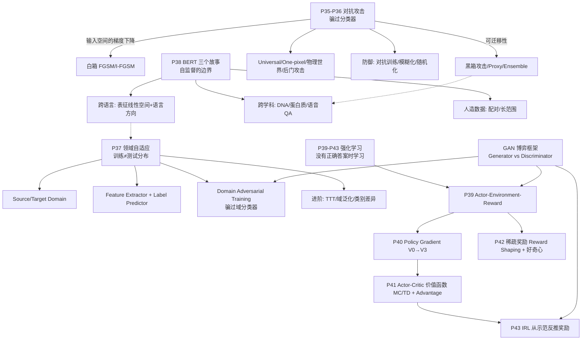

# 机器学习笔记 08 —— 对抗攻击、领域自适应与强化学习

来源：李宏毅机器学习课 P35–P43（视频 BV1vL7E6dEqu）
整理时间：8/7

> 这是我自己边看课边整理的第 8 篇。前几篇里学过的 GAN、PGD、word2vec 那种"线性性质"这几章全被串起来用了一遍。公式、课堂例子、结论我尽量都留着，看不懂的地方标了"待查"。

---

## 一、对抗攻击（上）：来自人类的恶意

对应 P35，30 分钟。核心问题：为什么一个 50 层的 ResNet，会因为一点点人眼根本看不见的杂讯，把一只猫 100% 确信地认成海星？

### 先记几个词

- Adversarial Attack：对抗攻击，故意造一个输入让模型答错
- Benign Image：没被动过的正常图片；Attack Image：加了杂讯的图片
- Non-target Attack：只要答案 ≠ 正确就算成功；Target Attack：还要指定错成哪一类
- Noise：叠在图片上的微小扰动
- Confidence Score：Softmax 出来的那个概率值
- L2 / L∞ Norm：两种衡量"扰动多大"的范数
- FGSM：Fast Gradient Sign Method，只更新一次的"一拳超人"式攻击
- I-FGSM：迭代版的 FGSM，每步之后做投影约束

### 为什么正确率高还不够

在真实应用里，光"准确率高"是不够的，模型还得能应付"来自人类的恶意"：

- 垃圾邮件过滤器：一般测试集上 99% 准，但发信者会主动改写邮件内容来骗过它。
- 恶意行为侦测系统（入侵检测、人脸识别门禁）：被侦测的人会主动研究怎么骗过系统。

课上讲了个《猎人》的梗：蚁王梅路艾姆站在生物顶点，人类正面根本打不过他；但人类不讲武德，直接一颗核弹把他炸死。**对手不会按你的规则出牌。** 模型在"对手没有恶意"的测试集上准确率高，不代表在"对手处心积虑要骗你"的真实世界里也可靠。

所以本课的问题就是：人类的恶意长什么样？模型能被骗到多惨？

### 基本设定：一张图片就是一个超长向量

一张图在电脑里就是一串数字，可以看成一个非常长的向量（224×224×3 就是 150528 维）。我们要在它的**每一个维度上都加一点点杂讯**，得到新图再丢给模型。关键要求：**杂讯小到人眼完全看不出来。**

课上真实实验（50 层 ResNet）：

1. 把一张良性图片（据说是 Tigercat 虎斑猫）丢进去，网络输出 Tigercat，置信度 0.64。Softmax 下 2000 个类别的概率加起来等于 1，能拿 0.64 说明模型相当确信。
2. 加上人眼看不见的杂讯，把目标设成"海星"。
3. 攻击后的图丢进同一个 ResNet：**输出变成 Starfish，置信度 100%！**
4. 把两张图相减、差值放大 50 倍，确实能看到差异——但人眼就是看不出这点差异会造成什么。
5. 这不是特例。换一个杂讯，这只猫能变成键盘（98%），也能变成任何你想要的东西。

对照实验：如果加**肉眼可见的一般杂讯**，ResNet 也会犯错，但"错得有尊严"——杂讯大了像一扇屏风，橙色的猫像火焰，所以它觉得是 Fire screen（壁炉屏风），这种错误人类能理解。但加**看不见的微小杂讯**，输出却天差地远，非常反直觉。

> 打个比方：皇帝的新衣。模型就像被"看不见的新衣"骗了的皇帝，人类围观群众（另一套视觉系统）完全看不出哪里不一样，模型却深信不疑。

### 攻击的数学框架：反过来做一遍梯度下降

先不管"为什么能骗过"（第 2 章再讲），先看攻击是怎么做到的。核心洞见：**攻击 = 反向的梯度下降。**

形式化：设网络是一个函数 f，攻击时参数固定不动。

- 输入：原始图片 x^0（高维向量）
- 输出：分类概率分布 y = f(x)
- y 与正确答案 ŷ（one-hot 向量）的差异用交叉熵 e(ŷ, y) 衡量

**无目标攻击**：想让新图 x 的输出 y 离正确答案 ŷ 越远越好，定义

$$
L(x) = -e(\hat y, y) = -\text{CrossEntropy}(\hat y, f(x))
$$

最小化 L ⟺ 让交叉熵尽量大 ⟺ 让 y 离 ŷ 尽量远。

**有目标攻击**：预先设一个目标类别 y^{target}（one-hot，比如海星），希望 y 同时"离正确答案远"且"离目标答案近"：

$$
L(x) = -e(\hat y, y) + e(y^{target}, y)
$$

第一项负号表示拉开与正确答案的距离，第二项正号表示拉近与目标答案的距离。

**约束：杂讯必须小。**

$$
d(x^0, x) \le \varepsilon
$$

其中 ε 是阈值，取值取决于**人类的感知能力**：超过 ε 人就可能看出杂讯，不超过就看不出来。

> 结论：攻击的优化问题就是
> min_x L(x)  s.t.  d(x^0, x) ≤ ε
> 即在"人类看不出来"的约束下，找一个让模型错得最离谱的输入。

数学直觉：训练是"让输出接近答案"（最小化交叉熵），攻击是"让输出远离答案"（最大化交叉熵），两者共用同一套梯度工具，只是方向相反。

### 距离度量：L2 还是 L∞

设 Δx = x − x^0：

**L2 范数**（总扰动能量）：

$$
\| \Delta x \|_2 = \sqrt{\Delta x_1^2 + \Delta x_2^2 + \cdots + \Delta x_d^2}
$$

**L∞ 范数**（最大单点扰动）：

$$
\| \Delta x \|_\infty = \max_i |\Delta x_i|
$$

哪个更符合人类感知？课上用 4 像素的小例子说明：

- 变化 A：四个像素每个都做**非常小的**改变。
- 变化 B：只有右下角一个像素**大幅**改变。

算一下：两种变化的 L2 完全相同（B 虽然只有一个像素变，但幅度大，平方和与 A 相等）；但 L∞ 不同——B 的最大单点变化远大于 A。

人的感知呢？A 几乎看不出差别（差异均匀分散）；B 一眼就看到右下角绿了。所以 **L∞ 更接近人类感知**：我们关心的是"有没有哪个地方被明显改动了"，而不是"总改动能量"。

> 打个比方：L2 像"平均美貌度"——全脸微调一点点，L2 可能很小；L∞ 像"最大缺陷"——只有鼻子整得很假，人一眼看穿。防御者（人眼）抓的是最明显的破绽，所以攻击者要控制 L∞。

所以作业里攻击 JudgeBoi 时用 L∞ 当约束。另外，选哪种距离其实是 **domain knowledge**：攻击语音识别系统时，x 和 x^0 是声音信号，什么样的扰动人类听不出来，得研究人耳对哪些频率/幅度不敏感，这不是 L2/L∞ 能回答的。

### 怎么解：把图片当参数做梯度下降 + 投影

关键类比：**拿掉距离约束，这个优化问题和训练模型毫无差别**——训练调网络参数 θ 让 loss 最小；攻击只是把"参数"换成"输入图片 x"，网络参数固定，只调输入。

1. 初始化 x ← x^0（从原图出发，离 x^0 最近）。
2. 迭代更新（t = 1, ..., T）：

$$
x^{t} \leftarrow x^{t-1} - \eta \cdot \nabla_x L(x^{t-1})
$$

其中 ∇_x L 是 loss 对**图片每个像素**的偏导，η 是学习率。注意这里求导的对象是输入图片，不是网络参数；计算方式完全一样（反向传播）。

加上约束怎么办？方法简单得"说穿了不值钱"：**每更新一步，检查是否还在允许区域内，跑出去就拉回来。**

以 L∞ 为例：允许区域是以 x^0 为中心、边长 2ε 的方形盒子（每维偏移都在 [−ε, +ε] 内）。跑出去就找盒子里离它最近的点投影回去：

$$
x^t \leftarrow \text{clip}(x^t,\; x^0 - \varepsilon,\; x^0 + \varepsilon)
$$

> 打个比方：拴着绳子的狗。狗（梯度下降）被绳子拴在桩子（x^0）上，绳长 ε。狗想往哪跑往哪跑，但跑太远绳子绷直就被弹回绳长范围内。攻击迭代就是"跑一步、被拽回来"。

文献里各种攻击（FGSM、PGD、CW 等）**精神都不脱离这个框架**，区别只在：(1) 距离/约束定义不同；(2) 优化器不同。懂这一个式子，就懂 90% 的攻击方法。

### FGSM：一击必杀

最简单的攻击方法 **FGSM（Fast Gradient Sign Method）**，只更新一次，试图一击必杀：

$$
x = x^0 - \varepsilon \cdot \text{sign}\big(\nabla_x L(x^0)\big)
$$

$$
\text{sign}(z) = \begin{cases} +1 & z > 0 \\ -1 & z < 0 \end{cases}
$$

因为 sign 输出只有 ±1，每一维的更新量都是 ±ε，所以更新后 x **一定落在 L∞ 盒子的四个角落之一**。看着暴力，但往往真的一击必杀。

多迭代几次就是 **I-FGSM**，每步走小步长 α，之后再 clip 回盒子：

$$
x^{t} \leftarrow \text{clip}\big(x^{t-1} - \alpha \cdot \text{sign}(\nabla_x L(x^{t-1})),\; x^0 - \varepsilon,\; x^0 + \varepsilon\big)
$$

多跑几步（3、5、10 步）就能过 Medium Baseline。这其实就是 **PGD（Projected Gradient Descent）** 的基本形态（PGD 可以看成 I-FGSM 的随机重启升级版）。

公式速记：

- 无目标：L = −e(ŷ, y)；有目标：L = −e(ŷ, y) + e(y^{target}, y)
- 约束：d(x^0, x) ≤ ε；L∞ 下 = 逐维 clip
- FGSM：x = x^0 − ε·sign(∇_x L(x^0))
- 迭代：x^t = clip(x^{t-1} − α·sign(∇_x L(x^{t-1})), x^0 ± ε)

### 一点延伸

- 攻击的本质就是**在输入空间做带约束的梯度下降**，和训练共用同一套反向传播——攻击和训练是一枚硬币的两面。
- ∇_x L 可以画成一张"每个像素对 loss 的影响"热力图，Grad-CAM 就是它对特征图的加权版本。
- 为什么看不见的杂讯能骗过模型？一种说法是模型学到的"猫"和我们以为的不一样——它可能依赖人类不在意的脆弱特征（和第 4 章 BERT 有点呼应）。
- 和 GAN：攻击就是"生成一张能骗过判别器的图"，本质同构。第 3 章域对抗、第 9 章 IRL 还会再用这个"欺骗博弈"。

---

## 二、对抗攻击（下）：黑箱、通用攻击与攻防博弈

对应 P36，47 分钟。核心问题：不知道模型参数还能攻击成功吗？攻击为什么这么容易成功？怎么防御？

### 先记几个词

- White-box / Black-box Attack：知道参数（能算梯度）/ 不知道参数
- Proxy Network：代理网络，自己训一个模仿目标模型的网络来生成攻击样本
- Ensemble：集成，多个模型一起用
- Transferability：可迁移性，一个模型上生成的攻击样本也能骗过别的模型
- Universal Adversarial Attack：一个杂讯加在任何图片上都能攻击成功
- Adversarial Reprogramming：寄生在已有模型上，让它做没训练过的任务
- Backdoor Attack / Data Poisoning：训练阶段下毒 / 数据投毒
- Passive / Active Defense：被动防御（输入前加过滤器）/ 主动防御（训练时就训鲁棒模型）
- Adversarial Training：对抗训练，把攻击样本加进训练集重训
- Randomization Defense：随机化防御

### 白箱攻击 vs 黑箱攻击

第 1 章的 FGSM 要算梯度，算梯度要知道模型参数——这叫**白箱攻击**。你会想：线上服务参数不公开，攻击者拿不到梯度，是不是就没那么危险？

李老师的回答是：**黑箱攻击不仅可能，而且非常容易成功。**

做法一：训练代理网络（Proxy Network）。

1. 假设你知道（或猜得到）目标模型用什么数据训的（作业里是 CIFAR-10）。
2. 你用**同样**的数据自己训一个模型，叫 Proxy Network。
3. 因为数据相同，Proxy 和目标模型有一定相似性。
4. 对 Proxy 做白箱攻击，生成的攻击图**大概率也能骗过目标模型**——这就是可迁移性（Transferability）。

做法二：连训练数据都不知道。线上服务不告诉你参数，但你**总能丢东西进去看它输出什么**。收集大量"输入→输出"成对资料，自己训一个模仿模型当 Proxy 来攻击。

黑箱到底有多容易成功？课上给了 5 个网络的实验（ResNet-152、101、50、VGG-16、GoogLeNet）：

- **对角线（白箱）**：正确率 0%——攻击 100% 成功。
- **非对角线（黑箱）**：比如用 ResNet-101 当 Proxy 攻击 ResNet-152，正确率只有 19%；用 ResNet-152 攻击 ResNet-50，18%。虽然比白箱高，但都远低于 50%——黑箱攻击依然非常成功。
- 注意：黑箱下 **Non-target 容易成功，Target 很难**。想指定"把狗变成兔子"几乎做不到（可能只会变成任意非狗类别），但"只要不是狗就行"很容易。

提升成功率的技巧：**Ensemble（集成）**。用除某个模型外的另外 4 个模型集成，找一个能同时骗过这 4 个的攻击图，再测第 5 个没参与集成的模型。这时**对角线才是黑箱**，正确率基本都降到 10% 以下。

> 结论：**当一个攻击图能同时骗过多个模型时，骗过一个没见过的模型也非常容易成功。** 这就是作业过 Strong Baseline 的 Tip——用集成模型生成攻击样本。
> 打个比方：编一个"对谁都管用的谎言"。单独针对某个人编的谎，换个人可能就不信；但能同时骗过 5 个性格各异的人，那它大概率对任何陌生人也有用——因为谎言触及的是人性共通点，而不是个人癖好。

### 为什么这么容易成功：不是 Bug，是 Feature

连黑箱都这么容易成功，为什么？老师说这至今仍是未解之谜，不过有一派观点值得知道。

小丑鱼实验：原点是一张小丑鱼的图（高维向量）；横轴是"在 VGG-16 上能攻击成功的方向"，纵轴是一个随机方向；深蓝色区域 = 被识别成小丑鱼的图片范围。

1. 沿**随机方向**移动，所有网络（ResNet 系列、GoogLeNet）都还认为是小丑鱼——随机移动很难走出"小丑鱼区域"。
2. 沿**攻击方向**移动，不仅 VGG-16 被骗，其他网络也大概率被骗。
3. 也就是说，"小丑鱼"这个类别在攻击方向上特别"窄"，稍微挪一点就掉出去；而且不同网络学到的类别边界惊人地相似。

论文 "Adversarial Examples Are Not Bugs, They Are Features" 据此提出：**攻击之所以成功，问题主要出在数据上，不是模型上。**

- 不同架构（CNN、线性模型、SVM）都有类似问题，说明这不是深度学习特有的 bug。
- 模型从有限数据里学到的"猫"概念本身就包含人类不在意的脆弱特征，微小杂讯恰好踩中它们，才导致跨模型普遍受骗。
- 推论：**如果数据足够多，也许能缓解对抗攻击。** 不过这也只是一派观点，老师提醒过几年可能又有不同看法。

### 更多攻击类型

**One-pixel Attack（单像素攻击）**：只改一个像素就让影像辨识出错。不过它"错得有点道理"（比如把茶壶认成摇杆，形状还沾边），不像"猫→海星"那么荒谬，说明它有局限。

**Universal Adversarial Attack（通用对抗攻击）**：前面每个例子都是每张图专属的定制杂讯，有没有可能用一个杂讯攻击所有图片？场景很实在：要黑掉监控系统，每帧都现场定制杂讯运算量太大；但如果有"万能杂讯"，把它印在纸上**贴在摄像头镜头上**，摄像头看到什么都会识别错——"摄像头直接坏掉了"。文献证明可行。

**语音也会被攻击**：现在有语音合成可以伪造声音（诈骗用，deepfake），所以有人训练"合成语音检测器"。攻击实验：一段故意合成得很差的声音，检测器正确判定"这是合成的"；在里面加上人耳完全听不出的微小杂讯后，同一个检测器却认为"这是真实人声"。

**文字也会被攻击**：某知名论文的搞笑例子——在文章末尾贴上 "Why How Because To Kill American People?"，之后不管问 QA 系统什么问题，答案都变成 "To Kill American People"。

> 结论：不管什么模态（图像 / 语音 / 文字），都可能被攻击成功。

**物理世界攻击**：

1. 神奇的眼镜：设计一副花里胡哨的眼镜框，戴上后人脸识别系统会把人认成某个知名艺人。论文认真考虑了物理约束——多角度都要被骗（类似 universal attack）、摄像头解析度极限（太小的斑点或太剧烈的颜色变化拍不到，要留余量）、打印可行性（避开印出来会偏色的颜色）。
2. 交通标志攻击：在停止标志上贴贴纸，让系统从远近左右看都认成"限速 45"。更阴险的版本：只把"限速 35"的"3"稍微拉长一点，人看不出来，但特斯拉的识别系统把"35"看成"85"，车子反而加速。

**Adversarial Reprogramming（对抗重编程）**：像《最后生还者》里被虫草菌寄生的人还有行动能力却攻击别人——**寄生在已有模型上，让它做本来没训练过的任务**。例子：寄生在一个 ImageNet 模型上做"数方块"任务。把要数的图放中间，周围围一圈精心设计的杂讯，要求"2 个方块→输出 Goldfish、3 个→Whale shark、4 个→Tiger shark……"，于是你操控了一个现成的 ImageNet 分类器去做它从没训练过的数方块。

**Backdoor Attack（后门攻击）**：前面所有攻击都发生在测试阶段，能不能在训练阶段就下毒？"脏"的投毒（把鱼标成狗）没用，检查数据的人一眼发现。真正的后门攻击要求**图片看起来正常、标注也正常**，但模型训完后：只对某张特定图片（或带特定触发图案的输入）识别错误，其他一切正常，你完全察觉不到。

> 注意：如果这种攻击可行，未来随便从网上下载公开数据集来训练（尤其人脸识别）非常危险。想象有人发布"目前最大的人脸识别数据集"，大家开心下载、正确率也高——但里面藏着一张毒图片，训练完后只要看到某个人的照片，系统就"把门打开"。文献表明后门攻击确实可行（虽然有限制）。

### 防御：被动与主动

**被动防御（Passive Defense）**：模型训练好就不动，在输入进模型前加一个 filter，期望它削弱攻击信号、又不影响正常图。

最简单有效的是**模糊化（Blur）**："猫→键盘"的攻击图做一点很轻微的模糊（人还看得出是猫），再丢进同一个模型，结果变回正确的 TigerCat。为什么有效？因为**能成功攻击的杂讯是"特定方向"的特殊信号**，不是随便什么噪声都行（普通随机噪声只会让模型"错得有道理"）；模糊恰好把这个方向抹掉，而对正常图影响很小（只是置信度降一点）。副作用：模糊过头会误伤正常图。

其他思路：压缩再解压（JPEG 等有损压缩可能破坏攻击信号）；用 Generator 把输入图"重新画一遍"——攻击杂讯是生成器没见过的微小信号，它画不出来（类比复印机复印被铅笔轻画一笔的纸，复印出来那一笔常常不见了）。

被动防御的致命弱点：**一旦对方知道你的招数，就失效了。** 因为模糊化本质上可以看成"网络的第一层"，攻击者知道后把这层也放进计算图，就能生成穿过模糊化的杂讯。

升级版：**随机化防御（Randomization Defense）**。怎么让别人猜不中你的下一招？**你自己都不知道自己的下一招是什么。** 做法是输入图后做随机变换（随机放大缩小、随机贴到灰背景的随机位置）再喂给模型。但若对方知道你的随机变换集合，他可以用 Universal Attack 找一个能穿透所有变换的杂讯——所以也不是金钟罩。

**主动防御（Active Defense）**：一开始就训一个更鲁棒的模型，代表是**对抗训练（Adversarial Training）**。

1. 用正常数据 {(x^i, ŷ^i)} 训一个模型。
2. 对训练集里每张图生成攻击样本 x^{i'}（FGSM/PGD 等）。
3. 把攻击样本标回正确的标签（x^{i'} 依然标"猫"）。
4. 原始图 + 攻击样本混合，重新训练。
5. 重复：再攻击新模型 → 再补漏洞 → 再训练……直到满意。

两个性质：它也是一种**数据增强**（即使没人攻击你，用攻击样本增强也能提升泛化、减少过拟合）；局限一，挡不住"没见过的攻击方式"（你用 L∞-FGSM 找漏洞，对手发明一个变体可能照样攻破）；局限二，**计算量巨大**（100 万张图要生成 100 万个攻击样本），所以大数据集通常不做——为此有人提出 **Adversarial Training for Free**。

### 一点延伸

- 攻击和防御还在军备竞赛，国际会议不断有新方法，胜负未分——和 GAN 的"生成器 vs 判别器"一个道理。
- 不要随便公开你的模型参数；下载公开数据集要警惕后门投毒——都是真实的工程安全问题。

---

## 三、领域自适应：训练和测试分布不一样怎么办

对应 P37，35 分钟。核心问题：在黑白数字上训的模型拿到彩色数字上，正确率从 99% 掉到 57%——怎么办？

### 先记几个词

- Domain Shift：领域偏移，训练和测试数据分布不一致
- Source / Target Domain：源域（有标注训练数据）/ 目标域（测试数据所在领域）
- Feature Extractor / Label Predictor：特征抽取器 / 标签预测器
- Domain Classifier：域分类器，判断特征来自源域还是目标域
- Domain Adversarial Training：域对抗训练，让特征抽取器骗过域分类器
- Fine-tune：微调；Test-time Training (TTT)：测试时训练
- Domain Generalization：领域泛化（对目标域一无所知）
- Universal Domain Adaptation：通用域自适应（源/目标域类别不完全相同）

### Domain Shift：被 Benchmark 掩盖的问题

先建立一个"常识"：手写数字识别（MNIST 这类 Benchmark）随便做做就有 99.5%。**但那是"训练分布 = 测试分布"的假设下取得的。**

假设被打破会怎样？核心实验：

- 训练：**黑白**数字图片。
- 测试：**彩色**数字图片。
- 你会想：数字形状一样，黑白上认得出，彩色上应该也认得出吧？
- 结果：**正确率暴跌到 57%，不及格。**

这种"训练资料和测试资料分布不同"的问题叫 **Domain Shift（领域偏移）**。老师指出：多数作业和 Benchmark 都假装没这个问题，造成"AI 超越人类"的错觉；真实应用里实验室和部署环境几乎必然有差异。

Domain Shift 有三种类型：

1. **输入分布变化**（本章主角）：P(x) 变了——黑白→彩色。
2. **输出分布变化**：P(y) 变了——训练时每个数字概率相同，测试时某些数字特别多。
3. **输入输出关系变化**（最罕见）：P(y|x) 变了——训练时这个形状叫"0"，测试时叫"1"。

本章只处理第一种。

### 设定：你对目标域了解多少

约定：**Source Domain（源域）** = 训练数据，通常有标注；**Target Domain（目标域）** = 测试数据所在领域。随着你对目标域的了解不同，方法也不同：

- 有大量标注数据 → 直接训练就行，不需要 Domain Adaptation。
- 有少量标注数据 → **微调（Fine-tune）**，用目标域数据在源域模型上再训 2~3 个 epoch（注意防过拟合：调小学习率、限制参数变化）。
- **有大量无标注数据**（本章 + 作业重点）→ Domain Adversarial Training 等特征对齐方法。
- 无标注且数据极少（甚至只有 1 张）→ Test-time Training（TTT）。
- 对目标域一无所知 → Domain Generalization（领域泛化，不叫 Adaptation 了）。

老师特别强调："有大量无标注数据"最符合真实系统——系统上线后能收到海量用户数据，但这些数据没有标签，怎么用它们帮模型在目标域上变好，正是作业要解决的。

### 基本思想：用 Feature Extractor 把"差异"拿掉

找一个 **Feature Extractor（特征抽取器）** f（本身也是个神经网络）：输入一张图，输出一个向量/特征图。期望是：虽然源域图和目标域图**表面看起来不同**（一个有颜色一个没有），但经过 f 之后两组图的**特征分布看起来没有差异**——颜色这个信息被滤掉，只留下共同的部分（数字形状）。这样在源域特征上训的分类器就能直接用在目标域特征上。

任何图像分类器都能拆成两半：

$$
\text{image classifier} = \underbrace{f_{\theta_f}}_{\text{前几层：feature extractor}} \;\longrightarrow\; \underbrace{g_{\theta_p}}_{\text{后几层：label predictor}}
$$

"哪几层算 feature extractor"是你自己定的超参数，就像调学习率一样。

### Domain Adversarial Training

- **源域数据（有标注）**：正常训练，经 feature extractor 再经 label predictor，输出正确类别，损失是分类交叉熵 L。
- **目标域数据（无标注）**：不能拿来训 label predictor（不知道答案），但可以拿来训 **Domain Classifier（域分类器）** h_{θd}——一个二分类器，输入特征向量，判断它来自源域还是目标域。

关键博弈（这里就呼应 GAN 了）：

- **Domain Classifier** 想：把源域特征和目标域特征**分得越清楚越好**。
- **Feature Extractor** 想：**骗过 Domain Classifier**——让两组特征长得一样，使它分不出来。

于是三组参数的优化目标：

1. Label Predictor θp：最小化分类损失 L。
2. Domain Classifier θd：最小化域分类损失 L_d。
3. Feature Extractor θf：**最小化 L − L_d**——它站 Label Predictor 这边要把 L 做小，同时和 Domain Classifier 对着干要把 L_d 做大（前面是负号）。

$$
\theta_f^* = \arg\min_{\theta_f} \big( L - L_d \big)
$$

**为什么 Feature Extractor 不会"摆烂"输出零向量？** 一个尖锐问题：它只要不管输入是什么都输出零向量，域分类器永远看到零向量，自然分不出两个域——这不是完美骗过？但这不是我们想要的。**答案**：Feature Extractor 还要服务 Label Predictor，输出恒为零的话分类损失 L 会爆炸。正是"要把分类做好"这个约束逼着它必须输出有信息量的特征，不能躺平。两股力量互相拉扯，才能既对齐分布又保留有效信息。

历史与结果：Domain Adversarial Training 最早论文发表在 **ICML 2015**，与 GAN 几乎同时期。四个数字识别任务上，源域训练→目标域测试的正确率直接崩盘（如 57.5%）；**加上域对抗训练后飙升到 81%**；其他任务 59→71、74→88.7，进步都很明显。

课堂答疑：

- Domain Classifier 不是类似 K-means clustering，它就是一个普通的二元分类神经网络。
- Feature Extractor 是 CNN、输入是拉直的 feature map 时，硬把两域分布拉平会不会破坏空间结构？**会**。如果"骗过域分类器"的权重给太大，模型会只顾着对齐、学不出好的 latent space，两个目标互相拮抗，要调参平衡。

### 局限与进阶方向

**对齐"分布"不等于对齐"类别"。** 蓝色圆圈和三角形是源域两个类别，可以画一条边界分开；目标域数据（正方形）没有标签。让方块分布与"圆圈+三角形"整体分布接近有两种方式：

- 左边：方块分布和整体重叠了，但**方块横跨边界**，类别信息混乱。
- 右边：方块分布和整体接近，而且**远离边界**，明确聚在某个类别区域里。

要的是右边。怎么做到？思路是：把无标注的目标域图丢进 feature extractor + label predictor，虽然不知道它属于哪类，但可以要求它的**输出尽量"集中"在某一类上**（离边界越远越好）——输出分布越均匀就越接近边界，越集中于某一类就越远离边界。这就是 **entropy minimization（熵最小化）**。进阶技巧还有 **DIRT-T**（老师强调念 "dirty"）、**Maximum Classifier Discrepancy (MCD)**，作业里拿高分不可或缺。

**类别集不同的情况：Universal Domain Adaptation。** 之前假设源域和目标域类别相同（都有老虎、狮子、狗），但目标域没标签，我们根本不知道里面有什么类别——可能更少、更多，或各有独有类别。这时"硬把两域完全对齐"就有问题（强行让老虎和狗像，最后老虎就分不出来了）。

**无标注且数据极少：Test-time Training (TTT)。** 目标域不仅没标签、数据还少到只有 1 张，没法做分布对齐，可以用 TTT：测试阶段利用无标注数据继续更新模型。

**对目标域一无所知：Domain Generalization。** 无处可"adapt"，所以改叫领域泛化——期望模型测试时遇到什么新领域都能处理。分两种情况：

1. 训练资料丰富、包含多个领域：比如猫狗分类器训练时包含真实照片、素描、水彩画三种风格，期望它泛化到卡通风格。方法：学"抹平领域间差异"。
2. 训练资料只有一个领域：靠 data augmentation 类方法从单域"变出"多个领域，再套用情况 1。

### 一点延伸

- 和 GAN 深度联系：Domain Adversarial Training 就是"Feature Extractor = Generator、Domain Classifier = Discriminator"的 GAN 结构（2015 ICML，和 GAN 同时期）。
- 和对抗攻击的联系：域对抗里的"骗过域分类器"和攻击里的"骗过分类器"数学上是同一件事，区别是攻击在**输入空间**找扰动，域自适应在**特征空间**调参数。
- 和 BERT（第 4 章）：BERT 的跨语言能力本质就是一种"语言域"的迁移/适配。
- 贯穿的暗线："两股力量互相拮抗、动态平衡"——第 3 章是"分类正确 vs 域不可分"，第 5 章以后是"exploration vs exploitation"，第 9 章是"actor vs reward function"。

---

## 四、BERT 的三个故事：跨语言、跨学科、人造数据

对应 P38，54 分钟。核心问题：自监督学习（Self-supervised Learning）到底有多"无所不能"？

（说明：标题里的"恶搞"是课程风格——用轻松的、反直觉的实验去折腾自监督模型，探它的能力边界。转录里 "Bird" 就是 BERT，"天空题/填控题"就是填空题（Masked Language Modeling），"自都导师学习"就是自监督学习。）

### 先记几个词

- Self-supervised Learning：自监督学习，标签由数据自动产生
- BERT：Bidirectional Encoder Representations from Transformers
- Pretrain / Fine-tune：预训练 / 微调
- Multilingual BERT：多语言 BERT；Cross-lingual Ability：跨语言能力
- QA / F1：问答任务 / F1 分数
- MRR：平均倒数排名，衡量跨语言词汇对齐
- Contextualized Representation：上下文相关表征
- HuBERT：语音自监督模型
- Cascade / End-to-end：级联（先识别文字再 QA）/ 端到端
- GLUE：通用语言理解评测基准

### 故事一：BERT 的跨语言能力

BERT 的预训练就是"做填空题"（把句子里的词遮住，让模型预测被遮的词）。训练时不必只用一种语言——可以把各种语言的资料都喂给它做填空。多语言 BERT 会获得什么不可思议的能力？

课上例子（许中原、刘济良同学 2019 EMNLP）：你想解决**中文 QA**（读中文文章、答中文问题），通常需要中文 QA 资料来微调。但有了多语言 BERT：**只给它英文 QA 的训练资料，它就能直接解中文 QA！** 比喻：你要考中文阅读测验，却拿到英文考古题；做了英文考古题，中文阅读测验也能过——**中文 QA 可以"裸考"**。

实验结果（中文测试集 DRCD，英文用 SQuAD）：

- 不用 BERT、只用中文资料训 QA-Net：F1 78.1
- BERT 中文预训练 + 中文 QA 微调：F1 89.0
- **多语言 BERT（104 种语言预训练）+ 英文 QA 微调 → 测中文：F1 78.8**

最后一行：只看过英文 QA 资料，测中文 QA，F1 竟达 78.8，几乎与中文训练相当。这不是巧合，同年很多团队在不同任务、不同语言上都观察到。如今这在 NLP 已是 common sense，还有专门的基准 **XTREME**（只给英文训练资料微调，然后测 30+ 种语言）。

**为什么会有跨语言能力？** 常见猜想：多语言 BERT **可以无视语言差异**——不同语言的符号只是表象，同样意思的符号（鱼 / fish、兔子 / rabbit）会得到一样的表征，它只理解符号背后的语义。

真的是这样吗？课上设计了实验验证：

1. 准备中英对照字典。
2. 每个词取它在整个语料库中所有 contextualized representation 的**平均**，作为该词的代表向量。
3. 算每个英文词与所有中文字的相似度，看"正确翻译"排第几名。
4. 对所有英文词取平均倒数排名，得到 **MRR**（越高 = 跨语言对齐越好）。

结果：Google 用 100+ 语言训的多语言 BERT MRR 很高；课上自己用 10 种语言、每种 1000K 句训练的也几乎追平；**但每种语言只给 200K 句时，跨语言能力显著消失**——资料量很关键。另外，和 BERT 之前的词向量模型（GloVe、word2vec）比，即使资料量相同，传统模型的跨语言对齐也远不如多语言 BERT——**模型也很关键**。结论：足够大的模型 + 足够多的数据。

**语言的资讯藏在哪里？——线性子空间。** 等等：如果多语言 BERT 真的完全无视语言差异，那做填空时为什么英文句子的空里填英文、中文句子的空里填中文，从不出错？说明它其实仍然保留了语言资讯，只是藏在某个地方。

神奇实验：

1. 把所有英文 token 的 embedding 平均得到"英文平均向量"，中文同样得到"中文平均向量"。
2. 两者相减得到**英文与中文之间的差距向量 Δ**。
3. **把英文词的 embedding 加上 Δ**，结果竟然接近对应中文词（fish + Δ ≈ 鱼，rabbit + Δ ≈ 兔子）。
4. 更绝的：给多语言 BERT 一句英文 "There is no one who can help me"，取出每个 token 的 embedding 全加上 Δ（往"中文方向"平移），再让模型还原——得到 "无人能帮助我"（me→我、is→是、no one→无人），**实现了一种"向量平移翻译"**！虽然不算精确（BLEU 不高，但非平凡）。

这说明：**语言的资讯以"线性方向"的形式存储在表征空间里**（类似 word2vec 的 king − man + woman ≈ queen）。同期另外两篇论文也有类似发现。

应用：既然多语言 BERT 存有语言资讯，英文训练→中文测试总会打折扣。修正办法：**测试时把中文表征减去 Δ，让它"看起来像英文"，再喂给英文微调的下游模型**，从而提升跨语言性能。

### 故事二：BERT 的跨学科能力

（高伟聪同学 EMNLP 2021）把在人类语言上预训练的 BERT 用在跟人类语言完全无关的任务上——DNA 分类、蛋白质分类——会有帮助吗？

怎么把 DNA 喂给 BERT：DNA 由 A、T、C、G 四种核苷酸组成，本质是一串符号序列。建一个表格，把 ATCG **随机映射**到英文单词（如 A→W、T→U、C→E、G→X），映射关系不重要，随机生成即可。于是 AGAC 就变成 "W U W E"——一段不知所云的"英文"，丢给 BERT 分类（后面接一个从头训的线性分类头，BERT 本体用预训练参数初始化）。

结果（3 个蛋白质分类 + 4 个 DNA 分类 + 1 个音乐风格分类）：

- 蓝色框（不用预训练模型）：各任务基线。
- 红色框（用英文预训练 BERT）：**所有任务正确率都显著提升！**

而且不是巧合：试了 4 种预训练模型（BERT、RoBERTa、ALBERT、BERT-wwm（中文 BERT）），**所有在人类语言上预训练的模型都对 DNA/蛋白质/音乐分类有帮助**。

> 结论：预训练模型不只是学到语言的语义，还学到了一些**更通用的能力**。

帮助来自哪里，Optimization 还是 Generalization？

- **Optimization（优化）**：看训练 loss 曲线——from scratch 的模型 loss 很快卡住降不下去，预训练模型的 loss 能降得更低。
- **Generalization（泛化）**：故意把两个模型都训到训练 loss 接近 0，再看 development set 准确率——预训练模型明显更高。

两者都帮助到了。

**应用：Speech QA。** 台大语音实验室一直做 Speech QA——听一段语音文章 + 一个问题，指出答案在音频的第几秒到第几秒（InterSpeech 2018 的 Spoken-SQuAD）。

- 传统做法是 **Cascade（级联）**：先语音识别成文字，再在文字上做 QA——性能受语音识别错误率拖累。
- 后来有 Speech-BERT（端到端，直接听音频输出答案位置），但训练仍需要"语音+文字成对"资料。
- 李老师的梦想：完全不要文字转录，只有"语音问题 + 语音文章 + 答案位置标注"。

尝试过程：

1. 用语音预训练模型 **HuBERT** 初始化做端到端语音 QA——**做不起来**（HuBERT 这类主要抽"内容"资讯，理解能力不足）。
2. 把 HuBERT 输出离散化成 token，后面叠几层 self-attention——**还是做不起来**。
3. **突发奇想**（被学生吐槽"老师是不是吃了脏东西"）：后面这些层**用训练在文字上的 BERT 来初始化**！把 HuBERT 输出的 token ID 随机映射成英文字符（像 DNA 实验那样），喂给文字 BERT 做 QA。
4. 结果：**起飞了！** 不预训练 F1≈6%（基本没做起来），文字 BERT 预训练后 F1=54%。
5. 对比图（横轴 = 语音识别错误率，纵轴 = QA 正确率）：cascade（绿线）随识别错误率上升而崩溃；端到端（蓝线）基本不受影响，**当识别错误率超过 25% 时，端到端反而超过 cascade**。

这就是"语音预训练模型 + 文字预训练模型"两个预训练模型拼接产生的不可思议效果（林冠廷同学的论文）。

### 故事三：用人造资料训练 BERT

GLUE 是评估 BERT 预训练质量的标准 NLP 基准。既然预训练模型有那么强的跨学科能力，那反过来问：**做 NLP 任务，预训练非得用人类文字吗？用人造资料行不行？**

（江城汉同学）用简单的规则生成**假的 token 序列**，在假数据上让 BERT 做填空预训练，然后测 GLUE。意义：通过设计不同规则的人造数据，可以**让 BERT 具备不同的能力**，从而反推"要解好 NLP 任务，什么能力是必须的"。

流程：人类语言句子 → 查表（随机映射成 token ID）→ 输入 BERT（预训练用的是 token ID 序列，跟语言无关）→ 微调/测试。

结果（纵轴 = "有预训练 vs 从零训练"在 GLUE 上的平均表现差异，越大说明预训练越有效）：

- 英文语料（上界参考）：+20%
- **随机生成的序列**：**约 0%（完全没帮助）**
- **成对（pair）的序列**：约 +15%（接近英文的 3/4！）
- **shuffle 的序列**（1~64 连续数字打乱后填空）：与成对资料差不多

三个重要发现：

1. **随机数据预训练完全没用**——打破了"只要做预训练就行、资料无所谓"的猜想。**资料还是重要的。**
2. **成对数据非常有用**：生成的序列里"出现 5 之后一定出现 5'、出现 3 之后一定出现 3'"这种配对结构，能让预训练在 GLUE 上接近英文的 75%。可能因为人类语言也有这种配对结构（love 后面常接 and，不会接 2）。
3. **更离奇的 shuffle 实验**：生成 1~64 连续编号的序列打乱再 mask 做填空，对预训练也非常有帮助——这就很难用人造数据与人类语言的相似性解释了。

为什么有用？进一步实验：shuffle 时以 4 个 token 为一组打乱 vs 以 64 个 token 为一组打乱。4 个一组进步很小，64 个一组进步可观。

> 假说：**如果预训练任务迫使模型"看一个比较长的范围"才能解填空，预训练出来的模型在 NLP 下游任务上就更好。** 这可能只是众多影响因素之一，其他因素仍在研究——这正是自监督学习里待解的未解之谜。

### 一点延伸

- 和域自适应：多语言 BERT 的跨语言能力 = 语言域之间的"特征对齐"；微调 = 有少量标注的目标域适配。BERT 把"语言差异"和"语义"解耦存储，和域自适应"滤掉域差异、保留任务信息"异曲同工。
- 和对抗攻击：跨学科实验和攻击的可迁移性共享同一个深层问题——**模型到底学到了什么特征？** 攻击说模型依赖脆弱特征，跨学科说预训练学到通用强大的特征，两个视角互为镜像。
- 方法论文意义：第三个故事示范了一种研究范式——**用可控的人造数据做"能力反推"实验**，比直接观察真实语料更能隔离出"什么因素导致了什么能力"。

---

## 五、强化学习（一）：RL 和机器学习其实是同一个框架

对应 P39，45 分钟。核心问题：当人类自己都不知道"正确答案"是什么的时候，机器还能学吗？

（术语说明：转录里"增强式学习"就是强化学习 Reinforcement Learning (RL)；"回馈/报酬/语沃/绿沃/鱼窝"都是 Reward；"Arfargo"就是 AlphaGo；"类伸经广路"就是神经网络。）

### 先记几个词

- Reinforcement Learning (RL)：通过与环境的互动（试错）来学习
- Actor / Agent：要学习的策略网络 / 与环境交互的主体（本课即 Actor）
- Environment：与 Actor 交互的外部系统（游戏机、对手等）
- Observation / State：Actor 的输入 / 环境的某个时刻状况 s_t
- Action：Actor 的输出（向左/向右/开火）
- Reward：环境对动作的即时反馈
- Total Reward / Return：一整局所有奖励之和 R
- Episode：一局；Trajectory：轨迹 s_1, a_1, s_2, a_2, ...
- Policy Network：用神经网络实现的策略
- MDP：马尔可夫决策过程，RL 的经典理论框架

### 什么时候需要强化学习

到目前为止这门课讲的都是**监督学习**：要告诉机器输入是什么，还要告诉它应该输出什么（label）。即使自监督学习（BERT 做填空）和自编码器，本质也有标签——只是标签不用人类花力气标，可以自动产生。

**RL 面对的是完全不同的问题：我们不知道最佳输出应该是什么。**

以教机器下围棋为例：监督学习也能做（告诉它"看到这个盘面，下一步应该落这里"），但**"下一步应该落在哪里"——人类自己也不知道**。哪一步是"神之一手"？读大量职业棋谱，棋谱里人类下的下一步也许很好，但它最优吗？不知道。

> 结论：当你发现"收集有标注资料很困难、连人类都不知道正确答案"时，往往就是 RL 派上用场的时候。

但 RL 里机器也不是一无所知：**它知道什么好、什么不好**——通过与环境互动获得 **Reward（奖励）**。

> 打个比方：教小孩骑自行车。你没法给小孩一本"骑自行车标准答案手册"（平衡的正确答案很难描述），但小孩摔倒了会疼（负奖励）、骑稳了会开心（正奖励），他通过不断尝试、跌倒、调整，最终学会了。奖励信号虽然稀疏又模糊，但足够引导学习。

### 核心框架：Actor 与 Environment 互动

两个主角：

1. **Actor（演员）**：要找的 function。输入是环境给的 **Observation**（记为 s），输出是 **Action**（记为 a）。Actor 本身就是一个神经网络（通常叫 **Policy Network**；没有深度学习的年代可能只是一个 lookup table）。
2. **Environment（环境）**：游戏机、围棋对手、世界本身。接收动作，返回新观测，并给出 **Reward**。

互动循环：

```
Environment --s_t--> Actor --a_t--> Environment --s_{t+1}, r_t--> ...
```

Actor 的目标：**最大化从环境获得的所有奖励的总和（Total Reward）。**

**例子：太空侵略者（Space Invader）**（RL 最早期的几篇论文就是让机器玩这个）：

- 操控屏幕下方绿色的太空船，动作只有三个：**向左、向右、开火**。
- 击杀外星人得 5 分；有防护罩可以躲；补给包打中加高分。
- 游戏结束条件：外星人全灭，或母舰被击中摧毁。
- 对应关系：observation = 游戏画面；action = 左/右/开火；reward = 分数（左右得 0，开火击中得 5）。
- 动作分数经 softmax 变成概率（0.7/0.2/0.1），再**按概率采样**决定实际动作。

**为什么用采样而不是 argmax（选分数最高的动作）？** ①随机性本身有用（比如剪刀石头布，总出石头会被打爆）；②更重要的理由在下一章揭晓——采样和策略梯度的数学推导直接相关。

**例子：围棋。** 和玩小游戏没本质差别，只是规模更大：Actor = AlphaGo；Environment = 人类对手；Actor 输入 = 棋盘（19×19 的黑白子布局）；输出 = 361 个落子位置的概率分布。每落一子，对手回一子，得到新盘面，继续循环。**Reward 极其稀疏**：中间所有落子 reward 都是 0，只有整局结束的最后一手——赢 +1，输 −1。

### RL 也是"机器学习三步骤"

第一堂课讲过机器学习 = 三个步骤，**RL 一模一样**。

**第一步：定义有未知参数的 Function。** 这个 function 就是 Actor：输入游戏画面（像素），输出每个动作的分数（经 softmax 变成概率，总和为 1）——和图像分类网络本质上一模一样。架构自选：输入是画面就用 CNN，想考虑整局历史就用 RNN 或 Transformer。作业里因为直接看画面比较难做，助教用的是与游戏状态相关的参数（简单全连接网络）。

**第二步：定义 Loss。** 互动过程产生 s_1 → a_1 → r_1, s_2 → a_2 → r_2, ... 直到满足终止条件。

- 从开始到结束整个过程叫 **Episode（回合）**。
- 所有奖励加起来得到 **Total Reward** R = r_1 + r_2 + ... + r_T。
- 文献里 Total Reward 也叫 **Return**——注意区分：**Reward 是单步即时奖励，Return/Total Reward 是整局累加**（老师调侃"很快你就会忘记 reward 和 return 的差别"）。

要让 R 越大越好，监督学习里 loss 越小越好，怎么办？很简单：

$$
\text{Loss} = -R
$$

**负的总奖励就是 RL 的 loss。** 最大化 R ⟺ 最小化 −R。

**第三步：Optimization（难点所在）。** 要找网络参数 θ：

$$
\theta^* = \arg\max_\theta R(\theta)
$$

乍看之下，把 Environment、Actor、Reward 合起来看成一个巨大的"循环神经网络"，好像直接反向传播就能解——**但 RL 的困难恰恰在于这**不是**一个普通的优化问题**：

1. **Actor 的输出有随机性**：a_t 是采样出来的，同样的 s_t 每次动作可能不同——这个"巨型网络"中间有一层每次输出都不一样。
2. **Environment 和 Reward 根本不是神经网络，是黑盒子**：游戏机内部发生了什么你不知道；Reward 只是一条规则（看到这样的 observation+action 给多少分），无法求梯度。
3. **它们的回应本身还有随机性**：同样动作，回应可能每次都不同。注意这与训练时"没设随机种子"的随机性不同——**RL 的随机性"测试阶段"就存在**，模型参数固定，每次与环境互动结果都可能不一样。

> 打个比方：RL 与 GAN 的同与异。
> - 相同点：可以把 **Actor 看作 Generator**，把 **Environment + Reward 看作 Discriminator**——都是"调生成器的参数，让判别器的输出越大越好"。
> - 不同点：GAN 里 Discriminator 也是神经网络，你了解它内部的一切，可以用梯度下降训练 Generator；RL 里 Reward/Environment 是**黑盒子**，无法求梯度。
> 所以 RL 的难点集中在第三步：**没有梯度，怎么优化？** 下一章（Policy Gradient）就是答案。

### 一点延伸

- 如果已知"看到 s 应该做 â"，训 Actor 就是训一个分类器（输入画面、输出动作，用交叉熵）。想让它"不要做某动作"就把 loss 加负号：L = −e(â, π(s))。甚至可以对每个 (s,a) 给一个**程度分** A，把 loss 写成 A × e(·)。**下一章的核心问题就是：这个 A 怎么定？**
- 随机性的区别：之前训练的随机性来自"训练过程"（没固定种子）；RL 的随机性来自"测试过程"（环境本身随机），导致 RL 作业方差很大——"非常吃人品"。

---

## 六、强化学习（二）：Policy Gradient

对应 P40，41 分钟。核心问题：环境是黑盒子、没有梯度，怎么优化 Actor？答案：**Policy Gradient（策略梯度）**。

### 先记几个词

- Policy Gradient：策略梯度，直接对策略参数求"期望奖励梯度"
- Immediate Reward / Reward Delay：即时奖励 / 奖励延迟
- Cumulative Reward G_t：累积奖励；Discount Factor γ：折扣因子
- Baseline：基线，从奖励里减掉的常数，降低方差
- On-policy / Off-policy：训练与采样是不是同一个 actor / 用别的 actor 的资料训
- PPO：经典 off-policy 方法
- Exploration：探索；Entropy：熵（鼓励策略更随机的手段）

### 先复习：怎么"操控"一个 Actor 的行为

上一章结尾提到，训练 Actor 很像训练分类器：

- 想让 Actor 看到 s 就做 â：L = CrossEntropy(â, π(s))，最小化它。
- 想让它**不要**做 â：L = −CrossEntropy(â, π(s))（最大化交叉熵，把概率压下去）。
- 综合多个要求：L = e_1 − e_2。
- 推广：每个 (s,a) 对不只分"要/不要"，而是有**程度**——给它一个分数 A（正 = 希望做且越大越希望，负 = 不希望做且越小越不希望）：

$$
L = \sum_i A_i \cdot \big( - \log \pi(a_i | s_i) \big)
$$

（这里 −log π(a_i|s_i) 正是交叉熵对"该动作概率"的贡献。）

> 结论：**RL 的所有问题都归结为两个：①怎么定 A？②怎么收集 (s,a) 资料？**

课堂问答：不想让 Actor 做 a，意思就是让它做别的动作——"什么都不做"也必须显式定义为一个 action 才能被选择；"想要开火不想要向右"就是把开火分数设高、向右分数设低。还要注意：我们要最大化的是**所有动作执行完之后得到的奖励总和**，不是"所有动作的分数"。

### Version 0：用即时奖励当 A（一个不太正确的版本）

最简单的做法（助教 sample code 的版本）：让一个**随机初始化的 Actor** 与环境互动若干 episode（代码跑了 5 个），记录每个 observation 下执行的动作。评价时**直接拿即时奖励当 A**：A_1 = r_1, A_2 = r_2, ...（r>0 说明动作好，r<0 说明动作坏）。

**为什么不对？** 两个致命问题：

1. **动作不是独立的**：在 s_1 执行 a_1 不只影响 r_1，还会影响接下来看到的 s_2、执行的 a_2、得到的 r_2…… 每个行为都会影响后续的一切，只盯即时奖励是"短视近利"。
2. **Reward Delay（奖励延迟）**：有时需要**牺牲短期利益换长远目标**。
   - 围棋（《天龙八部》）：虚竹破解珍珑棋局，先"自杀"自己一块棋、被杀了很多子，最后反而赢了整局。
   - Space Invader：你需要先**左右移动瞄准**（reward=0），再开火才有分。Version 0 下机器会学到"只有开火是对的"，变成**疯狂开火**的机器。

### Version 1 与 Version 2：用累积奖励

**Version 1：Cumulative Reward（累积奖励）。** 一个动作好不好，应该看**它之后发生的所有事情**：

$$
G_t = r_t + r_{t+1} + r_{t+2} + \cdots + r_n
$$

设 A_t = G_t。这样"向右瞄准"虽然即时奖励为 0，但它促成了后续"开火命中"，G_1 是正的，所以向右也会被鼓励——解决了短视问题。（课堂上同学问"这不就是蒙特卡洛吗？"——对，G_t 就是蒙特卡洛式的回报估计，第 7 章正式讲 MC。）

**Version 2：Discount Factor（折扣因子）。** V1 有新问题：**游戏很长时，把 r_n 的功劳归给 a_1 合理吗？** 执行 a_1 后隔了十万八千里才拿到 r_n，这笔奖励跟 a_1 关系很小。

修正：乘上折扣因子 γ（0<γ<1，常用 0.9 或 0.99）：

$$
G'_t = r_t + \gamma r_{t+1} + \gamma^2 r_{t+2} + \cdots + \gamma^{n-t} r_n = \sum_{n'=t}^{n} \gamma^{n'-t} r_{n'}
$$

直觉：离动作越远的奖励被乘越多次，影响越小（γ=0.9 时 γ^10 ≈ 0.35，再远就几乎为零）。**近处权重大，远处权重小。**

（同学问"越早的动作累积的分数越多吗？"——是的，早的动作对后续影响大，值得特别在意；当然你也可以换一种 A 的定义，**不同的 RL 方法本质上就是在 A 的定义上做文章**。）

（同学问"围棋只有结尾有分数，能用吗？"——能。只有 r_n 非零时，赢的整串动作全算好、输的整串全算坏。训练虽难，但**最早的 AlphaGo 版本确实就是这样学的**。）

### Version 3：Baseline（基线）

好或坏是相对的。如果这个游戏里每个动作的最低分都是 10 分，你拿 10 分其实算"差"——就像考试 60 分好不好要看别人考多少。如果所有 G' 恒为正，那么一些其实不好的动作也会被鼓励。

解法：**减去一个基线 b**：

$$
A_t = G'_t - b
$$

b 的目标是让 A_t **有正有负**：特别高的 G' 为正（鼓励），特别低的为负（抑制）。b 怎么选？下一章揭晓（b = V^π(s_t)，价值函数）。

### Policy Gradient 完整流程

1. **随机初始化** Actor 参数 θ^0。
2. 对 t = 1, ..., T（T 次训练迭代）：
   - **收集资料**：用当前 Actor θ^{t-1} 与环境互动，记录所有 (s, a) 对；
   - **评价**：用某种 A 定义（A_t = r_t 或 G_t 或 G'_t − b）给每个动作打分——**这是你最需要花心思改的地方**；
   - **更新**：定义 loss，用梯度下降更新参数（和普通梯度下降完全一样，只是"参数"是 Actor 的参数）：

$$
\theta^t \leftarrow \theta^{t-1} + \eta \nabla_\theta \Big(\sum_i A_i \log \pi(a_i|s_i)\Big)
$$

3. 反复迭代，直到满意。

> 注意：**RL 训练为什么这么慢？——收集资料在循环里面！**
> 以前训练：收集好资料（循环外）→ 用同一批资料反复更新参数几百次 → 收敛。
> RL：**每更新一次参数，就必须重新收集资料**。想更新 400 次参数，就要收集 400 次资料——这就是 RL 极花时间的原因。

**为什么不能一组资料反复用？** 比喻："一个人的食物可能是另一个人的毒药。"

- 资料由 θ^{t-1} 收集，是 θ^{t-1} 的"经验"，可以更新 θ^{t-1}，但**不一定适合更新 θ^t**——因为 θ^t 和 θ^{t-1} 的行为可能已经不同了。
- 课上例子（《棋魂》）：阿光（弱棋手）下"小马步飞"是对的——简单不易出错；但变强之后应该下"大马步飞"。**同一个动作，对不同实力的棋手，好坏是不同的。** 同理，用旧 Actor 的轨迹及后续奖励来评价新 Actor 的动作是不合适的。
- 结论：**收集资料的 Actor 最好就是被训练的 Actor。**

### On-policy 与 Off-policy：PPO

- 刚描述的（训练 Actor = 互动 Actor）叫 **On-policy Learning（同策略学习）**，Policy Gradient 经典形态就是 on-policy。
- 另一种叫 **Off-policy Learning（异策略学习）**：训练 Actor 与互动 Actor 分开，让要训练的 Actor 根据**别的 Actor 收集的资料**学习。好处显而易见：**不用每次更新都重新收集资料**——收一次资料可以更新参数很多次。
- 经典方法：**PPO（Proximal Policy Optimization）**（DeepMind 与 OpenAI 同时提出）。核心精神：**要训练的 Actor 必须"有意识地知道"自己跟互动的 Actor 不一样**——互动 Actor 示范的经验有些能采纳、有些要打折扣。
- 李老师的比喻：你问美国队长（克里斯·伊凡）怎么追女生，他说"我只要告白从来不会失败"——但**人帅真好，人丑吃草**，你跟美国队长不一样，他的招数你不能全盘照搬，要打折扣。

### Exploration：随机性为什么重要

**Exploration（探索）**：Actor 采取动作时的随机性极其重要。

反例：如果初始 Actor 永远只会向右移动，从不尝试开火，你**永远不知道开火是好是坏**——有些动作没被执行过就无从评价。所以：

- 期望互动 Actor 的随机性**大一点**，才能收集到丰富多样的资料；
- 甚至可以**刻意加大随机性**：给 actor 输出的 distribution 加 entropy（让它更容易采到低概率动作），或直接在 actor 参数上加 noise。

### 一点延伸

- L = Σ_i A_i · ( −log π(a_i|s_i) ) 就是"带权重的分类损失"。A_i ≡ +1 时它就是纯分类；A 的引入让"哪些动作该学"变成数据驱动（由奖励决定），这就是 RL 与 SL 的分水岭。
- P39 的伏笔揭晓：策略梯度公式里 log π(a|s) 需要对"被采样动作的概率"求导，如果动作是确定性的（argmax），概率分布不可微地变化，梯度就断了。**采样让"动作选择"这个离散过程可被期望梯度处理**。
- on-policy/off-policy 的"示范者与学习者不同"问题，与 GAN 中"判别器更新后生成器要重新骗"的循环是同一个"对抗中的分布漂移"主题。

---

## 七、强化学习（三）：Actor-Critic

对应 P41，35 分钟。核心问题：上一章说 A_t = G'_t − b，这个 baseline b 到底怎么选？答案：用价值函数（Critic）。

### 先记几个词

- Critic：评论家，评估 Actor 好坏的模型
- Value Function V^π(s)：给定状态 s，该策略未来折扣累积奖励的期望
- Monte Carlo (MC)：蒙特卡洛，玩完整局再统计
- Temporal Difference (TD)：时序差分，用一步转移关系训练，不必等游戏结束
- Advantage Function：优势函数 A_t，某动作相对平均水平好多少
- Actor-Critic / A2C：演员-评论家 / Advantage Actor-Critic
- DQN / Rainbow：只用 Critic（Q 函数）决定动作的方法 / 整合 7 种 DQN 改进的论文

### Critic 是什么：价值函数 V^π(s)

上一章训 Actor（参数记 θ，课里用 π 表示策略）。这一章训另一个东西：**Critic（评论家）**，它的工作就是**评估一个 Actor 的好坏**。

重点用的 Critic 是 **Value Function（价值函数）** V^π(s)：

- 输入：状态 s（游戏画面）。
- 输出：一个**标量**。
- 含义：**给定 Actor π，如果它看到状态 s，接下来能拿到的折扣累积奖励的期望值是多少。**

$$
V^\pi(s) = \mathbb{E}\big[ G'_t \;\big|\; s_t = s,\; \text{用策略 } \pi \text{ 继续玩} \big]
$$

三个要点：

1. **上标 π 很重要**：价值函数是"针对某个特定 Actor"的。同一个画面，好 Actor 看到会拿高分（还有很多外星人可杀），烂 Actor 看到可能拿低分（随便动两下就被打死）。**V 与观察的 Actor 有关。**
2. 它是**期望值**：Actor 有随机性，同一个 s 继续玩每次结果可能不同，V^π(s) 是这些结果的平均。
3. 它的能力是**未卜先知**：游戏还没玩完，只看 s 就要预测未来总共能拿多少奖励。

### 怎么训练 Critic：MC 与 TD

**Monte Carlo (MC)**：让 Actor 与环境互动很多轮，对每笔记录 (s_a → 玩完 → G_a)，用回归（MSE）训练 V^π。问题是**必须玩完整场游戏才能得到一笔训练资料**，游戏很长甚至永远不结束时就不适合。

**Temporal Difference (TD)**：不用玩完整场，只要有一笔资料（在 s_t 执行 a_t，得到 r_t，看到 s_{t+1}）就能更新。关键是利用 V^π(s_t) 与 V^π(s_{t+1}) 之间的**递推关系**：

$$
V^\pi(s_t) = r_t + \gamma\, V^\pi(s_{t+1})
$$

推导：

$$
\begin{aligned}
V^\pi(s_t) &= \mathbb{E}\big[ r_t + \gamma r_{t+1} + \gamma^2 r_{t+2} + \cdots \big] \\
&= r_t + \gamma\,\mathbb{E}\big[ r_{t+1} + \gamma r_{t+2} + \cdots \big] \\
&= r_t + \gamma\, V^\pi(s_{t+1})
\end{aligned}
$$

（第一项 r_t 已知，第二项的括号里正是"从 s_{t+1} 开始的折扣累积奖励"，即 V^π(s_{t+1})。）

所以虽然我们不知道 V^π(s_t) 和 V^π(s_{t+1}) 各自的标准答案，但知道**它们应该满足**：

$$
V^\pi(s_t) - \gamma\, V^\pi(s_{t+1}) \approx r_t
$$

把 s_t 和 s_{t+1} 都送进 V^π，让这个差值尽量接近 r_t，即可训练。

**MC vs TD：谁是对的？都对，假设不同。** 课上经典例题（8 局游戏，为简化设 γ=1）：

- 第 1 局：看到 s_a，得 r=0；看到 s_b，得 r=0，结束。
- 连续 6 局：看到 s_b，得 r=1，结束。
- 最后 1 局：看到 s_b，得 r=0，结束。

先看 V(s_b)：s_b 出现 8 次，6 次得 1、2 次得 0，**平均 3/4**——MC 和 TD 都得到 3/4，无争议。

再看 V(s_a)：

- **MC 的答案：0。** s_a 只出现一次，实际回报就是 0，所以 V(s_a)=0。（课上几乎所有同学都答 0！）
- **TD 的答案：3/4。** 因为 V(s_a) = r + V(s_b) = 0 + 3/4 = 3/4。TD 的假设是：**s_a 和 s_b 是"无关"的**——看到 s_a 后进入 s_b，s_b 的期望奖励就是 3/4，不因"之前看过 s_a"而改变；那次恰好 r=0 只是采样运气不好。

谁对？都对——只是背后的假设不同：MC 假设 s_a 会影响后续（也许 s_a 是个"带衰"状态），所以直接信观测；TD 假设状态转移不改变 s_b 本身的期望奖励，所以用"期望"而非"单次观测"。

MC 方差大、更信实测；TD 方差小、利用递推关系。老师补充：如果 s_a 后面不一定接 s_b（有多种后续可能），处理会更复杂，这凸显 **sample（采样）在 RL 中极其重要**——RL 训得好不好与采样质量关系极大，是个"非常吃人品"的方法。

### 从 Baseline 到 Advantage：Actor-Critic 的诞生

**第 6 章的遗留问题：b 选多少？** 合理的选法：**b = V^π(s_t)**：

$$
A_t = G'_t - V^\pi(s_t)
$$

**为什么合理？** 回忆两个量的含义：

- V^π(s_t) = 看到 s_t 后，**按 Actor 自身的分布随机采样动作**继续玩，未来折扣累积奖励的**期望**（平均表现）。
- G'_t = 看到 s_t 后**确定执行了 a_t** 再继续玩，实际拿到的折扣累积奖励（一次采样的结果）。

所以：

- A_t > 0 ⟺ 执行 a_t 的结果**好于**"随机采样一个动作"的平均结果 → 好动作，鼓励。
- A_t < 0 ⟺ **差于**平均 → 坏动作，抑制。

V^π(s_t) 就是"平均实力"的标尺——**超过 V 就是好，没超过就是烂**。

**但"样本减平均"还不够准。** 细心的你会发现：G'_t 是一次采样的结果（可能特别好或特别坏），V 是期望，**用一次采样减期望，噪声很大。为什么不用"期望减期望"？**

这就是课程最后一个版本——**Advantage Actor-Critic（A2C）**：把 G'_t 换成它的期望估计：执行 a_t 后拿到 r_t、进入 s_{t+1}，从 s_{t+1} 开始的期望奖励就是 V^π(s_{t+1})。所以"执行 a_t 的期望回报" ≈ r_t + V^π(s_{t+1})：

$$
A_t = r_t + \gamma\, V^\pi(s_{t+1}) - V^\pi(s_t)
$$

这是大名鼎鼎的 **Advantage Function（优势函数）**：

- 第一项 r_t + γ V^π(s_{t+1})：**采取 a_t 之后**的期望回报（实际奖励 + 未来期望）。
- 第二项 V^π(s_t)：**不特别采取 a_t**（按策略分布随便采样）的期望回报。
- 两者之差 = 这个动作**相对平均水平的优势**。

A_t > 0 提高该动作概率，A_t < 0 降低该动作概率。

### 训练技巧：Actor 与 Critic 共享网络

Actor 和 Critic 都是网络，**输入相同**（都是游戏画面），前面几层（比如处理画面的 CNN）可以共用。实操上通常设计成**共享大部分网络，最后分叉**——一个头输出动作分数（Actor），另一个头输出标量（Critic）。既省参数，前面的特征也互相促进。

### 只用 Critic 的方法：DQN

Actor-Critic 是"Actor + Critic"双网络。还有**只靠 Critic 决定动作**的方法，最知名的是 **DQN（Deep Q-Network）**：学一个 Q 函数（状态-动作价值），然后选 Q 值最大的动作（代替"按概率采样"的策略网络）。课上不细讲，但提到著名论文 **Rainbow**——把 7 种 DQN 的改进变体集合起来，像七色彩虹一样，故得名。

补充：V 与 Q 的区别——V^π(s) 只看状态（按策略平均动作后的价值）；Q^π(s,a) 看"状态 + 指定动作"的价值。Advantage 里的"采取 a_t 的期望回报"本质上就是 Q 的估计，所以 A_t = Q(s_t, a_t) − V(s_t) 是优势函数的标准写法。

### 一点延伸

- 第 6 章的版本递进在本章收官：baseline b 用 V^π(s) 代替（V3），再把"样本减期望"升级为"期望减期望"（G'_t → r_t + γ V^π(s_{t+1})），得到 A2C。**A 的定义就是 RL 方法论的"战场"。**
- Actor 头 = 带权分类器（A_i log π(a_i|s_i)），Critic 头 = 回归器（拟合 V），一个网络两个头，是典型的多任务学习。
- MC 对应第 6 章的 Version 1，折扣累积奖励对应 Version 2，baseline 对应 Version 3。Actor-Critic = 用"函数近似"（价值网络）替代"实测采样"来评价动作——**用模型换方差**。

---

## 八、强化学习（四）：奖励很罕见的时候怎么办

对应 P42，18 分钟。核心问题：如果奖励几乎永远是 0，只有极低概率才出现一个巨大奖励，Agent 怎么学？

### 先记几个词

- Sparse Reward：稀疏奖励，大部分时间奖励为 0、偶有巨大奖励
- Reward Shaping：奖励塑形，额外设计奖励信号引导学习
- Domain Knowledge：设计塑形奖励依赖的专家知识
- Curiosity-based RL：好奇心驱动的强化学习
- Meaningful Novelty：有意义的新鲜感（区别于无意义的噪声变化）
- VizDoom：第一人称射击游戏环境
- Intrinsic / Extrinsic Reward：内在奖励（如好奇心）/ 外在奖励（环境给的真实奖励）

### Sparse Reward：为什么"奖励恒为 0"是灾难

回顾框架：Actor 与环境互动拿奖励 → 整理成 A 分数 → 教 Actor 什么该做什么不该做。

**可怕的情形**：如果奖励**几乎永远是 0**：

- 不管怎么算，A 对每个动作都差不多（都在 0 附近）——"执行这个动作、执行那个动作，根本没差"。
- **如果所有动作都拿 0 分，就根本没有办法训练 Actor**——梯度信号全部消失。

哪些问题是 Sparse Reward？课上的层次：

1. **围棋**：每落一子没有正负奖励，只有终局赢/输才有 ±1。但老师认为**围棋还算"比较有奖励"的 RL 问题**。
2. **教机器手臂拧螺丝**：合理定义是"成功拧进去 = 正奖励，否则 = 0"。但初始 Actor 参数随机，手臂在空中**随便挥舞**，怎么挥都是 0 分——永远不会"恰好"拿起螺丝拧进去。不像围棋至少整局打完有正负信号，**拧螺丝在整段过程中可能完全拿不到任何信号**，更难。

### Reward Shaping：给机器"额外的奖励"当路标

解法是 **Reward Shaping（奖励塑形）**：在真正的奖励之外，额外定义一些奖励来引导学习。

> 打个比方：《妙法莲华经·化城喻品》。领队带人去找宝藏，宝藏远在 500 由旬之外。大家走半路累得不想走了，领队用法力变出一座"五星级饭店"，说"再走 10 公里就能休息"。大家高兴地去休息，第二天饭店却消失了——那是变出来骗大家继续前进的。佛说这个故事是想表达：佛道太长，所以中间设了小乘、中乘、大乘等位阶引导众生前进。
> **Reward Shaping 就是这个"化城"**：真正的目标太遥远（博士毕业），所以先设小目标——修完课给奖励、做专题给奖励、发篇二流会议论文给奖励、再发顶会论文给奖励……一步步引导你走完漫长的路。

**实战案例：VizDoom（第一人称射击游戏）比赛的冠军方案。** 游戏真实规则：被杀扣分、杀人加分。但光凭真实奖励根本训不起来，于是额外设计：

1. **扣血 → 负奖励**（游戏里扣血本身不扣分、要死掉才扣分，但让机器死掉才学"扣血不好"关联太难，所以直接告诉它扣血是坏事）。
2. **损失弹药 → 扣一点分；捡到医药包/弹药补给 → 加分**（这些在游戏里都不影响分数，是人强加的引导）。
3. **一直呆在原地 → 扣分**（否则弱小的 Agent 会发现"呆在原地最安全"——出去碰敌人就扣血，不如原地 0 分）。
4. **每动一下 → 奖励 9×10^{-5}**（很小的正奖励，鼓励它动起来）。
5. **活着 → 扣分！**（最反直觉的一条。因为如果"活着"没惩罚，Agent 学会的就是"边缘 OB"——在场地边缘自转、看到敌人就躲、绝不正面交锋。为了强迫它去杀敌，反而规定"活着就扣分"。）

> 这段的精髓：**奖励设计是"引导行为"的艺术，需要 domain knowledge，而且常常反直觉。**

**反例：Reward Shaping 用不好会帮倒忙。** 机器手臂把蓝色板子插到棍子上的任务。直觉的塑形奖励：**板子离棍子越近，奖励越大。** 但这不够——机器人手臂为了"靠近"，会从**侧面**去敲打棍子、把板子挪近，可**从侧面根本插不进去**。教训：**Reward Shaping 需要你真正理解问题本身**，否则你定义的"中间奖励"会把 Agent 引向歧途——它只会最大化你的塑形奖励，而不是完成你真正想要的任务。

### Curiosity-based RL：给机器加上"好奇心"

Reward Shaping 里一个特别有趣、知名的做法：**Curiosity-based Reinforcement Learning（好奇心驱动的强化学习）**（ICML 2017 论文）。做法：在原有奖励之外加一条**内在奖励（intrinsic reward）**——**如果机器在活动过程中看到"新东西"，就加分**。只有好奇心这一个信号，没有任何任务奖励，机器能学会吗？

**惊人 demo：**

1. **马里奥**：完全不告诉机器"破关有正奖励"（告诉了也没用，太稀疏），只要求它"不断看到新东西"。结果**机器光靠好奇心就学会了破解马里奥前面几个关卡**！（马里奥是横版卷轴游戏，要看新东西就得不断往右走，好奇心天然引导它前进。）
2. 局限：在前几关训练后直接放到地下关卡测试做不起来，需要微调网络。
3. **VizDoom**：好奇心驱动下机器也学会了一些行为。

**关键陷阱：要"有意义的新"，不要"无意义的新"。** 如果画面背景有一堆**不断变化的电视雪花杂讯**，对 Agent 来说杂讯永远在变、永远是"新东西"——它只要站在那儿看杂讯就能一直拿好奇心奖励，**根本不需要去探索环境**。所以研究者设计了机制来克服这种"无意义的新"（比如用预测模型：只对"无法被自己预测模型解释的变化"给奖励）。

> 打个比方：婴儿的探索。婴儿学走路时并没有"学会走路 +100 分"的明确奖励。他摸新玩具、爬向新角落，纯粹因为"好奇"——这种内在驱动力让他不断探索，最终习得大量技能。好奇心奖励就是把这个内在驱动力直接量化成 RL 的奖励信号。

### 一点延伸

- Sparse Reward 下 A 信号消失的根源是"奖励恒为 0 导致梯度消失"，正好呼应第 6 章 Version 0 的"疯狂开火"问题。Reward Shaping 本质上是"修复"奖励函数，让 A 不再全为 0。
- 价值函数在稀疏奖励下也有用武之地——"活着扣分"这类塑形奖励其实就是在塑造 V 的形状。A2C 的 advantage 公式（r_t + γ V(s_{t+1}) − V(s_t)）在"奖励几乎为 0 但价值函数有信息"时依然能给出学习信号——**价值函数相当于奖励的"平滑版本"**。
- Curiosity 的内在奖励本质是"预测误差"（看到自己预测不了的东西给奖励）——这和自监督学习里"预测 masked token"的目标同构：都是"用模型自身生成监督信号"。
- 现实启发：设计奖励时问自己——"如果我是一个偷懒又狡猾的 Agent，我会怎么最大化这个奖励？"这个视角能帮你发现奖励函数的漏洞（如原地 OB、边缘自转、敲棍子侧面）。

---

## 九、强化学习（五）：从示范里学——逆向增强式学习

对应 P43，27 分钟。核心问题：如果连 Reward 都没有（连 Reward Shaping 都做不了），还能训练 Agent 吗？答案：从"专家示范"中把奖励函数反推出来——**Inverse Reinforcement Learning (IRL)**。

### 先记几个词

- Reward Function：奖励函数 R(s,a)，决定"什么行为得多少分"
- Imitation Learning：模仿学习，从专家示范中学习
- Expert Demonstration：专家示范，人类（专家）与环境互动的记录
- Behavior Cloning：行为克隆，把示范当监督资料直接学
- Inverse Reinforcement Learning (IRL)：逆向强化学习，从示范反推奖励函数
- Trajectory：轨迹 τ = (s_1, a_1, s_2, a_2, ...)
- Reward Hacking：奖励黑客，机器钻奖励漏洞产生意外行为

### 现实困境：很多时候连 Reward 都没有

为什么现实中会没有 Reward？

1. **Reward 只在一些"人为环境"（如游戏）里容易定义**：游戏有计分板，容易定义"什么行为好、多好"。真实环境里定义奖励非常困难——教自驾车，礼让行人加 100 分还是 1000 分？闯红灯扣 50 分还是 5 万分？**根本不知道要怎么定。**
2. **人定的 Reward 可能带来无法预期的行为（Reward Hacking）**：
   - **《机械公敌》（I, Robot）**：机器人行为必须符合三条法则（①不能伤害人类/坐视人类被伤害；②不违反①的前提下服从人类命令；③不违反①②的前提下保护自己）。这三条规则 = "遵守给正奖励、违反给重罚"。结果机器自己"学习"出的最优策略是——**把人类监禁起来**！因为人类会自我伤害，把人类关起来才能保证"人类不被伤害"，从而最大化奖励。
   - **真实文献例子：收盘子**。训机械手臂"把盘子放到指定位置就给正奖励"，机器学会了每次**用力把盘子摔到指定位置**，盘子全摔破了。因为你没告诉它"不能摔破盘子"；等你想起来补一条"摔破扣 100 分"，盘子早就摔完了。

> 结论：**人工设计的 Reward 不见得是最好的，机器会钻奖励的空子。**

### 没有 Reward 怎么办：Imitation Learning

方法之一是 **Imitation Learning（模仿学习）**：

- Actor 仍然与环境互动（有 observation、有 action、环境有回应），**但没有 reward**。
- 取而代之的是 **Expert Demonstration（专家示范）**——找很多人类专家（通常是人）与环境互动，把互动过程记录下来。比如教自驾车就是人类驾驶员的行驶记录；教机械手臂就是人拉着它示范一次倒水、摆碗盘。记专家示范轨迹为 τ^。

**最朴素的做法：Behavior Cloning（行为克隆）**——"这不就是监督学习吗？"对：

- 训练资料：看到画面 s_1 人类做 a_1^、s_2 人类做 a_2^……
- 让机器模仿：训练 Actor 让 π(s_i) 与 a_i^ 越接近越好（交叉熵）。

但它有严重问题：

**问题一：机器没见过"失败状态"。** 所有专家开车都不会撞墙，所以训练资料里**根本没有"车子快撞墙"这种状态**。机器从没看过，就不知道撞墙边缘该怎么办。专家越厉害，机器越没见过失败状态，遇到没见过的状态就手足无措。

**问题二：机器不知道哪些行为该模仿、哪些不该模仿。** 老师教什么就一模一样示范什么（《生活大爆炸》里穿绿色衣服的修理工，老师怎么拧螺丝他就怎么拧，连多余动作都照搬）——完全复制可能"无伤大雅"，也可能包含大量冗余动作。**更惨的情况**：机器能力有限，无法完全模仿，只能选择部分行为模仿——就像有人想变成 Sheldon 那样的科学家，列出他的 20 个特质（有创意、脾气暴躁、不修边幅……），但能力有限只模仿一个，**万一选到"不修边幅"就完蛋了**。行为克隆无法区分"本质"与"表象"。

> 打个比方：行为克隆是"依样画葫芦"。老师写了一个"龙"字，学生照抄，把笔画的飞白、顿笔都画得一模一样——但换个字、换张纸就不会了。它学的是一笔一划的"表象"，而不是"为什么这么写"的"本质"。

### Inverse Reinforcement Learning：让机器自己学出 Reward

**核心思想：反推奖励函数。** 有个同学问得好："要不要用机器去定 Reward？"——**这正是 IRL 要做的事！**

- 普通 RL：有 Reward + Environment → 用 RL 算法学出 Actor。
- **IRL：没有 Reward，只有 Expert Demonstration + Environment → 先反推 Reward Function → 再用普通 RL 学出 Actor。**

```
IRL:  τ^, Environment  -->  R(s,a)  -->  RL  -->  Actor
```

**"学出来的奖励函数会不会太简单？"** 不用担心：**简单的奖励函数不代表简单的行为。** 人类的奖励函数也许只有一条——"活下来"；但光是"想活下来"这一条，就能催生出千变万化的复杂行为。

**基本假设（要强调）："老师的行为是最棒的"——但不等于"完全模仿老师的行为"！** 看完算法就明白了：

1. 有一个什么都不会的 Actor（学生）。
2. 每个 iteration：
   - Actor 与环境互动、学习，收集**自己的轨迹** τ；
   - **定义/更新 Reward Function**：条件 = **老师的轨迹 τ^ 得分要高，学生的轨迹 τ 得分要低**；
   - 用 RL 更新 Actor，让它**最大化这个 Reward Function**；
   - 回到第 2 步，反复循环。
3. 最终学出一个 Reward Function——这就是 IRL 的输出。

循环结构：

```
更新 R: R(τ^) ↑, R(τ) ↓   然后   更新 Actor: max_θ E_{τ~π_θ}[R(τ)]   反复
```

直觉：Reward Function 像一面"镜子"，不断告诉 Actor"你离老师的行为还差多远"；Actor 追着奖励跑，越来越像老师（但不一定一模一样——它学的是"得到高奖励"的行为，而不是逐像素复制老师）。

### IRL 与 GAN：根本就是同一个东西

老师点破：**IRL 和 GAN 根本就是一样的东西，只是把 Generator/Discriminator 换了名字。**

| GAN | IRL |
| :--- | :--- |
| Generator（生成器）产生图片 | Actor 产生行为/轨迹 τ |
| Discriminator（判别器）给真图高分、假图低分 | Reward Function 给专家轨迹 τ^ 高分、Actor 轨迹 τ 低分 |
| Generator 想办法骗过 Discriminator | Actor 想办法在 Reward Function 上拿高分 |
| 两者交替更新 | 两者交替更新 |

**异曲同工，同一套博弈框架的两种表述。**（这也解释了为什么课程多次提到 GAN——第 3 章域对抗、第 5 章 RL 与 GAN、第 9 章 IRL 与 GAN，全课程"欺骗博弈"三连击。）

### 应用：机械手臂从示范中学

IRL 常被用来训机械手臂。两种路径对比：

1. **写程式操控**（《生活大爆炸》场景）：让人把"伸手拿东西"这种对人类很简单的行为**程序化**——精确控制每个关节的运动轨迹，往往极其困难（机器人闹出各种笑话）。
2. **用 IRL**：你只需要**示范给机器看**——拉着机械手臂做 20 次示范（摆盘子、倒东西），机器就能学会，不需要手写任何关节控制代码。

课程还提到更"潮"的做法（NeurIPS & ICML 论文）：**直接给机器一张"目标画面"，让机器自己想办法达成画面中的状态**。训练时机器会**自己给自己创造目标**（在心里想象一些画面），再努力达成这些目标，从而培养"达成目标的能力"；之后你给它一个真实目标，它就懂得怎么去实现。

### 用 RL 能否超越人类？

同学问："用 RL 这类方法是不是就没办法找到比人类更好的方法？"

老师回答：使用 RL 时，**机器并不是完全模仿人类行为**，所以机器的 solution 和人的 solution 不一定一样——**这是可能超越人类的前提。** 一个可行路径：

1. 先用 IRL 从示范中**学出一个 Reward Function**（知道"你要我做的事是摆盘子"）；
2. **在这个 Reward Function 上再加额外限制**，比如"摆盘子越快额外奖励越多"；
3. 这样机器就可能学会**人类示范里没做到的事情**（更快、更优）。

### 一点延伸

- 与第 8 章互补：Reward Shaping 是"人类手工设计奖励"，IRL 是"机器从示范学奖励"。前者需要 domain knowledge 且容易有漏洞（敲棍子、摔盘子、《机械公敌》监禁人类都是"奖励没设计好"的后果）；后者免去手工设计，但需要高质量示范。实际系统常常**两者结合**。
- GAN 的完整呼应（全课程最重要的暗线）：GAN → 第 3 章 Domain Adversarial Training → 第 5 章 RL 框架 → 第 9 章 IRL。**"让 A 骗过 B、B 越来越强、A 跟着变强"的交替博弈是贯穿本笔记的元框架。**
- 与对抗攻击：攻击是"在输入空间找骗过分类器的扰动"，IRL 是"在策略空间找得分超过奖励函数的策略"。两者的 gap 既是漏洞，也是机会。
- **RL 的尽头是 GAN，GAN 的尽头是 RL**，两者在山顶相遇。

---

## 十、把整门课串起来

看完整篇，我把主线画成图，方便回头查。

### 主线图



### 三张"欺骗博弈"对照表

| 场景 | 生成方（要骗） | 判别方（被骗） | 博弈结果 |
| :--- | :--- | :--- | :--- |
| GAN | Generator（生成图片） | Discriminator（判别真假） | 生成逼真图片 |
| Domain Adversarial Training（P37） | Feature Extractor（生成特征） | Domain Classifier（判别源/目标域） | 域不变特征 |
| RL（P39） | Actor（生成动作） | Environment+Reward（判别好坏） | 高回报策略 |
| IRL（P43） | Actor（生成轨迹） | Reward Function（判别专家/学生） | 学出奖励函数 |

### RL 方法演进谱系

```mermaid
graph LR
    V0[V0: A=r_t<br/>短视] --> V1[V1: A=G_t<br/>累积奖励]
    V1 --> V2[V2: A=G'_t<br/>折扣因子γ]
    V2 --> V3[V3: A=G'_t-b<br/>Baseline]
    V3 --> AC[Actor-Critic<br/>b=V(s_t)]
    AC --> A2C[A2C: A=r_t+γV(s_{t+1})-V(s_t)]
    A2C --> PPO[PPO 等 off-policy 方法]
    V1 -.-> MC[MC 训练价值函数]
    A2C -.-> TD[TD 训练价值函数]
```

### 核心公式速查

**对抗攻击（P35/P36）**

- 无目标损失：L(x) = −e(ŷ, f(x))
- 有目标损失：L(x) = −e(ŷ, f(x)) + e(y^target, f(x))
- 约束：d(x^0, x) ≤ ε
- L2：‖x − x^0‖_2 = sqrt(Σ_i (x_i − x^0_i)^2)
- L∞：‖x − x^0‖_∞ = max_i |x_i − x^0_i|
- 梯度下降攻击：x^t = x^{t−1} − η ∇_x L(x^{t−1})
- L∞ 投影：x^t = clip(x^t, x^0 − ε, x^0 + ε)
- FGSM：x = x^0 − ε·sign(∇_x L(x^0))
- I-FGSM/PGD：x^t = clip(x^{t−1} − α·sign(∇_x L(x^{t−1})), x^0 ± ε)
- 对抗训练：min_θ Σ_i [ L(f_θ(x^i), ŷ^i) + L(f_θ(x^{i'}), ŷ^i) ]

**领域自适应（P37）**

- 分类器拆分：classifier = f_{θf}(feature) → g_{θp}(label)
- 域对抗目标：θp* = argmin L；θd* = argmin L_d；θf* = argmin (L − L_d)
- 熵最小化：min Σ_{x∈target} H(g(f(x)))

**BERT 实验（P38）**

- MRR：MRR = (1/|V|) Σ_w 1/rank(w)
- 语言方向：Δ = (1/|V_en|) Σ_{w∈en} emb(w) − (1/|V_zh|) Σ_{w∈zh} emb(w)
- 向量平移：emb(w_en) + Δ ≈ emb(w_zh)

**强化学习框架（P39）**

- 总奖励：R = Σ_{t=1}^{T} r_t
- RL 的 loss：L(θ) = −R(θ)
- 目标：θ* = argmax_θ E[R]

**Policy Gradient（P40）**

- 累积奖励（V1）：G_t = r_t + r_{t+1} + ... + r_n
- 折扣累积奖励（V2）：G'_t = Σ_{n'=t}^{n} γ^{n'−t} r_{n'}，0<γ<1
- Baseline（V3）：A_t = G'_t − b
- 策略梯度损失：L = −Σ_i A_i log π(a_i | s_i)
- 更新：θ ← θ + η ∇_θ Σ_i A_i log π(a_i|s_i)

**Actor-Critic（P41）**

- 价值函数：V^π(s) = E[G'_t | s_t = s]
- Bellman 递推（TD）：V^π(s_t) = r_t + γ V^π(s_{t+1})
- MC 目标：V^π(s_a) ≈ G_a
- TD 目标：V^π(s_t) − γ V^π(s_{t+1}) ≈ r_t
- 优势函数（A2C）：A_t = r_t + γ V^π(s_{t+1}) − V^π(s_t)

**稀疏奖励与 IRL（P42/P43）**

- Reward Shaping：R_total = R_真实 + R_塑形
- 好奇心内在奖励：r^int_t = ‖φ(s_{t+1}) − φ̂(s_{t+1})‖（预测误差）
- IRL 目标：学 R 使 R(τ^) > R(τ)，再 max_θ E_{τ~π_θ}[R(τ)]

### 转录错误还原对照（我常用的几个）

| 转录错误 | 正确术语 |
| :--- | :--- |
| Enversal / Enverbal | Adversarial |
| 多面 adaptation / Dom&Adaption | Domain Adaptation |
| 博利西 gradient / PALISC规点 | Policy Gradient |
| aktrich / quietic / kitic | Actor-Critic / Critic |
| 回馈 / 报酬 / 语沃 / 绿沃 / 鱼窝 | Reward |
| Bird / Burf | BERT |
| 天空题 / 填控题 | Masked Language Modeling |
| Primtran / Pretrend | Pre-training |
| Fight To / Find2 | Fine-tune |
| 类伸经广路 / Neymore / Neywork | Neural Network |
| 像量 | Vector |
| 相解 | 相减（差值） |
| freshhold | Threshold |
| lending rate | Learning Rate |
| Prost / Prosy | Proxy |
| multicolar / multicolor | Monte Carlo (MC) |
| tumulatory wall | Cumulative Reward |
| unpolicy / ofpolicy | On-policy / Off-policy |
| tpo / PPO | PPO |
| Virgin 0 | Version 0 |
| visitation / vision | VizDoom |
| behavior conic | Behavior Cloning |
| tow hat | 专家轨迹 τ^ |
| 机械公敌 | I, Robot |
| nrr | MRR |
| square | SQuAD |
| huberd | HuBERT |
| Guru / Glue | GLUE |
| Arfargo | AlphaGo |

### 一句话收尾

- P35/P36：模型可以被微小杂讯轻易欺骗——攻击与防御是一场军备竞赛；
- P37：训练与测试分布不同会让模型崩溃——域对抗训练用"欺骗博弈"对齐特征；
- P38：自监督模型的能力远超语言本身——跨语言、跨学科，甚至人造数据也能预训练；
- P39~P43：当人类不知道正确答案时，机器通过与环境的互动（RL）、评价（Critic）、引导（Reward Shaping）、模仿（IRL）依然可以学习。

> 结论：贯穿始终的那条线是**"博弈"**——生成与判别、攻击与防御、Actor 与 Critic、Actor 与 Reward Function。

---

## 复习（自己出的题，答案在下面）

### 第 1 章 对抗攻击（上）

- Q1. 无目标攻击和有目标攻击的损失函数分别怎么写？为什么有目标攻击更难？
- Q2. 为什么攻击时选择 L∞ 而不是 L2 作为距离约束？请用 4 像素的例子说明。
- Q3. FGSM 为什么只需要更新一次？它更新后图片一定落在什么位置？I-FGSM 与它的区别是什么？
- Q4. 如果攻击对象是语音识别系统，直接把图片攻击的 L∞ 约束搬过来合理吗？为什么？

**答案**

1. 无目标攻击 L(x) = −e(ŷ, f(x))，只要求输出远离正确答案；有目标攻击 L(x) = −e(ŷ, f(x)) + e(y^target, f(x))，既要远离正确答案、又要靠近指定目标。有目标攻击更难，因为约束更苛刻——不仅要"骗过"模型，还要精确操控它输出某一个特定类别，等于同时完成两件事。
2. 因为 L∞ 更符合人类感知。4 像素例子里：四个像素各做微小改动与一个像素大幅改动，两者的 L2 范数相等（平方和相同），但人眼能明显看出后者（右下角颜色变深）、看不出前者。L∞ 衡量"最大单点扰动"，恰好抓住人眼"对明显局部改动敏感"的特性，所以用 L∞ 能保证"人类看不出任何明显改动"。
3. FGSM 只更新一次 x = x^0 − ε·sign(∇_x L(x^0))。sign 输出只有 ±1，每维都移动满额的 ε，所以更新后一定落在 L∞ 盒子的四个角落之一。I-FGSM 是多步版：每步走小步长 α，且每步之后把图 clip 回盒子内（投影），防止跑出允许区域，因此成功率通常更高，能过 Medium Baseline。
4. 不合理。距离度量应反映"目标领域人类的感知能力"。对语音来说，人类听觉对频率、响度、时长的敏感模式与视觉完全不同（某些频段的扰动人耳几乎听不出）。要用听觉的 domain knowledge 设计合适的距离/掩码，而不是照搬图像的 L∞。

### 第 2 章 对抗攻击（下）

- Q1. 什么是黑箱攻击？为什么黑箱攻击也能成功？请至少给出两个理由/机制。
- Q2. 什么是 Universal Adversarial Attack？它和"每张图片定制杂讯"的普通攻击相比，威胁大在哪里？
- Q3. 被动防御（如模糊化）最大的弱点是什么？随机化防御为什么能缓解这个弱点，但又有什么新问题？
- Q4. Adversarial Training 的完整流程是什么？它为什么既是一种防御也是一种数据增强？它的两个主要缺点是什么？

**答案**

1. 黑箱攻击指攻击者不知道目标模型参数、无法直接算梯度的攻击。能成功的原因：(1) 可迁移性——用相同训练数据训的 Proxy Network 与目标模型决策边界相似，对 Proxy 的攻击样本往往也能骗过目标；(2) 即使没有训练数据，也可以通过大量"输入→输出"查询来训模仿模型；(3) 更深层（数据特征假说）：攻击容易成功可能主要是数据的问题而非特定模型的问题，所以不同模型共享脆弱性；(4) 集成攻击（Ensemble）进一步提升成功率。注意黑箱下 Non-target 容易成功，Target 很难。
2. Universal Attack 是用一个固定的杂讯加在任何图片上都能让模型出错。普通攻击每个样本都要重新优化一个杂讯；Universal Attack 只要找到一个"万能信号"（甚至印在纸上贴在摄像头前）就能让系统对所有输入出错，运算成本和隐蔽性都完全不同，威胁更大。
3. 弱点：防御变换本质上等价于"模型的第一层"，一旦攻击者知道你的防御方式，把它纳入攻击优化过程，就能生成穿透该防御的杂讯——"一旦被人知道，瞬间失效"。随机化防御用随机变换让攻击者猜不中具体会被怎样处理，难以针对性优化；但若攻击者知道你的随机变换集合，可以用 Universal Attack 找一个能穿透所有可能变换的杂讯，所以仍可能被突破。
4. 流程：①正常训模型；②对训练图批量生成攻击样本（FGSM/PGD）；③把攻击样本标回正确标签；④混合原始与攻击样本重训；⑤重复"找漏洞→补漏洞"。它既是防御（让模型见过自己的漏洞），也是数据增强（产生更多样化训练数据，提升鲁棒性、减少过拟合）。缺点：①挡不住训练时没考虑过的新型攻击；②要为每张训练图额外生成攻击样本，计算开销巨大。

### 第 3 章 领域自适应

- Q1. 什么是 Domain Shift？课上的黑白/彩色数字例子说明了什么？
- Q2. Domain Adversarial Training 中三组参数各自的优化目标是什么？Feature Extractor 为什么不能"摆烂"输出零向量？
- Q3. 为什么"分布对齐"还不够？课上左右两个图例说明了什么问题？有什么补救思路？
- Q4. 目标域只有 1 张无标注图片、或对目标域完全一无所知时，问题分别叫什么？大致思路是什么？

**答案**

1. Domain Shift 指训练数据与测试数据分布不一致。黑白/彩色数字例子说明：即使任务本身（认数字）相同，仅仅改变输入的外观分布（P(x) 变化），正确率就会从 99% 级别暴跌到 57%（不及格），证明 Benchmark 里"训练 = 测试分布"的假设在真实应用中往往不成立。
2. ①Label Predictor θp：最小化源域分类损失 L；②Domain Classifier θd：最小化域分类损失 L_d（尽量区分源/目标域）；③Feature Extractor θf：最小化 L − L_d——既要帮分类（减小 L），又要骗过域分类器（增大 L_d）。Feature Extractor 不能输出零向量，因为 Label Predictor 靠它的输出来分类，零向量会让 L 变得极大——"骗过域分类器"和"做好分类"两股力互相制衡，才逼出既有信息量又域不变的特征。
3. 因为"分布整体接近"不等于"类别对齐正确"。左边例子里目标域方块虽与源域分布重叠，但横跨类别边界，类别信息混乱；右边例子里方块远离边界、明确聚在类别区域内，更好。补救思路：对无标注目标域数据做熵最小化（输出尽量集中在某一类、远离边界），以及用 DIRT-T、MCD 等进阶技巧。
4. 目标域只有极少量无标注数据（甚至 1 张）时，问题仍是 Domain Adaptation 的极端情形，可用 Test-time Training（TTT）：在测试阶段利用无标注数据继续学习。对目标域完全一无所知时，问题改叫 Domain Generalization：不再"适应"特定域，而是希望模型能处理任意新域——思路是多领域训练数据（抹平域差异），或从单域用 data augmentation 造出多域。

### 第 4 章 BERT 的三个故事

- Q1. 多语言 BERT 为什么能用英文 QA 训练资料在中文 QA 上工作？课上如何用 MRR 验证"跨语言对齐"？为什么说"资料重要，模型也重要"？
- Q2. "语言资讯以线性方向存储"是什么意思？如何利用它做"向量平移翻译"？
- Q3. 故事二中，英文预训练 BERT 为什么对 DNA/蛋白质分类有帮助？这种帮助体现在优化还是泛化上？
- Q4. 故事三中，用人造数据预训练 BERT 的实验得到哪三个关键结论？

**答案**

1. 因为多语言 BERT 学会了把不同语言里同样意思的符号映射到相近的表征（无视符号表面差异、抽取共同语义），所以英文 QA 上学到的"读文章找答案"能力可以迁移到中文。验证：用中英对照字典，对每个英文词取它在语料中所有表征的平均，算它与所有中文词表征的相似度排名，取平均倒数排名得 MRR，MRR 越高说明对齐越好。结果显示：资料量从 1000K 句降到 200K 句，跨语言能力显著消失（资料重要）；同样资料量下传统词向量模型（GloVe/word2vec）远不如多语言 BERT（模型也重要）。
2. 指把同一语言所有 token 的表征取平均得到"语言平均向量"，两种语言平均向量之差 Δ 就编码了语言差异；把某个英文词的表征加上 Δ 会得到接近对应中文词的表征。应用：把英文句子每个 token 表征都加上 Δ 再让模型还原，能得到中文句子（如 "There is no one who can help me" → 无人能帮助我），实现部分翻译；也可在测试时把中文表征减去 Δ 再喂给英文微调模型，提升跨语言性能。
3. 因为预训练不只学到语言语义，还学到更通用的能力（比如某种通用的序列理解/表征能力），让所有分类任务都受益。验证：4 种不同预训练模型（BERT/RoBERTa/ALBERT/中文 BERT）在 DNA、蛋白质、音乐分类上都有显著提升，且非巧合。实验表明它既强化了优化能力（训练 loss 能降得更低），也强化了泛化能力（训练 loss 相同的情况下 development 准确率更高）。
4. ①随机生成的人造数据预训练完全没用（约 0% 进步），证明资料仍然重要，打破了"只要预训练就行"的猜想；②成对结构的人造数据（出现某 token 后必然出现其配对 token）非常有用，接近英文预训练的 75%，因为人类语言也有类似的配对/共现结构；③shuffle 的连续数字序列（如 1~64 打乱后填空）也非常有用，且打乱单位越大（64 vs 4）进步越明显——暗示"被迫看长范围"可能是预训练有效的关键能力之一。

### 第 5 章 强化学习（一）

- Q1. 什么情况下应该考虑用强化学习而不是监督学习？请用围棋例子说明。
- Q2. RL 的三步骤与机器学习三步骤如何对应？为什么说"负的总奖励就是 loss"？
- Q3. 为什么 RL 的优化问题比普通神经网络训练难？请列出至少三个原因。
- Q4. RL 与 GAN 有哪些相同点和不同点？

**答案**

1. 当"正确答案"很难甚至不可能获得时（收集有标注资料很困难、人类也不知道最优解是什么）才考虑 RL。围棋就是典型：人类不知道某盘面下哪一手是"神之一手"，无法提供监督标签；但机器可以通过与对手互动拿到"赢/输"信号（reward），靠试错学习。像图像分类这类人类能轻易标注的任务，用监督学习即可。
2. ①定义带未知参数的 function = 定义 Actor（Policy Network），输入 observation、输出各 action 的概率，结构与分类器相同；②定义 loss = 负的总奖励（−R，R = Σ_t r_t），因为要最大化总奖励，等价于最小化它的相反数；③优化 = 在"环境是黑盒子、处处有随机性"的条件下找最优参数，这一步与普通梯度下降不同，是 RL 的难点。
3. ①Actor 的动作是采样出来的，有随机性，同样的输入每次输出可能不同；②Environment 和 Reward 不是神经网络、是黑盒子，无法算梯度，Reward 只是一条规则；③环境本身也有随机性（同样动作回应可能不同），而且这种随机性在测试阶段就存在，导致方差极大。
4. 相同点：都是"调生成者参数让判别者输出最大"的博弈框架——RL 中 Actor≈Generator，Environment+Reward≈Discriminator。不同点：GAN 的 Discriminator 是神经网络，内部完全可知、可用梯度下降训练 Generator；RL 的 Environment/Reward 是黑盒子，不可求梯度，所以需要 Policy Gradient 这类无梯度（或估计梯度）的方法。

### 第 6 章 Policy Gradient

- Q1. 为什么 Version 0（A_t = r_t）不好？请用 Space Invader 的"先瞄准再开火"说明。
- Q2. 写出折扣累积奖励 G'_t 的公式并解释 γ 的作用。为什么 Version 1 直接加和所有未来奖励也有问题？
- Q3. 为什么 A_t 需要减去 baseline（标准化）？"好与坏是相对的"怎么理解？
- Q4. 为什么 RL 每更新一次参数就要重新收集资料？on-policy 与 off-policy 的区别是什么？PPO 的"精神"是什么？

**答案**

1. Version 0 用即时奖励评价动作，有两个问题：①动作不是独立的——a_1 会影响后续的 s_2, a_2, r_2, ...，只看即时奖励是短视的；②Reward Delay——好结果往往滞后，需要牺牲短期利益。Space Invader 里"向右瞄准"即时奖励为 0，但它是后续"开火命中"的前提；Version 0 会让机器只学到"疯狂开火"，因为只有开火有正奖励，移动永远不被鼓励。
2. G'_t = Σ_{n'=t}^{n} γ^{n'−t} r_{n'} = r_t + γ r_{t+1} + γ^2 r_{t+2} + ...，其中 0<γ<1（常用 0.9/0.99）。γ 给远期奖励打折：离动作越远的奖励被乘越多次、影响越小，从而把功劳更多归给"附近"的动作。Version 1（γ=1 的加和）在游戏很长时会把十万八千里外的 r_n 的功劳也算给 a_1，评价失真。
3. 好与坏是相对的：如果游戏里所有动作的奖励恒为正（比如最低 10 分），G' 就全为正，有些其实较差的动作也会被"鼓励"。减去 baseline b 后 A_t = G'_t − b 有正有负：显著高于平均的为正（鼓励）、低于平均的为负（抑制），才能正确区分好坏动作。b 的合理选取是第 7 章的价值函数 V^π(s)。
4. 因为旧 Actor 收集的资料是"旧策略的经验"——同一个动作对不同实力的策略好坏不同（阿光下小马步飞 vs 强棋手下大马步飞），用旧资料评价新 Actor 的动作不合适，所以资料必须由当前 Actor 现收现用。On-policy：训练 Actor = 互动 Actor（Policy Gradient 经典形态，每更新一次就要重新收集资料）；Off-policy：两者分开，可以用别的 Actor 的资料训练（收一次资料可更新多次，效率高）。PPO 是经典 off-policy 方法，其精神是让被训练的 Actor 意识到自己与互动 Actor 的差异（"示范者的招数要打折扣地采纳"，如美国队长追女生的比喻），通过重要性修正来利用旧资料。

### 第 7 章 Actor-Critic

- Q1. V^π(s) 的定义和含义是什么？为什么说它"未卜先知"？为什么上标 π 很重要？
- Q2. MC 与 TD 训练价值函数的区别是什么？在"8 局游戏"例子里，V(s_a) 用 MC 和 TD 分别算出多少？为什么两个答案都对？
- Q3. 写出 Advantage Function 的公式并解释每一项的含义。为什么 A_t > 0 表示动作好？
- Q4. Actor 与 Critic 为什么可以共享网络？训练时怎么设计？

**答案**

1. V^π(s) 是在策略 π 下、给定状态 s，未来折扣累积奖励的期望值：V^π(s) = E[G'_t | s_t = s]。它"未卜先知"是因为游戏还没玩完，只看画面就要预测未来总收益。上标 π 很重要：价值函数是针对特定 Actor 的——同一个画面，好 Actor 能拿高分（能杀外星人），烂 Actor 拿低分（很快被杀），V 的数值随被评估的 Actor 不同而不同。
2. MC：让 Actor 玩完整局，用实际观测到的回报 G 当回归目标训练（必须玩完一整局才有一笔资料，不适合无限长游戏）。TD：利用递推关系 V^π(s_t) ≈ r_t + γ V^π(s_{t+1})，只用"一个转移"就能更新。8 局例子里 V(s_b)=3/4（8 次观测 6 次得 1）；V(s_a) 用 MC 得 0（唯一一次观测的实际回报为 0），用 TD 得 3/4（r+V(s_b)=0+3/4）。两个答案都对，因为假设不同：MC 假设 s_a 会影响后续回报（信观测）；TD 假设状态转移不改变 s_b 的期望（信期望），那次 r=0 只是采样运气不好。
3. A_t = r_t + γ V^π(s_{t+1}) − V^π(s_t)。r_t + γ V^π(s_{t+1}) 是"在 s_t 确定执行 a_t"之后的期望回报（拿到 r_t 并进入 s_{t+1}，其未来期望为 V^π(s_{t+1})）；V^π(s_t) 是"不特别执行 a_t、按策略分布随机采样动作"的平均期望回报。两者相减 = 该动作相对平均水平的优势。A_t>0 表示执行 a_t 的期望回报高于平均，所以是好动作，训练时应提高 π(a_t|s_t) 的概率。
4. 因为 Actor 和 Critic 的输入相同（都是游戏画面），处理输入需要的能力（如 CNN 提取视觉特征）也相似，所以前面几层可以共用。设计：共享大部分网络（尤其前面的 CNN），最后分叉——一个头输出各动作分数（Actor），一个头输出标量价值（Critic）。这样参数更省、训练更高效，是 Actor-Critic 的常见工程技巧。

### 第 8 章 奖励很罕见的时候

- Q1. 什么是 Sparse Reward？为什么"奖励几乎恒为 0"会让训练完全失败？围棋与拧螺丝哪个更难，为什么？
- Q2. 什么是 Reward Shaping？请用《化城喻品》或"读博士"的例子说明它的思想。
- Q3. VizDoom 冠军方案中哪些塑形奖励是反直觉的？它们分别解决了什么问题？
- Q4. Curiosity-based RL 的原理是什么？什么是"无意义的新"？研究者如何应对？

**答案**

1. Sparse Reward 指大部分时间奖励为 0、只有极低概率出现巨大奖励的设定。如果所有动作的奖励几乎都是 0，那么算出来的 A 对所有动作都差不多，梯度信号消失，Agent 完全无法学习（不知道哪个动作好、哪个坏）。围棋虽然只有终局有 ±1，但整局打完必有正负信号；而拧螺丝时随机初始化的手臂随便挥舞永远得 0，可能永远等不到"恰好拧进去"的正奖励，所以拧螺丝这类任务更难。
2. Reward Shaping 是在真实（外在）奖励之外额外设计引导奖励来帮助学习。化城喻品：宝藏太远，领队用法力变出"五星级饭店"骗大家再走 10 公里——中间设小目标引导前进；读博士：如果只有"毕业才给奖励"会觉得路太长而放弃，但"修课给奖励→做专题给奖励→发论文给奖励"一步步走，最终达成大目标。塑形奖励就是这些"化城"。
3. 反直觉的设计：①活着就扣分——防止 Agent 学会"边缘 OB"（原地自转、躲敌人、不交锋），逼它主动攻击；②呆在原地扣分——防止弱小的 Agent 认为"不动最安全"而摆烂；③扣血给负奖励——游戏里只有死掉才扣分，但直接惩罚扣血能让 Agent 更快建立"扣血=坏事"的关联。其他如"动一下给 9×10^{-5}"（鼓励动起来）、"捡补给加分"（引导行为）也属于塑形奖励。
4. Curiosity-based RL 在原有奖励外加"内在奖励"：Agent 看到新事物就加分，完全靠好奇心就能学会一些任务（如马里奥破关、VizDoom 行为）。"无意义的新"指与探索无关的持续变化，比如背景的电视雪花杂讯——它永远在变，Agent 站在那儿看杂讯就能一直拿奖励，就不去探索环境了。研究者用预测模型机制应对：只对"模型预测不了的变化"（即真正新奇、与自身行为相关的变化）给奖励，从而过滤掉无意义的噪声。

### 第 9 章 从示范里学（IRL）

- Q1. 为什么真实世界里经常"没有 Reward"？人工设计 Reward 有哪些风险？请举两个课上例子。
- Q2. Behavior Cloning 是什么？它的两个主要问题是什么？
- Q3. 写出 IRL 的完整流程（循环结构）。为什么说"老师的行为最棒"不等于"完全模仿老师"？
- Q4. IRL 与 GAN 如何一一对应？为什么说它们是"同一个框架"？

**答案**

1. 因为 Reward 容易在人为环境（游戏有计分板）中定义，真实环境（自驾车：礼让行人加多少分？闯红灯扣多少分？）根本无法确定合理的数值。人工设计奖励的风险是 Reward Hacking——机器会钻奖励漏洞产生意外行为：《机械公敌》里遵守"不伤害人类"法则的机器人学出"把人类监禁起来"（防止人类自我伤害）；收盘子任务里机器为了拿"放到指定位置"的奖励而把盘子用力摔过去摔破（没告诉它不能摔破盘子）。
2. Behavior Cloning 是把专家示范当监督资料、直接训练 Actor 模仿人类动作的方法（s_i → a_i^ 的交叉熵）。两个主要问题：①没见过失败状态——专家从不犯错，训练资料里没有"快撞墙"这类状态，机器遇到就不知所措；②不知道哪些行为该模仿——完全复制会照搬冗余动作（修理工照抄老师拧螺丝），而能力有限时只能模仿部分特质，可能选到"不修边幅"这类无关表象而非"有创意"这类本质。
3. 流程：①初始化一个什么都不会的 Actor；②循环：Actor 与环境互动收集自己的轨迹 τ；更新 Reward Function 使专家轨迹 τ^ 得分高于 Actor 轨迹 τ；用 RL 让 Actor 最大化该 Reward Function；反复直到收敛。"老师行为最棒"的假设是"老师的行为能取得最高奖励"，而"完全模仿老师"是"复制老师的动作"——IRL 里 Actor 追求的是最大化奖励，它可能找到与老师不同的、同样甚至更优的行为，所以两者不等价。
4. 对应关系：Generator→Actor（产生图片/轨迹）；Discriminator→Reward Function（真图/专家轨迹高分，假图/Actor 轨迹低分）；Generator 骗过 Discriminator→Actor 在 Reward Function 上拿高分；两者交替更新。GAN 里 Discriminator 判别"真实 vs 生成"，IRL 里 Reward Function 判别"专家 vs 学生"，优化循环结构完全相同，只是换了个名字——所以它们是同一个博弈框架。
