# 机器学习笔记 09 —— 神经网络压缩与机器终身学习

来源：李宏毅机器学习课 P44–P49（视频 BV1vL7E6dEqu）
整理时间：8/20

> 这是我看 P44 到 P49 边看边记的笔记。前半段（P44、P45）讲怎么把又大又胖的模型压小：剪枝、知识蒸馏、量化、低秩分解、动态计算；后半段（P46、P47）讲终身学习，就是让一个模型学新本事的时候别把旧本事忘光；最后 P48、P49 是同一份作业（HW14）的两个版本说明。公式、推导、课上举的例子我都尽量原样留着，术语多，按章开头抄一小把生词，方便回头查。

分集大概是这样：

- P44 神经网络压缩（一）：类神经网络剪枝（Pruning）→ 第 1 章
- P45 神经网络压缩（二）：从各种面向来压缩神经网络 → 第 2 章
- P46 机器终身学习（一）：为什么今日的人工智能会遗忘 → 第 3 章
- P47 机器终身学习（二）：灾难性遗忘（Catastrophic Forgetting）→ 第 4 章
- P48 作业说明 HW14：Lifelong Learning（第一版，Permuted MNIST）→ 第 5 章
- P49 作业说明 HW14：Lifelong Learning（更新版，Rotated MNIST）→ 第 6 章

一开头老师就把这篇的两条主线摆出来了。一个感觉是模型一直在变大：BERT 几亿参数，Transformer 层数越堆越深。大是好，但麻烦也跟着来——放不进手机手表这种小设备里；跑一次太慢，自动驾驶等不起；训练一次太贵，不可能每次都从头再来。于是两个问题：能不能把训练好的胖模型变瘦（压缩）；能不能让一个模型活到老学到老，学新的不忘旧的（终身学习）。

这两个问题看着没关系，其实串在一起：终身学习最头疼的灾难性遗忘，说白了就是学新任务时把旧任务占的参数覆盖掉了；而压缩里最难的一步是"删参数还得保住性能"，那就得先回答"哪些参数重要"。所以"哪些参数重要"这把钥匙，压缩和终身学习都要用。这个点后面每章我都会提。

---

## 第 1 章　剪枝：树大必有枯枝

先记几个词：

- **Network Compression**：网络压缩，在不明显掉性能的前提下把模型体积/计算量压小
- **Edge Device / IoT Device**：边缘设备，智能手表、摄像头、传感器这种算力小的终端
- **Latency**：延迟，发请求到拿到结果的时间差
- **Pruning**：剪枝，把没用上的参数/神经元剪掉
- **Weight / Neuron**：权重（连接两个神经元的参数）/ 神经元
- **Fine-tune**：微调，剪完用小学习率接着练，把掉的性能找回来
- **Iterative Pruning**：迭代式剪枝，剪一点→微调→再剪一点
- **Optimal Brain Damage**：最优脑损伤，LeCun 1990 那篇经典剪枝论文
- **Sparsity**：稀疏度，被剪参数的百分比
- **Lottery Ticket Hypothesis**：大乐透假说
- **Sub-network**：子网络
- **Winning Ticket**：中奖彩票，那组"运气好"的初始化参数

### 到底在压缩什么

回忆一下 CNN 那篇：一个网络本质就是一堆参数（权重 w 加偏置 b）。GPT、BERT 这种动辄几十亿参数。老师开玩笑说前面讲的都是"巨大但不精细"的模型——参数多，但真干活的有几个？

网络压缩要干的就一件事：把这些又大又空的模型缩小——参数更少、存储更少、计算更少，但性能跟原来差不多。

### 为什么非压不可：三个动机

**动机一，设备太小。** 模型很多时候不是跑在云端大服务器，而是跑在资源很紧的小设备上：智能手表内存可能就几百 MB、CPU 慢得可怜；摄像头、传感器、智能门锁算力更小；自动驾驶车上的传感器还得毫秒级反应。模型太大，手表根本跑不动，内存装不下、算力算不完。

**动机二，延迟。** 有人问：那把数据传云端算，手表上不就不用放模型了吗？老师给的理由是延迟：手势识别的数据传上去 0.5 秒、云端算 0.5 秒、传回来又 0.5 秒，一共 1.5 秒。很多场景能忍，但要是自动驾驶的传感器呢？前面冒障碍物得立刻刹车，1.5 秒下去车早撞了。

那 5G 延迟小到能忽略，是不是就行了？老师说，就算延迟真能忽略，还有第三个理由。

**动机三，隐私。** 数据传云端，云端的人就能看见你的数据——健康数据、语音、家里摄像头画面，你可能不想让第三方公司看到。在手表上本地算、数据不出设备，隐私就保住了，这就是边缘计算的价值。

**一个边界声明**：这门课讲的压缩全部是软件层面的，只谈在软件上把模型压小，完全不涉及硬件加速（专门芯片、FPGA、ASIC 那些）。硬件加速是另一个方向，这里不碰。

### 五种压缩技术一览

投影片里一共介绍了 5 种，都是软件层面的：

1. **Pruning（剪枝）**：没用的参数直接扔——第 1 章重点
2. **Knowledge Distillation（知识蒸馏）**：让小网络去模仿大网络——第 2 章
3. **Quantization（量化）**：降低每个参数的存储精度——第 2 章
4. **Low-rank Approximation（低秩分解）**：把一层拆成两层更瘦的——第 2 章，跟深度可分离卷积同源
5. **Dynamic Computation（动态计算）**：不追求变小，而是让网络能自己调计算量——第 2 章

> 记忆钩子：前 4 个目标都是"把模型变小"（存储/参数层面），第 5 个是"让模型按需算"（运行时弹性）。它们互不排斥，实际工程经常组合用（先蒸馏、再剪枝、再量化），第 2 章末尾细说。

### 剪枝：树大必有枯枝

剪枝（Pruning）特别朴素，一句话：**树大了必有枯枝**。巨大的网络里海量参数，不是每个都干活。很多参数就是在"滑水"、打酱油，占存储、费算力。剪枝就是把没干活的参数揪出来扔掉。

想象一棵果树：树冠太大，很多枝条不结果还抢养分，园丁就把不结果的枯枝剪掉，养分集中给结果的枝。网络剪枝一个道理。

生物学类比：老师放过一张高中生物课本的图——人刚出生时神经元之间几乎没连接；6 岁连接疯长到顶峰；之后一部分连接慢慢消失（被修剪），留下的更高效稳定。跟网络剪枝挺像：连接多不一定好，剪掉没用的、留精华。

历史：这不是新概念。1990 年代 Yann LeCun（卷积网络之父）就有篇经典论文《Optimal Brain Damage》（最优脑损伤）。剪权重比作"给大脑造成损伤"，Optimal 是说找出最好的剪法，让损伤最小。

> 注意：为什么叫"脑损伤"？因为剪参数确实会让性能掉（相当于脑子受伤），要做的是在损伤最小的前提下剪。这个视角贯穿整个剪枝领域。

### 剪枝的四步循环

标准流程四步，能循环：

**第 1 步，先训一个大网络。** 老老实实把大的（甚至超大）训好。为啥先训大的，下节（大乐透假说）说。

**第 2 步，评估每个参数/神经元的重要性。** 逐个看：删掉它影响大不大？没影响就是不重要。怎么评：

- 看绝对值：$|w_i|$ 大说明影响大、重要；接近 0 说明对输出几乎没影响，不重要
- 借终身学习的思路：第 4 章也要判断哪些参数重要，去定守卫值 $b_i$——把每个参数的 $b_i$ 算出来，$b_i$ 小的直接剪
- 对神经元：统计它输出不为 0 的次数，几乎总输出 0（或极小）的神经元基本没参与计算，剪掉也没事

**第 3 步，把不重要的剪掉**，得到更小的网络。

**第 4 步，微调（Fine-tune）恢复性能。** 剪完准确率通常会掉一点（参数被拿走，网络"受了伤"）。把训练资料拿出来，用小学习率重新练一下这个小网络，准确率就回升。

**然后回到第 2 步，循环。**

一个关键细节：为什么不一刀剪很多？实验发现一次剪太多伤太大，大到微调也救不回来。就像一棵树一下砍掉大半树冠，树可能直接死；每次只修一点，树慢慢适应，就能扛更多修剪。所以实际用**迭代式剪枝**：剪约 10% → 微调 → 再剪 10% → 再微调……反复，最后能剪掉很多参数，准确率跟原来差不多。

> 结论：设大网络准确率 $A_{big}$、剪枝+微调后 $A_{small}$，希望两者差不多，同时参数数量少很多：
> $$A_{small} \approx A_{big}, \qquad |\theta_{small}| \ll |\theta_{big}|$$
> 目标就是在这两个条件间找平衡，一次剪 10% 保证每次微调都能把性能拉回来。

### 剪枝单位之争：剪权重还是剪神经元

以什么为单位剪，实现上差很多：

- **Weight Pruning（权重剪枝）**：以单个权重（两神经元之间的连接）为单位，谁绝对值小剪谁
- **Neuron Pruning（神经元剪枝）**：以整个神经元为单位，谁不重要就把它连着的所有连接一起剪掉

**权重剪枝的问题：形状变不规则。** 以权重为单位剪，第一层某个神经元原来连 3 个，剪完可能只剩 2 个；另一个原来有 4 个输入，剪完剩 2 个……结果每层连接数参差不齐，形状不规则（Irregular）。带来两个麻烦：

- 不好实现：PyTorch 里定义网络都是"这层输入几个、输出几个"这种规整写法，参差不齐的网络代码都不好写
- 不好用 GPU 加速：GPU 加速网络的核心是把运算看成矩阵乘法，矩阵乘法要求形状规整，网络不规则就套不上，GPU 优势发挥不出来

**实际中的"自嗨"：置零。** 实践中做权重剪枝，往往不是真删参数，而是把被剪的权重**直接置零**。好处是结构不变、代码好写、GPU 照常加速；问题是——根本没把网络变小！参数还在、还占内存，只是值是 0。老师一针见血：你只是在想象里把它变小，在自嗨，你觉得变小了，其实没有。

**实验证据：剪掉 95% 也没提速。** 老师引了一篇文献：图里三条紫线是稀疏度（被剪参数百分比），紫线几乎到 1，也就是 95% 以上参数都被剪了；而且准确率只掉一两个百分点。但下面三组长条是三种计算资源上的加速比（Speedup，>1 才算真加速）。结果让人跌眼镜：多数情况根本没加速，甚至更慢！原因就是形状不规则，GPU 没法用矩阵乘法，还得专门处理稀疏结构。所以——

> 注意：Weight Pruning 在"加速"这个维度上不见得有效。真让它加速得靠专门的稀疏矩阵库（自己写 kernel），但大家一般不会写。

**神经元剪枝就友好多了**：以神经元为单位剪完，架构还是规则的，每层只是输入/输出维度变小（比如 512 维变 256 维）；PyTorch 里只要改每层的 Input/Output Dimension；网络规整，GPU 照样矩阵乘法加速。所以实践里更常用神经元剪枝。

有同学问"CNN 剪完，mask 掉的参数运算量是不是没变"——是的，只置零不真删，运算量确实没变；除非有专门处理稀疏运算的库，否则权重剪枝没法真提速。

> 结论：剪枝在"减少参数数量"上很成功，但在"加速"上，权重剪枝被不规则形状拖累，神经元剪枝靠保持规则结构胜出。

### 为什么不直接训个小网络：大乐透假说

看到这你一定想问：既然大网络剪完的小网络跟大网络差不多，那我干嘛不直接训个小网络？直接训小的不是更省时间？

老师的答案：**大网络比较好训。** 实验发现，直接训一个小网络，往往达不到"大网络剪枝后的小网络"那种准确率。同样的结构、同样的参数量，一个从小养大、一个从大剪小，结果不一样——后者总是更好。为什么？一个著名假说：**大乐透假说（Lottery Ticket Hypothesis）**。

先说"训练网络是看人品的"——你在作业里肯定体会过，每次训练结果不一定一样，抽到好的初始化就好，抽到坏的差。训练网络本质是抽奖。怎么提高中奖率？包牌——多买彩票。

大乐透假说把这套搬到网络上：

> 一个大的网络可以看成很多小网络的组合——大网络里其实包含了很多子网络（Sub-network）。训大网络，等于同时训很多小网络。每个小网络不一定能训出来，不一定能靠梯度下降找到好解、把 loss 降下去。但只要众多子网络里有一个成功，大网络就成功了，"一人得道鸡犬升天"。大网络包含的小网络越多，像包牌买得越多，中奖概率越高。所以网络越大越可能训起来。

写成功率：设大网络里有 $N$ 个子网络、每个成功概率 $p$（很小），那大网络至少一个子网络成功的概率：

$$P_{\text{success}} = 1 - (1-p)^N$$

$N$ 越大，越接近 1。这就是"大网络好训练"的概率论解释。

**实验怎么验证：关键在初始化参数。**

- Step 1：一个大网络随机初始化（初始参数记红色），正常训练，得到训好的参数（紫色）
- Step 2：剪枝把紫色里不重要的剪掉，得到一个小网络（假设剩 4 个参数）
- Step 3（对照 A）：把这小网络重新随机初始化（绿色，跟红参数完全无关），再训——**训不起来**，一样大小的小网络，loss 降不下去
- Step 4（实验 B）：不重新随机，而是从红色（原始初始化）里把小网络对应的 4 个参数原封不动搬过来，用这组"继承来的初始化"去训——**训得起来**

两组都是"随机初始化"，为啥一个行一个不行？假说解释：大网络里有很多子网络，红色这组初始化恰好就是"幸运那组"——是能训起来的那个子网络的初始化。大网络训完剪枝，留下的就是幸运的那些参数。对照 A 重新随机，运气不好就抽不到能训起来的参数，所以训不起来。

> 记忆钩子：中奖的不是"网络结构"，是那一组初始化参数。剪枝等于帮你筛出那组中奖的初始化参数（Winning Ticket）。这就是"彩票"这个名字的来头。

影响力：大乐透假说很出名，在 ICLR 2019 拿了 Best Paper Award，之后衍生一堆研究。其中一篇叫《Deconstructing Lottery Tickets》（解构大乐透），下节看它。

### 解构大乐透：符号比数值更重要

《Deconstructing Lottery Tickets》做了很完整的实验，三个最有趣的结论：

**结论 1：训练前后绝对值差距越大，剪掉越有效。** 试了不同的剪枝策略（Pruning Strategy），发现某两种最有效；并且发现一个参数训练前后绝对值差距越大，剪掉它越有效。直觉上，变化大的参数说明它在训练里发挥了作用、被充分优化了。

**结论 2：中奖的关键是正负号（Sign），不是绝对值！** 这是最惊人的。实验这样做：把剪枝后剩下的初始化参数拿出来，值比如

$$0.9,\ -3.1,\ 4,\ -9.1,\ 8.5$$

论文发现：完全可以不管这些数值本身，只保留正负号——大于 0 的统一换成 $+\alpha$，小于 0 的统一换成 $-\alpha$（$\alpha$ 是同一个常数），用这组"只有符号、没有数值"的参数初始化，**照样训得起来**，效果跟原参数差不多！

> 结论：正负号是初始化参数能不能训起来的关键，绝对值不重要。

彩蛋：论文的章节标题写着 "significance of initial weights"，看着想说"初始权重的重要性"，但作者故意在 sign 后面加连字符（sign-ificance），一语双关强调 sign（符号）才是关键。可惜注意到的人不多。

**结论 3：可能连训练都不用！** 顺着"大网络里藏着幸运子网络"往下想，论文问了个更大胆的：会不会大网络里本来就有一个子网络，连训都不用训，直接拿出来就是个好分类器？用米开朗基罗雕大卫像的典故类比：

> 有人问米开朗基罗怎么雕出大卫像，他说：我不是雕出大卫像，我是把大卫像从石头里释放出来——它本来就在石头里，我只是去掉多余的部分。

那会不会整个大网络里参数全是随机的，但其中已经藏着一组天生能做分类的参数？啥都不用训，直接把这个大网络剪一剪，去掉多余的，就得到一个能用的分类器？

答案：竟然真可以！论文发现这样得到的分类器准确率能接近监督学习（Supervised Learning）训出来的。不过老师说这没让他特别惊讶——因为这篇发表前几个月，已经有一篇《Weight Agnostic Neural Networks》（权重无关神经网络）提出类似说法：构造一个网络，里面的数值要么随机的、要么全设成一个常数，也能取得一定程度的效果。看来就算参数全是随机的（甚至常数），也可能有不错性能。（老师还顺便科普了个 arXiv 八卦：看论文"最后上传版本"的月份会觉得 Weight Agnostic 后发；但看"第一版"，其实是 Weight Agnostic 先发、解构大乐透在后。）

**打脸论文：Rethinking the Value of Network Pruning。** 故事还没完，老师又抛出一篇《Rethinking the Value of Network Pruning》——直接打脸大乐透假说。更有意思的是，这篇打脸论文和大乐透假说同时出现在 ICLR 2019，结论却不太一样。

打脸论文做了这些实验：试了两个数据集、好几种模型；记录没剪过的大网络准确率；剪枝+微调后小网络确实能跟大网络差不多；然后问：直接训一个小网络真的不行吗？

- 第一个实验（Scratch 1）：小网络真的重新随机初始化（注意，跟大乐透假说那种"从原随机参数里借来的"不一样，这是真·重新随机），训一个小网络，结果果然差一点，跟多数人想象一致
- 第二个实验（Scratch 2）：如果让小网络多训几个 epoch 呢？之前大家让小网络训的 epoch 跟大网络一样多；给更多训练时间试试——**结果：多训一会儿，直接训的小网络就比"剪枝后的小网络"更好了！**

也就是说，"小网络训不起来、必须先训大的再剪枝"——这可能只是个幻觉（Illusion）、一个都市传说。直接训小网络，只要训练时间给够（epoch 多点），照样训得起来。

**那大乐透假说到底对不对？** 打脸论文的回应：大乐透假说观察到的现象也许只在某些特定情况下成立。根据它的实验，只有在学习率设得比较小、而且是 Unstructured Pruning（非结构化剪枝，以单个权重为单位）时，才看得到"大乐透现象"；学习率调大就看不到了。

老师最后总结：大乐透假说有多正确、是真是假，还留待更多研究。这正是科研的魅力——同一个会议上，一篇提出假说拿了最佳论文，另一篇给出相反证据，真理在争论里慢慢清楚。

> 学习提示：大一新生不用去裁决这场争论，记住两件事就够。①现象：实践里"先训大网络再剪枝"通常比"直接训小网络"好（大网络好训）；②争议：这现象可能只是"训练时间不够"的错觉，也可能跟学习率、剪枝结构有关。记住"大网络好训练"这条经验规律，记住"大乐透假说"这名字和核心思想（大网络=很多子网络的集合）。

### 跟前面笔记串一串

- 剪枝后微调，其实就是最朴素的迁移学习（Transfer Learning）：把大网络学到的知识当初始化，在剪过的结构上继续学。你在 BERT 那篇学的"预训练+微调"和这里的"大网络训练+剪枝+微调"是一个思想：先用大容量模型学好知识，再在小结构上延续。
- 剪枝和终身学习的第一次握手：老师讲"怎么评参数重要性"时特意提到，终身学习里也要判断哪些参数重要，那里的守卫值 $b_i$ 和这里的剪枝重要性是同一个问题。"哪些参数重要"把压缩和终身学习串在一起，这是本篇最重要的贯穿线索。
- 跟 Transformer 的实战联系：Transformer 笔记里学过 Attention，多头注意力其实有不少冗余；现实中"剪枝 BERT/GPT"是很活跃的方向，第 2 章的知识蒸馏就是对 BERT 压缩最常用的手段。学完这篇，对"为什么 GPT 能塞进手机"会更有概念。
- "大网络好训练"和模型容量（Model Capacity）：大网络容量大、优化空间大，容易找到好解；小网络容量小、优化面窄，更难训。剪枝本质是在"大容量训练"和"小容量部署"之间搭一座桥。

## 复习（第 1 章：自己出的题，答案在下面）

**第 1 题**：用自己的话说，为什么要把模型部署到边缘设备（比如智能手表），而不总把数据传云端算？至少给两个理由。

**第 2 题**：剪枝的标准流程是什么？为什么实践里要"一次只剪 10%，微调，再剪 10%"，而不是一刀剪 90%？

**第 3 题**：权重剪枝和神经元剪枝在实现上有什么区别？为什么权重剪枝剪掉 95% 参数却几乎没加速？

**第 4 题**：简述大乐透假说的核心内容，并用它解释"先训大网络再剪枝"为什么通常优于"直接训小网络"。

**答案：**

1. 两个核心理由是延迟（Latency）和隐私（Privacy）。延迟：数据传云端再传回来有时间差，自动驾驶传感器这种实时性要求极高的场景受不了。隐私：数据传云端意味着服务商能看到用户数据（健康、语音、摄像头画面），本地算能保护隐私。此外还有资源层面的动机：模型太大，小设备的内存和算力根本跑不动。
2. 流程：①训一个大网络；②评每个参数/神经元的重要性（看绝对值大小、输出非零次数，或借终身学习的 $b_i$ 守卫值）；③剪掉不重要的；④微调恢复性能；然后回到②循环。一次只剪一点，是因为实验发现一次剪太多伤太大、微调也救不回来；迭代地"剪 10%→微调→再剪 10%"能逐步剪掉更多参数还保持性能。
3. 权重剪枝以单个权重为单位，剪完每层连接数参差不齐、形状不规则，PyTorch 里难实现，也难用 GPU 矩阵乘法加速；实践里往往只把权重置零（mask），参数仍占内存、并没真变小，所以剪掉 95% 也几乎不加速（甚至更慢）。神经元剪枝以整个神经元为单位，剪完架构仍规则，只需改每层输入/输出维度，好实现、GPU 友好，所以更常用。
4. 大乐透假说：大的网络可以看成很多子网络的集合，训大网络等于同时训很多子网络；每个子网络不一定能训出来，但只要其中一个能靠梯度下降找到好解，大网络就成功。网络越大、子网络越多，像包牌买彩票越多，中奖（训成功）概率越高。剪枝后留下的小网络，其初始化恰好来自那组"中奖的幸运参数"（Winning Ticket），所以训得起来；直接随机初始化同样大小的小网络很可能抽不到幸运参数，所以训不起来。这就解释了"先训大网络再剪枝"通常优于"直接训小网络"。

---

## 第 2 章　从各种面向压缩网络

先记几个词：

- **Knowledge Distillation**：知识蒸馏，小网络（学生）模仿大网络（老师）的输出分布
- **Teacher / Student Network**：老师网络 / 学生网络
- **Soft Label / Hard Label**：软标签（老师输出的连续概率分布）/ 硬标签（one-hot 正确答案）
- **Ensemble**：集成，训多个模型把输出投票或平均
- **Logits**：softmax 之前的网络输出
- **Temperature (T)**：温度，softmax 里的除数，T>1 让分布更平滑
- **Quantization**：量化，用更少的比特存每个参数
- **Weight Clustering**：权重聚类
- **Codebook / Lookup Table**：码本 / 查找表
- **Huffman Encoding**：霍夫曼编码（熵编码）
- **Binary Network**：二值网络
- **Depthwise Separable Convolution**：深度可分离卷积
- **Low-rank Approximation**：低秩分解
- **Dynamic Computation**：动态计算
- **Early Exit**：提前退出
- **Slimmable Network**：可伸缩网络
- **MSDNet**：多尺度密集网络

### 知识蒸馏：让小学生跟老师学

第 1 章剪枝是直接拿大网络开刀。P45 第一个方法路线完全不同：

> 知识蒸馏（Knowledge Distillation）：先训一个大网络叫老师网络（Teacher Network），再训一个小网络叫学生网络（Student Network）——学生不看正确答案，而是模仿老师的输出来学。

老师（大网络）经验丰富，知道 1 和 7 长得像、7 和 9 也有点像；学生（小网络）直接听老师的，比自己瞎摸索快。

以手写数字识别为例：

1. 把训练资料丢给老师，老师产生输出。分类问题里老师的输出其实是个分布（Distribution）——比如看到一张图，老师认为 1 的分数是 0.7、7 是 0.2、9 是 0.1
2. 把一模一样的图给学生
3. 学生不看正确答案（one-hot 的"这是 1"），而是把老师的输出当正确答案：老师说要 1:0.7、7:0.2、9:0.1，学生就尽量逼近这个分布

细节：老师犯错怎么办？老师回答很干脆——不管他，学生就是照老师的答案学，老师错学生就学错的东西。（这也说明蒸馏的局限：学生的上限基本就是老师。）

**为啥学生直接学正确答案不行、学老师输出反而更好？** 两个层面：

- 跟剪枝一样的理由：直接训小网络往往不如"小网络跟着大网络学"。大网络好训练，小网络直接训效果不佳
- 蒸馏特有的理由：老师给了额外信息（Soft Label）。如果直接告诉学生"这是 1，7 的分数是 0、9 的分数是 0"（hard label），这目标太难——因为 1 和 7 长得像、1 和 9 也有点像，硬把 7、9 压到 0，学生学得很痛苦，可能学不起来。但老师会说："你就算没法把 1 推到 1 也没关系，1 和 7 本来就有点像——连老师都分不清 1 和 7。你只要学到 1 是 0.7、7 是 0.2 就够了。"老师的输出（soft label）里包含了类别之间的相似性信息，学生学到这个"软知识"，比直接学 one-hot 硬标签学得更好。

> 比喻：hard label 是老师只告诉你"答案是 A"；soft label 是老师告诉你"A 最可能（0.7），B 也有一点可能（0.2），因为 B 和 A 很像"。后者信息量大得多，学生学的是"道理"不是死记答案。

**神奇推论：学生能学会没见过的数字。** 老师说 Hinton 论文里有个神奇性质：老师只需告诉学生"哪些数字之间有啥关系"，学生甚至能在完全没见过某个数字训练资料的情况下学会它。假设训练资料里完全没有数字 7，但老师见过 7；老师告诉学生"1 跟 7 有点像、7 跟 9 有点像"——光凭这个关系，学生就有机会学会 7 长啥样。想想也合理：蒸馏传的不是"答案"，是"知识结构"（类别间相似关系），知识结构能外推到没见过的类别。

**历史**：2015 年 Hinton 发表《Distilling the Knowledge in a Neural Network》，让知识蒸馏广为人知；但 Hinton 之前，2013 年就有篇标题很炫的《Do Deep Nets Really Need to be Deep?》（深度网络真的需要深吗？）已经提出蒸馏想法。2013 年那会儿"深度学习很好"还没成共识，作者得写文章论证深网络为啥好，顺带提出了蒸馏。

**老师可以是集成（Ensemble）。** Ensemble 很简单：训多个模型，输出是多个模型投票或平均。

- 机器学习比赛（Kaggle 等）里想名列前茅，往往靠"超级集成"：训 100 个、1000 个模型，结果全平均
- 实际部署里集成计算量太吓人：来一笔资料要 1000 个模型都跑一遍再平均，速度没法接受
- 知识蒸馏解决这个问题：把多个模型集成起来的结果当老师输出，让学生去学。这样**一个学生网络就能逼近"一堆网络集成"的准确率**——把集成压成一个小模型。这算蒸馏最重要的工业应用之一

**小技巧：中间层也能对齐。** 不一定只让学生最后一层学老师最后一层：可以让学生第 3 层学老师第 6 层（假设老师 12 层、学生 6 层）；也可以用 softmax 之前的输出（logits）来学，或者每层都拿来学；实验发现做得限制越多、对齐越细，结果往往越好。如果学生和老师差距太大、学生学不动，可以在中间加个"中等大小"的网络，让学生先学中间网络再过渡——像学习要"跳一跳够得着"。

> 延伸：有同学问 ensemble 是不是只有把 logits 平均一种做法？老师说变形很多：可以在输出上平均（最常见），也可以在参数上平均——后者你其实用过！Transformer 的翻译作业里，助教代码就做了"把不同训练阶段的参数平均"的小技巧（翻译任务上特别有效）。

### 温度参数：让老师的软知识更软

复习 softmax：分类问题里把每个神经元输出取指数（exponential）再归一化（normalize），得到 0 到 1、加起来等于 1 的概率分布：

$$\text{softmax}(y)_k = \frac{e^{y_k}}{\sum_j e^{y_j}}$$

蒸馏的小技巧是稍微改一下 softmax：做指数之前，先把每个数值除以一个大写的 $T$（Temperature，温度），$T$ 是人工调的超参数（Hyperparameter）：

$$\text{softmax}(y/T)_k = \frac{e^{y_k/T}}{\sum_j e^{y_j/T}}$$

$T$ 的作用：**$T > 1$ 时，本来尖锐（sharp）、集中的分布会变得平滑（smooth）、平均。**

为什么让分布变平滑？举例：设三个类别在 softmax 前的输出是

$$y_1 = 110, \quad y_2 = 1, \quad y_3 = 1$$

直接 softmax：$e^{110}$ 远大于 $e^1$，所以 $y_1$ 概率几乎 1、$y_2$ 和 $y_3$ 趋近 0，分布非常尖锐、几乎是 one-hot——那学生学这个跟直接学正确答案有啥区别？没有区别！老师"1 和 7 有点像"的知识完全没传出来。

把温度设大点，比如 $T = 100$：先除以 100，变成

$$y_1/100 = 1.1, \quad y_2/100 = 0.01, \quad y_3/100 = 0.01$$

再 softmax，三个类别的分数就平滑、平均多了。老师知道了：类别 2、3 虽然分低，但毕竟"有一点点可能"——这个"一点点可能"就是学生需要的知识！

加温度会不会影响老师的分类结果？**不会！** 加温度做完 softmax，最高分还是最高分、最低分还是最低分，所有类别排序完全不变，所以分类结果不变；变的只是分数的平滑程度。拿这个平滑结果教学生才有意义。

$T$ 多大合适？$T$ 接近无穷大时所有类别分数差不多，学生也学不到东西；$T$ 太大太小都不好。**$T$ 和 learning rate 一样，是做蒸馏时要调的超参数。**

> 记忆钩子：$T$ 就像"老师讲话的温柔程度"——$T$ 大，老师更委婉、把"类别间相似性"这种细道理讲得更清楚；$T=1$ 时老师很生硬，只给结论（one-hot），学生学不到道理。

### 量化：用更少的比特存参数

参数量化（Parameter Quantization）意思很简单：能不能用更少空间存一个参数？

- 现在存一个参数可能用 64 或 32 bit 浮点
- 真需要这么高精度吗？16 bit 够不够？8 bit 够不够？甚至更少？
- 最简单做法：本来 16 bit 存一个数，改成 8 bit 存——存储空间直接砍半，模型大小减半！而且性能不会掉很多，甚至有时降低精度结果还会稍微好一点（听着反直觉但真有，降精度相当于给模型加了点正则化 regularization，有时反而抑制过拟合）

> 注意：这招在本次作业里用不上。因为作业对网络大小的限制不是看模型本身，而是看你用了几个参数。不减参数数量、单纯用量化压缩，作业里不加分。

### 权重聚类 + 霍夫曼编码

**权重聚类（Weight Clustering）**，直接举例：参数值是 $[0.8, 0.7, 0.9, -0.4, -0.3, -0.5, -2.9, -3.0, -4.2, -4.1, \dots]$，按数值大小分群（Cluster），接近的放一群。假设分 4 群：

- 黄色群：0.7、0.8、0.9 → 代表值取平均约 $+0.8$
- 蓝色群：-0.3、-0.4、-0.5 → 约 $-0.4$
- 绿色群：-2.9、-3.0 → 约 $-3.0$
- 红色群：-4.1、-4.2 → 约 $-4.2$

压缩关键：原来属于黄群的参数，不管原值多少，我们都只记"它属于黄群"。存储只需两样：

1. 一个表格（Codebook / Lookup Table），记每群的代表值（4 个值）
2. 每个参数属于哪一群的索引（Index）——4 个群只需 2 bit 编码（$2^2 = 4$）

于是本来存一个参数要 16 bit 或 8 bit，现在只要 2 bit！压缩率很可观。

> 比喻：像全班 50 人衣服只有红黄蓝绿 4 种颜色，老师记"张三穿红色"只要 2 bit（红=00、黄=01、蓝=10、绿=11），不用记"张三的衣服是 #FF5733 色号"这种 24 bit 精确值。大概颜色对就行，细节不重要。

怎么训练让聚类更有效？有同学问"聚类要做 update 吗？每次 update 都重新分群吗？"老师介绍简单的做法：先把网络训完，再直接做权重聚类（训练后聚类）。但直接做可能让聚类后参数和原来差太大。更好的做法：训练时就把"参数彼此比较接近"当约束，作为 loss 的一部分（正则项）塞进训练，让参数自然形成群聚效果。每个群的代表值，就是决定好群区间后，取群内所有数值的平均。

**霍夫曼编码（Huffman Encoding）**：如果对通信/信息论熟，可能学过——

> 比较常出现的东西用比较少的 bit 描述，比较罕见的用比较多的 bit 描述。

平均下来存储所需的 bit 总数就少了。它是熵编码（Entropy Coding）家族一员，可以从消息理论的角度理解资料压缩。权重聚类 + 霍夫曼编码可以叠加，进一步压存储。（为什么作业不强调权重聚类？老师说这系列方法跟课程主轴关系不大，作业没特别要求，只是让大家知道有这些技术。）

### 二值网络：每个参数只有 +1 或 -1

压缩参数到终极：**每个参数只用一个 bit 存**——权重要么 $+1$、要么 $-1$，只有两种可能！这叫**二值网络（Binary Network）**。

怎么训出来这门课没细讲（细节在引用文献里），但分享了一个经典方法的结果：Binary Connect。

一般人听到"参数只有 $\pm 1$"，第一反应是"性能肯定很差吧？"老师说：倒未必！Binary Connect 论文把它用在三个图像识别任务上（最简单的 MNIST、稍难的 CIFAR-10 等）：

| 任务 | 普通网络错误率 | Binary Connect 错误率 |
|---|---|---|
| MNIST（手写数字） | 1.3% | 更低（更好） |
| CIFAR-10（十类图片） | 约 10% | 更低（更好） |

用二值网络的结果，居然比正常网络还好一点！

为什么？老师解释：

> 用二值网络时，我们给了网络很大的限制——参数只有 $\pm 1$ 两种选择，网络的容量（Capacity）被大大限制。容量小的模型比较不容易过拟合（Overfitting）。

所以二值的权重反而起到防过拟合的效果。这呼应学过的正则化思想：限制模型表达能力，有时反而提升泛化。

> 联系前文：这跟"量化有时性能反而略好"是同一原理——约束（限制容量）= 隐式正则化 = 抑制过拟合。这思想在机器学习里很常见（L2 正则、dropout、early stopping 都是"限制"的艺术）。

### 深度可分离卷积：MobileNet 的基石

先复习 CNN 的几个关键事实（第 2 篇笔记学过）：

- 卷积层每层的输入是个 feature map（特征图）
- 假设 feature map 有 2 个 channel，那每个 filter（滤波器）的高度（厚度）也得是 2——filter 不是长方形，是立方体（深度=输入 channel 数）
- 把 filter 滑过 feature map 得到输出；有几个 filter，输出就有几个 channel
- 参数量：假设 4 个 filter，每个 $3 \times 3 \times 2$，总参数 $= 3 \times 3 \times 2 \times 4 = 72$

**深度可分离卷积（Depthwise Separable Convolution）**把标准卷积拆成两步：

**第一步，Depthwise Convolution（深度卷积）——一个 channel 一个 filter。**

- 有几个 channel 就有几个 filter，每个 filter 只管一个 channel
- 浅蓝 filter 只在第 1 个 channel 上滑，深蓝只在第 2 个上滑
- 输入几个 channel，输出就几个 channel（输入输出 channel 数一模一样，跟标准卷积不同）
- 问题：channel 之间没有任何互动——如果某个 pattern（模式）需要跨 channel 才看得出来，深度卷积无能为力

**第二步，Pointwise Convolution（逐点卷积）——用 1×1 filter 混合 channel。**

- 这步和标准卷积一样有一堆 filter，但限制 kernel size 一律 $1 \times 1$
- $1 \times 1$ 的 filter 看不到空间上的模式，唯一任务是考虑不同 channel 之间的关系，把深度卷积输出的各 channel 加权混合
- 输入输出 channel 数可以不一样，但 kernel size 强制 $1 \times 1$

> 比喻：深度卷积像"每个厨师各管一道菜"（互不交流），逐点卷积像"把所有菜按秘方混成套餐"（跨菜系调配）。两步合起来既能看局部模式又能跨通道融合，参数量却大幅下降。

**参数量对比（重点推导）。** 设输入 channel 数 $i$、输出 channel 数 $o$、kernel size $k \times k$。

标准卷积：每个 filter 是 $k \times k \times i$，输出 $o$ 个 channel 要 $o$ 个 filter：

$$P_{\text{std}} = (k \times k \times i) \times o = k^2 \cdot i \cdot o$$

深度可分离卷积：

- Depthwise：每个 channel 一个 $k \times k$ 的 filter（没厚度），共 $i$ 个 channel：

$$P_{\text{dw}} = k \times k \times i = k^2 \cdot i$$

- Pointwise：每个 $1 \times 1$ filter 大小是 $i$（要混合 $i$ 个输入 channel），输出 $o$ 个 channel 要 $o$ 个：

$$P_{\text{pw}} = i \times o$$

- 总参数：

$$P_{\text{ds}} = P_{\text{dw}} + P_{\text{pw}} = k^2 \cdot i + i \cdot o$$

压缩比：

$$\frac{P_{\text{ds}}}{P_{\text{std}}} = \frac{k^2 i + i o}{k^2 i o} = \frac{1}{o} + \frac{1}{k^2}$$

因为 $o$（输出 channel 数）通常很大（256、512 量级），$1/o$ 可以忽略；关键是 $1/k^2$：

- kernel $2 \times 2$：压缩比 $\approx 1/4$，网络大小变成原来的四分之一
- kernel $3 \times 3$：压缩比 $\approx 1/9$，变成原来的九分之一！

> 推导技巧：看到 $\frac{a+b}{ab} = \frac{1}{b} + \frac{1}{a}$ 这个恒等式了吗？"和比积"的分解，以后遇到类似的"拆开算比例"可以直接套。

为什么这招有用？它其来有自——没有深度可分离卷积之前，早有个方法叫低秩分解（Low-rank Approximation），用来减少一层网络的参数量。深度可分离卷积本质上就是低秩分解在卷积上的特例。下节细推低秩分解。

> 作业提示：深度可分离卷积是这次作业的主力——要过 Strong Baseline（强基线）就靠它！把一层 CNN 拆成两层 CNN（depthwise + pointwise），就很有机会过 strong baseline。

### 低秩分解：把一层拆成两层

**问题设定**：设网络有一层（全连接层），输入 $n$ 个神经元、输出 $m$ 个神经元，参数是 $n \times m$ 的矩阵 $W$。$n$ 或 $m$ 有一个很大（比如 1000），参数量 $1000 \times 1000 = 10^6$（一百万）就很可观。

**核心思想：中间插一层"瘦子"。** 在 $n$ 和 $m$ 之间插一层，这层有 $k$ 个神经元（$k \ll n, m$），并且不加激活函数（Activation Function）。

原来：一层，参数 $W \in \mathbb{R}^{n \times m}$；现在：两层——第一层 $U \in \mathbb{R}^{n \times k}$，第二层 $V \in \mathbb{R}^{k \times m}$，整体相当于 $W' = U \times V$。你可能觉得"一层拆两层，参数不是变多了吗？"仔细算一下反而变少了！

**参数量对比（推导）**：

- 原来：

$$P_{\text{old}} = n \times m$$

- 拆两层后：

$$P_{\text{new}} = n \times k + k \times m = k(n + m)$$

- 只要 $k$ 远小于 $n$ 和 $m$：

$$k(n+m) \ll n \times m$$

举例：$n = m = 1000$，原来 $10^6$；取 $k = 20$，则 $P_{\text{new}} = 20 \times (1000 + 1000) = 40000$——**参数从 100 万降到 4 万，只有原来的 4%！** 这就是过去常用的做法：$n$、$m$ 是 1000 没关系，$k$ 取 20、50，参数就大幅减少。

**代价：矩阵的"秩"受限。** 把 $W$ 拆成 $U \times V$ 后：

> $W$ 不再是任意矩阵，它的 rank（秩）会小于等于 $k$。

不用深究 rank 的严格定义（线性代数会学），直觉上：$W$ 的自由度被限制了——本来能放任何参数，现在必须能被 $k$ 个"骨架方向"组合出来，表达能力受限。好处是参数大减；代价是 $k$ 越小、$W$ 表达力越弱、性能可能下降。这就是"用容量换参数"，跟二值网络、量化是同一主题的变奏。

**深度可分离卷积 = 低秩分解的特例。** 用具体例子说明等价性：

- 标准卷积里，输出特征图左上角的值 = 一个 filter 的 $3 \times 3 \times 2 = 18$ 个参数与输入左上角 18 个数值的内积
- 拆成 depthwise + pointwise 后，左上角的值 = 深度卷积输出的左上角 2 个值（分别来自两个 channel 的 $3 \times 3$ 区域）再经 $1 \times 1$ filter 加权混合
- 所以"18 个数值 → 1 个数值"被拆成"18 → 2 → 1"，本质就是把一层的卷积拆成两层网络，跟低秩分解同一原理：一层拆成两层，对参数的需求反而减少

> 统一视角：标准卷积的 filter 集合可以看成一个 4 维张量（kernel 高 × 宽 × 输入 channel × 输出 channel）；深度可分离卷积把它拆成"空间卷积（depthwise）"和"通道混合（pointwise）"两个低秩因子。这跟 $W = U \times V$ 的矩阵分解是同一件事。

### 动态计算：让网络按需伸缩

前面几个方法目标是把网络变小。动态计算（Dynamic Computation）不一样：

> 希望网络可以自由调整它需要的运算量。

为什么需要弹性？

- 不同设备资源不同：同一个模型要跑在手机、手表、车载上，资源差别很大；最好训好一个模型，放到新设备上不用重训，它自己适应
- 同一设备状况不同：电量足时可以给模型更多算力；电量不足时模型省着点算，把算力留给别的应用

为什么不准备一大堆网络？训 10 个从最小到最大的按需选？不行——手机存储有限，存 10 个太占地方。我们想要**一个**网络能自由调整运算需求。

**方向一：自由调整深度（Dynamic Depth）。**

- 训一个很深的网络（比如图像分类）
- 在 layer 和 layer 之间额外加一些小分类器——每个额外分类器根据当前 hidden layer 的输出直接给分类结果
- 推理时：资源足 → 图片跑过所有层得最终结果；资源不足 → 通过第一个 layer 后就直接丢给额外的分类器 1 得结果（Early Exit，提前退出）
- 怎么训？训练时不仅要求最后一层输出接近 ground truth，也要求每个额外分类器的输出接近 ground truth，把所有输出的 cross entropy 加起来当总 loss：

$$L = \sum_{\text{每个出口}} \text{CrossEntropy}(\text{出口输出}, \text{ground truth})$$

然后最小化 $L$。老师说明这个基础方法确实能用，但不是最好的；更好的做法可参考 MSDNet（多尺度密集网络）等文献。

**方向二：自由调整宽度（Dynamic Width）。** 让网络自由决定每层神经元数量：

- 设定好几个宽度档位（100%、75%、50%）
- 同一个网络，训练时同一张图丢进去，每个宽度档位的子网络都产生一个输出
- 要求每个输出都接近正确答案，把所有输出与 ground truth 的距离加起来得一个 loss，最小化

老师特别强调：这不是三个不同的网络！它们是同一个网络的不同宽度——相同颜色的权重是同一个权重（共享参数）。最左边用 100% 神经元；中间预决定"25% 神经元不用"；最右边"50% 不用"。训练时把所有状况一起考虑。这个"宽度弹性"做法也有坑（直接这么训效果并不好），需要特别的想法解决——可参考 Slimmable Neural Networks（可伸缩网络）等文献。

**方向三：让网络自己决定（Conditional Computation）。** 前面两个方向决定权在人（电量低于多少少用几层、用多宽都是你预设的）。能不能让网络自己根据输入决定用多少计算量？因为不同输入难度不同：

- 有些图简单，通过第一层网络就已经知道答案
- 有些图难——比如老师举的例：一只猫被卷成墨西哥卷饼的样子！第一层看是个卷饼，第二层还是个卷饼，要过很多层网络才判断出"这是一只猫"

如果能"简单图第一层就停、难图跑到最后一层"，就能在保证精度的同时省下大量计算。这就是条件计算（Conditional Computation）的研究方向。

**题外话彩蛋**：老师拿课程评分开了个玩笑——本学期评分标准明确，大家拿到 A+ 后可能后面作业就不想做了，这就像网络"做到中间就停下来"（early exit），也是人之常情。以前成绩是相对排名制大家很痛苦，本学期改成原始分直接对应等级，日子轻松多了。

### 五种技术可以叠加 + 跟前面串一串

老师特别强调，前 4 个技术（剪枝、蒸馏、量化/聚类、低秩分解）不互斥。想把网络压到极致，完全可以：先用知识蒸馏（大模型教小模型）→ 再做剪枝（去掉多余参数）→ 再量化（降低精度）。实际工程里"蒸馏+剪枝+量化"是工业部署的黄金组合（比如把 BERT 压成 DistilBERT 再量化）。

- 蒸馏和第 1 章剪枝呼应：两者都回答"为什么不直接训小网络"——答案都是"大网络好训练"。剪枝是"物理上切除"，蒸馏是"精神上传授"，而且蒸馏可以先于剪枝，层层压缩。
- 量化/二值网络和正则化的联系：第 1 篇笔记（ML 基础）学过正则化（Regularization）防过拟合。二值网络、低精度量化"反而性能略好"，本质是容量限制 = 隐式正则化，跟 L2 正则、dropout 是同一个哲学：给模型戴上枷锁反而让它跳得更好。
- 深度可分离卷积和 Transformer 的联系：MobileNet 家族（深度可分离卷积）是轻量级 CNN 的标配；轻量级 Transformer（如 MobileBERT）也大量借鉴"分解+共享"的思想。"把大运算拆成小运算的组合"是压缩的核心套路，CNN 和 Transformer 通用。
- 动态计算和强化学习（第 8 篇笔记）的联系：让网络自己决定用多少层，本质是个决策问题，可以用强化学习来训"提前退出"策略。可以把"动态深度"看成一个马尔可夫决策过程：状态 = 当前中间层特征，动作 = 退出 or 继续。
- 压缩和终身学习的深层关系（预告）：压缩里反复出现的"评估参数重要性"，在终身学习（第 4 章）是核心中的核心。第 1 章剪枝看"绝对值/输出非零次数"，终身学习看"参数对旧任务 loss 的影响"——评价参数重要性的方法，是两大主题共同的心脏。

## 复习（第 2 章：自己出的题，答案在下面）

**第 1 题**：知识蒸馏里，为什么学生学老师的输出分布（soft label）比学 one-hot 正确答案（hard label）效果好？温度参数 $T$ 起什么作用？

**第 2 题**：推导深度可分离卷积相对标准卷积的参数压缩比，并算出 kernel size 为 3×3、输出通道数为 512 时压缩比大约是多少。

**第 3 题**：权重聚类怎么压缩存储空间？分 4 群时每个参数需要几个 bit？

**第 4 题**：低秩分解里，把一层 $n \times m$ 的全连接层拆成"中间层大小为 $k$ 的两层"后，参数量从多少变成多少？代价是什么？它跟深度可分离卷积啥关系？

**答案：**

1. 因为老师的输出分布（soft label）包含类别之间的相似性信息——比如"1 和 7 很像"，这是 one-hot 硬标签（只有 1 和 0）完全没有的。学生学到这些软知识，学习更容易，甚至能学会没见过类别的特征。温度 $T$ 的作用：$T>1$ 时把老师的输出分布变得更平滑（更不尖锐），避免老师输出接近 one-hot 而丢掉类别间相似性；$T$ 是超参数要人工调，$T$ 太大（接近无穷）时所有类别分数趋于相同，学生也学不到东西。
2. 标准卷积参数 $P_{\text{std}}=k^2 i o$（$i$ 输入通道、$o$ 输出通道、kernel $k \times k$）；深度可分离卷积 $P_{\text{ds}}=k^2 i + i o$（depthwise 部分 $k^2 i$，pointwise 部分 $i o$）。压缩比 $= \frac{k^2 i + i o}{k^2 i o} = \frac{1}{o} + \frac{1}{k^2}$。$k=3$、$o=512$ 时，$\frac{1}{512} + \frac{1}{9} \approx 0.002 + 0.111 \approx 0.113$，即压到约原来的 1/9。
3. 权重聚类把数值相近的参数归为同一群（比如 4 群），存储只需记两样：①码本（每群代表值，通常取群内均值）；②每个参数所属群别的索引。4 个群只需 2 bit 编码（$2^2 = 4$），所以每个参数从 16/8 bit 压到 2 bit，存储大幅下降。还能叠加霍夫曼编码（高频群用更短编码）进一步压。
4. 参数量从 $n \times m$ 变成 $k(n+m)$（第一层 $n \times k$、第二层 $k \times m$，$k \ll n, m$）。例如 $n=m=1000$、$k=20$ 时从 100 万降到 4 万。代价是分解后矩阵的 rank $\le k$，权重矩阵表达能力受限（不再是任意矩阵）。深度可分离卷积正是低秩分解在卷积上的特例：标准卷积 filter 可视为 4 维张量，depthwise（空间卷积）+ pointwise（1×1 通道混合）就是把它拆成两个低秩因子，与"一层拆两层"原理完全相同。

---

## 第 3 章　机器终身学习（一）：为什么 AI 会遗忘

先记几个词：

- **Lifelong Learning (LLL)**：终身学习，一个模型持续学新任务且不忘旧任务（活到老学到老）
- **Continuous Learning / Never-Ending Learning / Incremental Learning**：持续学习 / 永不停歇的学习 / 增量学习（都是终身学习的别名）
- **Catastrophic Forgetting**：灾难性遗忘
- **Multi-task Learning**：多任务学习，把多个任务资料倒一起同时训
- **Upper Bound**：上界
- **Transfer Learning**：迁移学习
- **bAbI**：Facebook 提出的 20 个简单 QA 任务（规则模板生成）
- **QA (Question Answering)**：问答
- **Task Sequence**：任务序列
- **Permutation / Rotated Digits / Split Task**：置换 / 旋转数字 / 分割任务
- **Accuracy Matrix R**：准确率矩阵
- **Average Accuracy**：平均准确率
- **Backward Transfer (BWT)**：后向迁移
- **Forward Transfer (FWT)**：前向迁移

### 什么是终身学习

Lifelong Learning 直译就是终身学习——活到老学到老。用这关键词去 Google，找到的通常是人类怎么终身学习的文章（终身学习英文缩写 LLL，Triple L）。但老师要讲的是：**机器也需要终身学习**。这个目标很接近人对 AI 的想象：

> 一般人对 AI 的想象是：先教它语音辨识，会了；再教影像辨识，也会了；再教翻译，还会了……不断教新技能，等它学会上百万、上千万技能，就越变越厉害，最终变成"天网"统治人类。

AI 能不断学新任务、越来越强，这就是终身学习的终极目标。它还有很多很潮的别名：Continuous Learning（持续学习）、Never-Ending Learning（永不停歇的学习），还有一个"比较不潮"的名字：Incremental Learning（增量学习）。

**现实应用：模型上线后的持续进化。** "天网"可能太远，那终身学习跟我有啥关系？一个很现实的场景：

1. 你在实验室开发出一个模型，用收集的资料训好，模型上线
2. 上线后会取得使用者的反馈（feedback）——用户点了什么、搜了什么、纠正了什么
3. 希望收集资料变成循环：上线 → 收集新资料 → 更新模型参数 → 再收集更多 → 再更新……
4. 系统越来越厉害

把旧资料想成"过去的任务"、把用户反馈的新资料想成"新任务"——机器不断在线收集资料、用新资料更新模型，本质上就是个终身学习问题。

> 比喻：终身学习就像一家不断扩张的餐厅——今天学会做川菜，明天学会做粤菜，后天学会做甜点，而且之前学会的菜不能忘。顾客（任务）会越来越多，你不可能每次学新菜都重新开一家店（重训模型）。

### 灾难性遗忘（Catastrophic Forgetting）：两个经典实验

让机器不断看新资料、不断更新参数——听着很简单？老师说，用两个实验告诉你难在哪。

**实验一：两个手写数字识别任务（不同噪声程度）。**

任务设定：

- 任务一：手写数字识别，但图片非常 noisy（带噪声），机器要看穿噪声判断数字
- 任务二：手写数字识别，但图片干净、无噪声

（可以说这是同一个任务、不同的 domain（域）——老师说没问题，终身学习文献里所谓的"不同任务"，大多数其实就是"不同的 domain"，远没到"语音识别 vs 翻译"那种差距。）

过程与结果：

1. 用一个非常简单的网络（只有 3 层，每层 50 个神经元）
2. 先学任务一：准确率 90%。神奇的是，还没看过任务二，任务二准确率已经有 96% 了！——Transfer（迁移）效果非常好：能解任务一基本就能解任务二
3. 同一个模型继续学任务二（不是从头学，而是用任务一更新完的模型，继续用任务二资料更新）：任务二升到 97%（看过资料当然更厉害）；**糟糕！任务一从 90% 掉到 80%！**

机器忘了它过去已经学到的技能。

**关键对照实验：把资料倒在一起学。** 有人会说："这有啥好奇怪的？你网络那么小、脑容量有限，学任务二当然忘了任务一。"老师马上做对照：把任务一和任务二的资料直接倒在一起，同时训这一个网络——任务一 89%、任务二 98%。

**结论炸裂**：对这个小网络来说，同时学好任务一和任务二，它是办得到的！每层只有 50 个神经元也足以同时学好两个任务。但为什么不是同时学、而是"先学任务一、再学任务二"，它就会在学任务二时忘掉任务一？

> 它有足够能力把两个任务都学好，但当你让它依序学习时，它没办法记住旧任务。这就是终身学习最核心的难点。

**实验二：bAbI——20 个 QA 任务依序学习。** 为证明"刚才那现象不是特例、而是很普遍"，老师又举了 NLP 的例子——QA（问答）。

bAbI 数据集：Facebook 为研究 QA 定义了 20 个简单 QA 任务（深度学习刚想解决 QA 的年代，人们觉得 QA 太难，所以定义了这些简单任务）。特点：

- 文章用固定模板（template）规则生成
- 问题也用固定句型生成
- 任务非常简单，比如："Mary 把蛋糕给了 Fred，Fred 把蛋糕给了 Bill，Bill 把牛奶给了 Jeff。问：谁把蛋糕给了 Fred？答：Mary。"或者任务 15："羊会怕狼，猫会怕狗，老鼠会怕猫。Gertrude 是一只羊，它怕什么？怕狼。"

（做过 QA 作业的话会觉得这太简单——但当年能让机器学会这么简单的问题，人们已经很震惊。）

实验：把 20 个任务排成一列，让机器从任务一学到任务二十，看能不能全学会。只看任务五的正确率：

- 学任务一到任务四时，任务五一直 0%（没学过当然不会，不怪模型）
- 学完任务五，任务五爆冲到 100%
- **学完任务六，任务五掉回 0%！** 学完任务七，任务五又是 0%……机器只要一学新任务，旧任务马上忘光光

同样做对照：把 20 个任务资料全倒在一起同时学——机器可以同时学会多个任务，好几个任务都能得到很高的正确率。

> 机器明明有能力学多个任务，但让它依序一个个学，它就是不肯把多个任务都学会。古语：**"是亦不为也，非不能也"**（不是做不到，是不肯做）。

**命名：灾难性遗忘（Catastrophic Forgetting）。**

- Forgetting（遗忘）——人类也会忘，机器忘也许不稀奇
- Catastrophic（灾难性的）——但机器忘的程度太过分了：基本学了新技能就把旧技能清零，根本学不会多个技能

老师画了个生动的比喻：依序学习多个任务的机器，就像"脑袋有洞"的人——新任务进来，旧的东西就掉出去，它永远学不会多个技能。

### Multi-task Learning：看着万能，其实是"上界"

你一定想问："刚不是看到了吗？把多个任务资料倒在一起同时学（Multi-task Training），机器就能学会多个任务。那终身学习有啥好研究的？"老师回答直击要害：因为要学第 1000 个任务时，你得把前面 999 个任务的资料全拿出来，和第 1000 个倒一起训。这意味着：

1. 存储（Storage）问题：机器必须把一辈子看过的资料全存下来——你没那么大空间
2. 计算（Computation）问题：1000 个任务的资料全倒一起训，训练时间太长，忍不了

老师的比喻：**Multi-task Learning 就像——你要学一门新课，必须把这辈子所有学过的课的教材全部再读一遍。** 显然很没效率，任务越来越多训练时间越来越长、存储越来越大。

但它是"上界（Upper Bound）"。虽然不切实际，但 Multi-task Training 有个重要理论地位：文献上通常把它看作终身学习的 Upper Bound——

> 把所有任务资料倒一起训，任务多时不现实，但它确实能让机器学会多个任务，所以它是"终身学习不可能超越的结果"。

研究者的标准操作：做终身学习研究时，先跑一个 Multi-task Training 结果告诉大家 Upper Bound 在哪，再看自己的技术能不能逼近（bump against）这个上界。

> 比喻：Multi-task Learning 像"开卷考试，允许带所有教材"——成绩当然最好，但不现实；终身学习研究的就是"闭卷考试"下怎么尽量接近开卷成绩。上界给了一个天花板，让我们知道自己的方法还有多少提升空间。

（有同学说"Multi-task Learning 等于让机器复习，性能当然好"——老师回应：对！我们就是要问，在不准复习的前提下，能不能做到不忘记以前看过的东西？）

### 为什么不让每个任务用一个模型

又一个自然问题："为什么一定要一个模型学多个任务？每个任务学一个模型不就好了？"每个任务单独学一个模型确实没有灾难性遗忘，但老师给三个反对理由：

**理由 1：技能太多，模型存不下。** 要教机器上万个技能（天网总得会上万技能吧），总不能每个技能一个模型——模型太多，存储装不下。

**理由 2：任务间无法互通有无。** 不同任务用不同模型，资料之间不能共享信息——任务 A 的经验没法帮任务 B，模型无法触类旁通。

**理由 3：人类只有一个脑。** 对我们来说只有一个大脑，却能学会多种任务、不断学新技能——我们并不需要每个任务一个独立的脑。为什么机器不能做到一样的事？这就是终身学习想探讨的：能不能一个模型学多个任务？

### 终身学习 vs 迁移学习

有同学说："这听起来跟迁移学习挺像啊？"像，但关注点不一样：

| 维度 | 迁移学习（Transfer Learning） | 终身学习（Lifelong Learning） |
|---|---|---|
| 都涉及 | 让机器学多个任务 | 让机器学多个任务 |
| 关心的问题 | 任务一学到的技能能不能帮到任务二 | 学完任务二后，回到任务一还能不能解 |
| 主要指标 | 只关心新任务（任务二）做得好不好 | 关心旧任务（任务一）有没有被忘掉 |
| 方向 | 前向（Forward） | 后向（Backward）为主 |

一句话：两个方法都会"学两个任务"，但迁移学习在意的是新任务做得怎么样，终身学习在意的是旧任务做得怎么样。

> 记忆钩子：迁移学习="把旧知识带到新任务"（向前看）；终身学习="学新任务时不把旧知识弄丢"（向后看）。

### 任务序列与评估方法

**任务序列长什么样？** 做终身学习实验，首先得有一串任务让机器依序学。文献里任务通常比较简单，常见设定：

1. **Permuted MNIST（像素置换）**：任务一是正常手写数字；任务二是把每个数字的像素按某种固定规则打乱（比如把 28×28 的像素重排）——打乱后像"星星点点"，但模型要认出来；每个任务用不同置换规则，就成了不同任务
2. **Rotated Digits（旋转数字）**：更简单的做法——把数字往右转 15 度算一个任务、往左转 15 度算一个任务（角度不同就是新任务）
3. **Split Tasks（分割任务）**：任务一分辨 0/1，任务二分辨 2/3，任务三分辨 4/5……但注意：对机器来说，0 是第 1 类、1 是第 2 类、2 还是第 1 类、3 是第 2 类（标签是复用的）——机器要判断"这张图属于第 1 类还是第 2 类"

> 作业彩蛋：HW14 是选择题形式，助教提供代码，其中一个"送分题"就是问：在助教代码里，不同任务怎么定义？（答案是像素置换 Permutation 或旋转 Rotation，具体见第 5、6 章。）

**评估方法一：准确率矩阵 R 与平均准确率。** 标准做法：

1. 有一串任务 $1, 2, \dots, T$
2. 先用随机初始化的参数在 $T$ 个任务的测试集上测一遍，得 $T$ 个准确率（"零基础"基线）
3. 让模型学任务一，学完在全部 $T$ 个任务上测一遍
4. 学任务二，再在全部 $T$ 个任务上测一遍；……一直学到任务 $T$
5. 得到一张准确率表格（矩阵）$R$

矩阵里每个 $R_{ij}$ 的含义：**训完第 $i$ 个任务之后，在第 $j$ 个任务上的准确率**。例如 $R_{21}$ 是刚学完任务 2 时在任务 1 上的准确率；$R_{T-1,2}$ 是刚学完任务 $T-1$ 时在任务 2 上的表现。

怎么看这张表：

- $i > j$（行号大于列号）：学完较新的任务 $i$ 后，过去学过的任务 $j$ 表现如何？——看它有没有忘旧任务（正是终身学习最关心的）
- $i < j$：学完任务 $i$、还没学任务 $j$，机器会不会无师自通已经会解任务 $j$？——看迁移能力（Transfer）

最常见的指标：**平均准确率（Average Accuracy）**——让模型依序学完所有任务，到最后一个任务学完后，去之前所有任务上都算一遍准确率再取平均：

$$\text{Avg. Acc.} = \frac{1}{T}\sum_{j=1}^{T} R_{Tj}$$

这个值通常：最后一个任务（刚学的）表现最好；越早的任务忘得越惨（第一个任务可能准确率趋近于零）。把这些值平均起来，就代表这个方法的好坏。

**评估方法二：后向迁移（Backward Transfer, BWT）**——衡量遗忘有多严重：

$$\text{BWT} = \frac{1}{T-1}\sum_{j=1}^{T-1}\left(R_{Tj} - R_{jj}\right)$$

每一项 $R_{Tj} - R_{jj}$ 的含义：学完任务 $j$ 时（记忆犹新）的准确率，与学完所有 $T$ 个任务后任务 $j$ 上的准确率之差——差值越大，遗忘越严重。

关键洞察：

- 因为机器每次学新任务都会遗忘旧任务，所以通常 $R_{Tj} < R_{jj}$，**BWT 通常是负的（小于 0）**
- **如果你能提出一个方法让 BWT 是正的**——即学了新任务后反而触类旁通把旧任务做得更好——那你就很厉害了！一般方法做不到，只要负得不严重就已经很厉害

**评估方法三：前向迁移（Forward Transfer, FWT）**——通常不是重点，它问的是：还没看过某个任务、只看过其他任务时，机器已经学到什么程度？做法是拿"看过其他任务后、没看任务 $t$ 时的表现"减去"随机初始化时的表现"，衡量前向帮助多大。终身学习核心还是"不忘旧任务"（后向），前向是锦上添花。

> 小结：终身学习评估三件套——平均准确率（总成绩）、BWT（遗忘程度，通常为负）、FWT（迁移帮助，次要）。记住：BWT 为负是常态，BWT 为正就是突破。

### 跟前面串一串

- 灾难性遗忘和优化的联系：为什么模型会遗忘？本质上是梯度下降只在乎"当前任务的 loss"——学任务二时梯度只朝降低任务二 loss 的方向走，根本不关心任务一的 loss 有没有被推高。这就是第 4 章解法的出发点：给 loss 加上"旧任务保护项"。
- bAbI 和你的 QA 作业：你在 BERT 笔记里做过 QA 作业，bAbI 就是 QA 的"幼儿园版"——模板生成的简单文章和问题。它让研究者能在受控条件下研究"依序学习"现象，是终身学习领域的经典基准。
- Multi-task Learning 和"上界"思想：这个"先跑上界、再比差距"的评估范式，在之前的课程里也有类似体现——强化学习里"最优策略的上界"、GAN 里"真实分布 vs 生成分布"。先找到天花板，再衡量自己的位置，是评估任何方法的标准姿势。
- 迁移 vs 终身学习的对比是本章最重要的概念分界：记住"终身学习看旧任务、迁移学习看新任务"，第 4 章的解法全部围绕"保护旧任务"展开。

## 复习（第 3 章：自己出的题，答案在下面）

**第 1 题**：用自己的话解释什么是灾难性遗忘，并用"两个手写数字识别任务"的实验说明"模型有能力同时学好两个任务，却无法依序学好"。

**第 2 题**：为什么 Multi-task Training 能解决遗忘问题，却被认为"不是终身学习的最终解决方案"？它在终身学习研究里扮演什么角色？

**第 3 题**：准确率矩阵 $R$ 里，$R_{ij}$ 表示什么？为什么说 BWT 通常是负的？如果某个方法的 BWT 是正的，意味着什么？

**第 4 题**：终身学习和迁移学习都涉及学多个任务，它们的关注点有什么本质区别？

**答案：**

1. 灾难性遗忘指模型依序学多个任务时，学了新任务就忘光旧任务的现象——遗忘程度严重到基本学不会多个技能，所以叫"灾难性"。实验：一个 3 层每层 50 个神经元的网络，先学带噪声的手写数字（任务一）达 90%，再学干净的手写数字（任务二）达 97%，但任务一掉到 80%；而把两个任务资料倒一起同时训，任务一 89%、任务二 98%——说明这网络完全有能力同时学好两个任务，只是依序学习时做不到记住旧任务。
2. Multi-task Training 把全部任务资料倒一起训，确实能让模型学会多个任务、避免遗忘。但它要求把"一辈子看过的所有资料"全存下来（存储问题），且每次学新任务都要把所有资料重训一遍（计算问题），任务越多越不可行，所以不是最终解决方案。它的地位是**上界（Upper Bound）**：研究者先跑出 Multi-task 结果作为天花板，再衡量自己的终身学习方法能逼近到什么程度。
3. $R_{ij}$ 表示"训完第 $i$ 个任务后，在第 $j$ 个任务测试集上的准确率"。$\text{BWT} = \frac{1}{T-1}\sum_{j=1}^{T-1}(R_{Tj} - R_{jj})$，即"学完所有任务后 vs 刚学完任务 $j$ 时"的准确率之差；因为模型学新任务必然遗忘旧任务，通常 $R_{Tj} < R_{jj}$，所以 BWT 通常为负。如果某方法 BWT 为正，说明学了新任务反而让旧任务做得更好（触类旁通），是突破性成果。
4. 迁移学习关注"任务一学到的技能能否帮到任务二"，只看新任务（任务二）做得好不好；终身学习关注"学完任务二后回到任务一还能不能解"，只看旧任务（任务一）有没有被遗忘。一个向前看（前向迁移），一个向后看（后向迁移/后向保持）。

---

## 第 4 章　机器终身学习（二）：灾难性遗忘的解法

先记几个词：

- **Selective Synaptic Plasticity**：选择性突触可塑性，只让部分参数可更新，重要参数被固化
- **Synaptic / Plasticity**：突触（神经与神经之间的连接）/ 可塑性（能被改变）
- **Regularization-based**：基于正则化的方法，在 loss 上加保护项
- **Additional Neural Resource Allocation**：额外神经资源分配
- **Memory Replay**：记忆回放
- **Guard Value $b_i$**：守卫值
- **Intransigence**：固执（参数锁太死学不动新任务）
- **EWC (Elastic Weight Consolidation)**：弹性权重巩固
- **Fisher Information**：Fisher 信息
- **SI (Synaptic Intelligence)**：突触智能
- **MAS (Memory Aware Synapses)**：记忆感知突触
- **R-WALK**：EWC 与 SI 的混合
- **SCP**：分布保持方法
- **GEM (Gradient Episodic Memory)**：梯度情景记忆
- **Progressive Neural Networks**：渐进式神经网络
- **PackNet / CPG**：打包网络 / 压缩-挑选-增长
- **Curriculum Learning**：课程学习

### 三大解法方向

老师说，终身学习的研究方向主要分三大类：

1. **Selective Synaptic Plasticity（选择性突触可塑性）**——也就是 **Regularization-based（基于正则化）** 的方法。这个方向发展得最完整，所以本章花最多时间（作业主要问题也集中在它身上）
2. **Additional Neural Resource Allocation（额外神经资源分配）**——给新任务分配新参数/网络
3. **Memory Replay（记忆回放）**——重放或生成旧任务数据来"复习"

先解释名字：Synaptic 是突触（神经与神经之间的连接），Plasticity 是可塑性（能被改变）。所以"选择性突触可塑性"意思是：只让网络里某些连接（参数）具有可塑性（可更新），另外一些必须固化（不能改数值）。

> 神经科学类比：人脑记忆巩固（memory consolidation）过程中，有些突触连接被长期增强（LTP，长时程增强）变得牢固；新的学习主要发生在"还没被固定"的连接上。终身学习的正则化方法正是模仿这个机制：重要的连接锁死，不重要的连接随便改。

### 灾难性遗忘为什么会发生

**一个只有两个参数的玩具模型。** 为了看清机理，老师构造了个玩具模型：假设模型只有两个参数 $\theta_1$ 和 $\theta_2$（现实有几百万个参数，但两个够讲清原理）。左右两张图分别是任务一和任务二的 loss function（也叫误差曲面 Error Surface）：横轴纵轴是 $\theta_1$、$\theta_2$ 的取值；颜色代表 loss 大小（越深/越蓝 loss 越大，越白/越浅越小）。

**遗忘的完整过程（分步推演）：**

- Step 1：训任务一。从随机初始化的 $\theta^0$ 出发，用梯度下降沿梯度方向更新，直到 loss 降得够低，得参数 $\theta^b$——落在任务一曲面的谷底。
- Step 2：把 $\theta^b$ 拿到任务二上继续训。左右两曲面虽不一样，但 $\theta^b$ 是同一组参数。把 $\theta^b$ 放到任务二曲面上看，它可能不在谷底；于是按任务二的梯度继续更新，参数被推向任务二的谷底方向（假设往右上角移动），得到 $\theta^*$。
- Step 3：检验。$\theta^*$ 在任务二上是低 loss 的好位置（任务二学好了）；但把 $\theta^*$ 拿回任务一，会发现它在任务一上 loss 很高、表现很差！

> 结论：灾难性遗忘的本质是——模型参数在任务二上的"好位置"，在任务一上不是好位置。训练任务二时参数被推离任务一的谷底，却没有机制把它拉回来。

**解法的灵感：任务二有"很多个"好位置。** 关键洞察：

> 对一个任务而言，也许有很多组不同的参数都能给它低的 loss——任务二的谷底不是"一个点"，而是一片区域（用一个蓝色椭圆表示：在这个椭圆范围内 loss 都算够低）。

那么：**如果我们训任务二时，参数不往右上角走，而是往左边走（仍在蓝色椭圆里），会不会学完任务二后参数拿回任务一依然表现良好？**

**这就是所有正则化方法的出发点**：想办法让参数在学新任务时只往"不伤害旧任务"的方向移动。

### 选择性突触可塑性：给每个参数一个守卫值 $b_i$

**基本思想：重要参数不许动。** 每个参数对我们过去学过的任务重要性不一样。有些参数对过去任务特别重要——学新任务时，这些重要参数的值尽量不要变；新任务只去改那些对过去任务不重要的参数。

**修改损失函数（核心公式）。** 设 $\theta^b_i$ 是前一个（旧）任务学完后第 $i$ 个参数的值。我们不再直接最小化当前任务的 loss $L$，而是最小化一个修改后的 loss $L'$：

$$L'(\theta) = L(\theta) + \frac{1}{2}\sum_{i} b_i \left(\theta_i - \theta^b_i\right)^2$$

逐项：

- $L(\theta)$：当前新任务的原始损失（比如分类的交叉熵）
- $\theta_i$：正在优化的第 $i$ 个参数
- $\theta^b_i$：旧任务学完后第 $i$ 个参数的值（快照）
- $\left(\theta_i - \theta^b_i\right)^2$：惩罚"参数偏离旧值"，越偏离惩罚越大
- $b_i$：守卫值（Guard Value），第 $i$ 个参数的重要性/保护强度：
  - $b_i$ 大 → 强烈要求 $\theta_i$ 靠近 $\theta^b_i$（这个参数不许动）
  - $b_i$ 小（接近 0）→ 不 care $\theta_i$ 和 $\theta^b_i$ 是否靠近（随便改）

（求和 $\sum_i$ 遍历所有参数；系数 $\frac{1}{2}$ 是为了求导方便——$\frac{1}{2}x^2$ 的导数是 $x$，让梯度表达式干净。）

注意：我们不是平等看待所有参数——不是要求所有参数都接近旧值，而是只要求部分（重要的）参数接近。哪些要接近由 $b_i$ 控制。这就是"选择性"（Selective）的含义。

**两个极端（务必理解）：**

- 极端一：所有 $b_i = 0$ → 正则项消失，$L' = L$，就是普通训练 → 灾难性遗忘
- 极端二：所有 $b_i$ 都非常大 → 所有参数被锁死，$\theta_i$ 几乎等于 $\theta^b_i$ → 旧任务确实不会忘，但新任务学不好——参数几乎不能动，模型没能力学好新任务。这个极端叫 **Intransigence（固执、顽固、不肯妥协）**

老师核心思想：好方法在"灾难性遗忘"和"固执"之间找平衡——重要的参数锁住（$b_i$ 大），不重要的放开（$b_i$ 小），这样旧任务不遗忘、新任务又学得动。

> 比喻：$b_i$ 就像每个参数的"锁链强度"。$b_i=0$ 完全没锁链（参数乱跑→旧记忆丢失）；$b_i$ 无穷大是焊死在地板上（新任务寸步难行→固执）；聪明的做法是只把关键参数拴住、次要参数保持自由。

**$b_i$ 是人为设定的，不能"学"。** 有同学问："$b_i$ 要人为设定，还是能作为参数的一部分让机器训练？"老师回答：$b_i$ 是人为设定的（文献里）。为什么不能学？

> 如果你让 $b_i$ 自己学，模型目标是让 loss 最小——怎么让 loss 最小？直接 $b_i = 0$，正则项消失，loss 就最小了！所以让 $b_i$ 自己学，根本达不到终身学习的效果。

所以 $b_i$ 必须人为设定，而**终身学习研究的关键问题就是：$b_i$ 到底怎么算？怎么知道哪些参数对旧任务重要？** 这就是 EWC、SI、MAS、R-WALK、SCP 这些方法各自的独门秘籍。

**$b_i$ 怎么算：看参数移动对 loss 的影响（直觉版）。** 训完模型得 $\theta^b$ 后，逐个检查每个参数对这个任务的影响：

- 如果把 $\theta_1$ 这个方向移动一下，对 loss 几乎没影响 → $\theta_1$ 对任务 1 不重要，可以随便给值 → $b_1$ 设小
- 如果把 $\theta_2$ 方向移动一下，对 loss 影响很大 → $\theta_2$ 对任务 1 很重要 → $b_2$ 设大（不许动）

数学直觉：$b_i$ 应该和"参数 $i$ 对旧任务 loss 的二阶导数"（曲率）有关——曲率大的方向（loss 对参数敏感）必须锁住。这正是 EWC 用 Fisher 信息近似曲率的原因。

效果验证（直觉版）：$b_1$ 小、$b_2$ 大 → 训任务 2 时参数倾向只更新 $\theta_1$、尽量不动 $\theta_2$ → 梯度方向被"掰弯"（本来往右上，现在往右/下走）→ 得到 $\theta^*$ 拿回任务 1，因为任务 1 的 loss 在 $\theta_1$ 方向上不敏感，对任务 1 的伤害就小 → 灾难性遗忘得到缓解。

### EWC 与各种 $b_i$ 算法

**EWC 实验图怎么读（终身学习论文的标准图）。** 老师展示了 EWC 论文里的经典实验图（看终身学习论文时几乎必出现），三个任务 A、B、C 依序训，三个纵轴分别是任务 A、B、C 的准确率，横轴是依序训的过程：

- 蓝色线（Baseline，$b_i$ 全 0）：学任务 A 时准确率很高；开始学任务 B，任务 A 掉下来；学任务 C，任务 A 再掉——这就是灾难性遗忘
- 绿色线（L2，$b_i$ 全设 1）：任务 A 确实不掉（防住了遗忘）！但看任务 B、C：任务 B 学不起来（准确率没飙升），任务 C 更惨——这就是 Intransigence（固执）：所有参数同等限制、限制太大，新任务学不动
- 红色线（EWC，不同参数不同 $b_i$）：任务 A 不掉，任务 B、C 也学得不错——三个任务上表现都最好

结论：给所有参数一样的限制（L2）不行；给不同参数不同的 $b_i$（只固定某些参数，其余可动）才是正解。

> 有同学问"改变训练 task 的顺序，结果会不会差很多？"老师答：会！而且差很多（4.8 节有例子）。所以论文做实验时不会只跑一种顺序，而是穷举所有顺序（ABC、CBA、BCA……）取平均，才能代表方法真正的好坏。

**EWC 的核心：用 Fisher 信息估计 $b_i$。** EWC（Elastic Weight Consolidation，弹性权重巩固）是最经典的终身学习方法之一。核心思想：$b_i$ 应反映"参数 $\theta_i$ 对旧任务 loss 的敏感度"——用数学语言说是旧任务 loss 在 $\theta^b$ 处的二阶导数（曲率）。

对单个参数做泰勒展开（把旧任务 loss $L_{\text{old}}$ 在 $\theta^b$ 附近展开）：

$$L_{\text{old}}(\theta) \approx L_{\text{old}}(\theta^b) + \nabla L_{\text{old}}(\theta^b)^\top(\theta - \theta^b) + \frac{1}{2}(\theta - \theta^b)^\top H (\theta - \theta^b)$$

其中 $H$ 是 Hessian 矩阵（二阶导数矩阵）。因为 $\theta^b$ 是旧任务的最优解，一阶项 $\nabla L_{\text{old}}(\theta^b) \approx 0$，所以旧任务 loss 的变化主要由二阶项（Hessian）决定：

$$\Delta L_{\text{old}} \approx \frac{1}{2}(\theta - \theta^b)^\top H (\theta - \theta^b)$$

Hessian 的对角元素 $H_{ii}$ 越大，说明 $\theta_i$ 一偏、旧任务 loss 涨得越猛 → $\theta_i$ 越重要 → $b_i$ 应该越大。

但 Hessian 太大算不动，EWC 用 Fisher 信息矩阵 $F$ 近似 Hessian：

$$F = \mathbb{E}_{x \sim \text{data}, y \sim p_\theta(y|x)}\left[\nabla_\theta \log p_\theta(y|x) \cdot \nabla_\theta \log p_\theta(y|x)^\top\right]$$

直觉上，Fisher 信息衡量"参数 $\theta_i$ 对模型输出分布的影响程度"——影响越大越重要。EWC 的最终 loss：

$$L_{\text{EWC}}(\theta) = L_{\text{new}}(\theta) + \frac{\lambda}{2}\sum_i F_i \left(\theta_i - \theta^b_i\right)^2$$

其中 $F_i$ 就是 $b_i$（对角化的 Fisher 信息），$\lambda$ 是正则强度超参数。多个任务时：每个任务训完都会得一组 $F_i$，把所有任务的 $F_i$ 加起来就是总的 $b_i$（老师在 Q&A 确认过："把每一个任务的 b 通通加起来就结束了"）。

**其他方法速览（作业选择题考点）：**

- **SI（Synaptic Intelligence，突触智能）**：不用 Fisher 信息，而是沿训练轨迹累加每个参数对 loss 变化的贡献——参数在训练中"走过的路程"里，哪个参数贡献的 loss 变化大，哪个就重要（公式细节见第 5 章）
- **MAS（Memory Aware Synapses，记忆感知突触）**：用模型输出对参数的梯度算重要性——$\Omega_i = \left| \frac{\partial \|f(x;\theta)\|^2}{\partial \theta_i} \right|$（输出 L2 范数平方对参数的偏导绝对值），只需喂图片、不需要 label（第 6 章作业要你实作它！）
- **R-WALK**：EWC 和 SI 的混合体（需要 label，第 5 章选择题考点）
- **SCP**：提出更宽松的距离度量（distribution-based distance），防止"过度估计参数重要性"导致的固执（第 5 章细讲）

> 老师的 Q&A 补充（重要考点）：
> - "EWC 在训练每个新 task 前，会不会像 GEM 一样存旧资料？"——不会。EWC 计算参数重要性是在每个任务训练完的当下就立即计算并记录下来，然后旧资料就可以丢掉（不过它确实要额外存"旧模型快照 + $b_i$ 值"，占一点存储）
> - "不同 task 的 importance 会不会冲突？怎么 merge？"——做法比想象简单：每个任务算出一组重要性，把所有任务的重要性加起来就结束了
> - "$b_i$ 可以直接用算的算出来吗？"——可以！而且每个方法算法不一样、用的资料不一样：有的只需要旧任务的 image，有的需要 image + label。作业选择题会问每个方法有没有用到 label

### GEM：限制梯度方向

**思路：不在参数上加锁，而在"更新方向"上加锁。** 正则化方法是在参数上加限制（不许重要参数移动）。GEM（Gradient Episodic Memory）是另一个经典方法，它不在参数上做限制，而是在梯度（Gradient）更新方向上做限制。

做法（分步推演）：

1. 在任务 2 上算任务 2 的梯度 $g$（指示参数往哪走能让任务 2 的 loss 降最快）
2. 先别急着更新！回到任务 1 上，算"如果参数在任务 1 上做更新，更新方向应该是哪个方向"——用蓝色箭头代表参数在任务 1 上的更新方向 $g_b$
3. 检查 $g$ 和 $g_b$ 方向是否一致：算它们的内积（Inner Product）$\langle g, g_b \rangle = g^\top g_b$
   - 若 $\langle g, g_b \rangle \ge 0$：方向一致，放心更新（学任务 2 不会伤害任务 1）
   - 若 $\langle g, g_b \rangle < 0$：方向相反！按 $g$ 更新会伤害任务 1（灾难性遗忘的来源）
4. 修改梯度：把 $g$ 改成 $g'$，要求：
   - $g'$ 与 $g_b$ 的内积 $\ge 0$（不伤害旧任务）
   - $g'$ 与 $g$ 尽量接近（仍然尽量学好新任务）

数学上这是个带约束的优化问题（Constrained Optimization）：

$$\min_{g'} \frac{1}{2}\|g' - g\|^2 \quad \text{s.t.} \quad \langle g', g_b \rangle \ge 0$$

它的解（用拉格朗日乘子法，或者几何直觉：把 $g$ 投影到与 $g_b$ 正交的平面上）：

$$g' = g - \frac{\langle g, g_b\rangle}{\|g_b\|^2}\, g_b \quad \text{（当 $\langle g, g_b\rangle < 0$ 时）}$$

> 推导说明：把 $g$ 分解成"平行于 $g_b$ 的分量"和"垂直于 $g_b$ 的分量"。与 $g_b$ 反平行的分量就是伤害旧任务的元凶，把它减掉，剩下的垂直分量 $g'$ 满足 $\langle g', g_b\rangle = 0 \ge 0$，且是距离 $g$ 最近（损失最小）的合法方向。这就是"把梯度投影到安全方向"。

**猫腻：GEM 偷偷存了旧资料。** 老师问了个"找茬"问题：你发现 GEM 有一点点猫腻吗？

> $g_b$ 是怎么算出来的？要算任务 1 的梯度，意味着你必须存有任务 1 的资料！

GEM 的缺点：它需要把过去任务的资料（至少一部分）存下来——这和终身学习"不想把过去资料都存下来"的初衷有点不一致。但老师说：这个问题也许没那么严重，因为：

- GEM 只需要存非常少量的资料——$g_b$ 最重要的工作只是修改一下 $g$ 的方向，算方向不需要大量数据，存一点点样本就够（所以叫 Episodic Memory，情景记忆）
- 反过来看，正则化方法（EWC 等）也要占额外空间——要存旧模型快照和 $b_i$ 值
- 所以只要 GEM 存的旧资料所占内存，没有比"多存 $b_i$ + 旧模型"更多，GEM 也是可以接受的做法

> 对比：正则化方法 = 用"参数快照 + 重要性数值"换存储；GEM = 用"少量旧数据"换存储。两者都用了额外空间，只是存的东西不同。没有免费的午餐——终身学习所有方法都要付出一些"记忆代价"。

### 额外神经资源分配：Progressive Networks 与 PackNet

**Progressive Neural Networks（渐进式神经网络）。** 第二个大方向是改变每个任务使用的神经资源。最早的经典做法：

- 训任务一时，有一个模型
- 训任务二时，完全不动任务一学到的模型，另外多开一个网络分支
- 这个新分支会吃任务一的 hidden layer（隐藏层）输出作为输入（叫 Lateral Connection，侧向连接）——所以任务一学到的有用信息，任务二也能利用
- 训任务三时同理：任务一、任务二的参数都不动，只新增并训练任务三专属的参数

优点：旧参数完全没动过 → 完全没有灾难性遗忘问题。
缺点：每训一个新任务，模型就长大一点。如果模型长大的速度和新增任务数量成正比，那么任务不断新增时最终内存还是会耗尽——模型大到存不下来。所以 Progressive Networks 并没有完全解决灾难性遗忘问题；但任务数量不多时，它完全可行。

> 比喻：Progressive Networks 像"不断加盖新楼层的大楼"——老楼层原封不动（不会遗忘），但楼越盖越高，总有一天地基撑不住。适合楼层不多的情况。

**PackNet：反过来的操作。**

- 先开一个比较大的网络
- 每个新任务进来只用这个大网络的其中一部分参数（通过掩码 mask 指定）：任务一只能用黑色框框的参数，任务二只能用橙色框框的，任务三只能用绿色框框的
- 好处：参数总量不会随任务增加而增加
- 坏处：老师犀利点评——这**只是"招三暮四"（掩耳盗铃）**：和"不断新增参数"相比，你只是提前把更多的内存用完而已——一开始就开了个大网络，迟早也会内存耗尽

**两者结合：CPG。** Packed Networks 和 Progressive Networks 可以结合，著名的结合体叫 CPG（Compacting, Picking and Growing，压缩-挑选-增长）：模型既可以新增参数（Growing），每次又只保留部分参数用于训练（Picking/Compacting）。细节没展开，留给感兴趣的同学研究。

### 记忆回放：用生成器"复习"旧任务

**思路：不能存旧资料，那就"现场造"旧资料。**

- 第 3 章讲过：把旧资料和新资料倒一起训，就不会遗忘（但旧资料存不下）
- 那怎么办？——不能存过去的资料，但我们训练一个生成模型（Generative Model）！

做法（分步推演）：

1. 训任务一时，不只训一个分类器（Classifier）来解任务一，还同时训一个生成器（Generator），它能生成任务一的资料
2. 训任务二时，如果只把任务二资料倒给机器会有灾难性遗忘；又不能把任务一资料拿出来——那就用 Generator 现场生成任务一的资料
3. 任务二的分类器训练时不只看到任务二资料，还看到 Generator 生成的"任务一资料"（合成数据 Synthetic / Pseudo Data）——混合训练，避免遗忘
4. 训完任务二后，把任务二的资料和任务一生成的数据倒一起，再训一个新的 Generator——这个 Generator 可以同时生成任务一和任务二的资料
5. 如此反复迭代

**这个方法合理吗？——经验上非常有效！**

- 存储层面：需要额外训一个 Generator，它也占空间；但只要 Generator 占的空间比存储原始资料小，就是有效的方法
- 实验经验：老师自己的实验室做过很多终身学习研究，"生成数据"的方法在实践中非常有效——往往可以逼近终身学习的 Upper Bound（上界），也就是做到和 Multi-task Learning 差不多的结果！

> 联系前文：这个 Generator 正是你在第 4 篇笔记（GAN）里学的生成模型！GAN 的生成器能"无中生有"造出图片，用在终身学习里就是"无中生有"造出旧任务数据，让模型既能复习旧知识、又不用真的存旧数据。前 8 篇笔记的知识在这里派上了大用场。

**场景扩展：不同任务类别数不一样怎么办？** 到目前我们都假设每个任务需要的模型是一样的（甚至强制每个任务类别数一样）。但如果任务一类别数是 10、任务二 20、任务三 100，新任务还要不断增加类别呢？有办法解！文献包括：

- **LwF（Learning without Forgetting，无遗忘学习）**：用蒸馏的思想，学新类别时保留旧类别的知识
- **iCaRL（Incremental Classifier and Representation Learning，增量分类器与表示学习）**：一边学新类、一边复习旧类代表作

这些方法（以及终身学习的三种情境：Task-incremental / Domain-incremental / Class-incremental）会出现在作业选择题里。老师特别说明：本课程讲的只是三个情境中最简单、最容易的一种，另外两种更有挑战性的情境是什么，留给同学们在作业里自己探索。

### 任务顺序很重要：课程学习

老师兑现前面的承诺，用具体例子说明任务顺序的影响：

- 第 3 章的例子是"先学有噪声的图片，再学无噪声的图片"——结果灾难性遗忘（任务一从 90% 掉到 80%）
- 反过来："先学无噪声的图片，再学有噪声的图片"：
  - 学完任务二（无噪声）后，任务二 97%，任务一（有噪声）也有 62%（无师自通了一部分）
  - 再继续学任务一（有噪声）后：任务一、任务二都做好了，没有灾难性遗忘问题！

结论：任务的顺序是重要的——有些顺序会有遗忘问题，有些顺序其实没有。研究"什么样的顺序才是好的、对学习有效的"，这个方向叫 **Curriculum Learning（课程学习）**——就像学校安排课程，先易后难、循序渐进，学习效果更好。

> 比喻：学习顺序就像课程表。先学"有噪声的难任务"再学"简单的干净任务"，模型容易忘本；先学简单的再学难的，反而稳扎稳打。这跟自己学习的经验完全一致——由易到难，事半功倍。

### 跟前面串一串

- 正则化方法 = 带权重的 L2 正则化：$L' = L + \frac{1}{2}\sum_i b_i(\theta_i - \theta^b_i)^2$ 这个式子，和第 1 篇笔记学的 L2 正则 $L + \lambda\|\theta\|^2$ 形式几乎一样——区别只在：L2 正则把参数拉向 0，终身学习正则把参数拉向"旧任务的快照 $\theta^b$"，而且每个参数的"拉回强度"$b_i$ 不同。你早已学过终身学习的数学骨架，只是不知道而已。
- EWC 的数学基础（Fisher 信息）与统计学的联系：Fisher 信息是统计学里估计量方差下界（Cramér-Rao bound）的核心工具，在终身学习里被用来衡量"参数重要性"。如果把 Hessian 泰勒展开的推导读一遍，就能真正理解 EWC"为什么用 Fisher 信息当 $b_i$"。
- Memory Replay 与 GAN 的直接联动：第 4 篇笔记的 GAN 在这里有了全新用途——生成旧数据做复习。这也说明自监督/生成式方法（第 5 篇笔记）不只是用来"生成好看的图"，而是终身学习等高级能力的基石。
- LwF 与知识蒸馏（第 2 章）联动：LwF 解决"类别增量"问题的核心手段就是知识蒸馏——用旧模型当老师，约束新模型在旧类别上的输出分布不要变。蒸馏思想贯穿压缩与终身学习两大主题，再次印证本篇开头的贯穿线索。
- 灾难性遗忘与对抗攻击（第 7 篇笔记）的联系：对抗攻击研究"输入上微小扰动导致输出剧变"，灾难性遗忘研究"参数空间微小移动导致旧任务表现剧变"——两者都揭示了一个事实：神经网络的决策边界比我们想象得脆弱。理解这种脆弱性，是设计鲁棒系统的前提。

## 复习（第 4 章：自己出的题，答案在下面）

**第 1 题**：用两个参数的玩具模型，从 loss landscape 的角度解释灾难性遗忘为什么会发生。

**第 2 题**：写出选择性突触可塑性的修改后损失函数 $L'$，并解释 $b_i$、$\theta^b_i$、$(\theta_i - \theta^b_i)^2$ 各自的含义。为什么 $b_i$ 不能作为可训练参数让机器自己学？

**第 3 题**：什么是 Intransigence（固执）？它和灾难性遗忘分别对应 $b_i$ 的什么取值？好的方法如何在两者之间取得平衡？

**第 4 题**：GEM 的核心思想是什么？它的"猫腻"（缺点）是什么？为什么这个缺点也许可以接受？

**答案：**

1. 假设模型只有 $\theta_1$、$\theta_2$ 两个参数。训任务一时参数从随机初始化 $\theta^0$ 经梯度下降到达任务一曲面的谷底 $\theta^b$；把 $\theta^b$ 放到任务二曲面上按任务二梯度继续更新到 $\theta^*$（任务二的谷底）。因为两个任务的 loss landscape 不同，$\theta^*$ 虽然在任务二上 loss 低，但在任务一曲面上往往处于高 loss 区域——把 $\theta^*$ 拿回任务一测试表现就很差。本质是：参数在任务二上的好位置，在任务一上不是好位置，训任务二时参数被推离任务一的谷底，又没机制把它拉回来。
2. $L'(\theta)=L(\theta)+\frac{1}{2}\sum_i b_i(\theta_i-\theta^b_i)^2$。$L(\theta)$ 是当前新任务的原始 loss；$b_i$ 是第 $i$ 个参数的守卫值（对旧任务的重要性），$b_i$ 大表示该参数不许动；$\theta^b_i$ 是旧任务学完后第 $i$ 个参数的值（快照）；$(\theta_i-\theta^b_i)^2$ 惩罚参数偏离旧值。$b_i$ 不能学：如果让 $b_i$ 作为可训练参数，模型为了让 loss 最小会直接把 $b_i$ 学成 0（正则项消失），根本达不到保护旧任务的效果，所以 $b_i$ 必须人为设定，终身学习研究的关键就是如何算出好的 $b_i$（如 EWC 用 Fisher 信息、SI 用轨迹累加等）。
3. Intransigence（固执）指 $b_i$ 设得太大、所有参数被锁死，导致模型学不好新任务——它和灾难性遗忘是两个极端：$b_i=0$（无约束）→ 灾难性遗忘；$b_i$ 极大（全部锁死）→ 固执。EWC 实验图里，蓝线（$b_i=0$）任务 A 遗忘严重；绿线（L2，$b_i$ 全 1）任务 A 保住了但任务 B、C 学不起来；红线（不同参数不同 $b_i$）既保住任务 A 又学好 B、C。平衡之道就是"选择性"：对旧任务重要的参数锁住（$b_i$ 大），不重要的放开（$b_i$ 小），让新任务有足够自由度去学。
4. GEM 训新任务时，先算新任务梯度 $g$ 与旧任务梯度 $g_b$ 的内积；若 $\langle g, g_b\rangle < 0$（方向相反，更新会伤害旧任务），就把 $g$ 投影修改为 $g'$，使 $\langle g', g_b\rangle \ge 0$ 且 $g'$ 尽量接近 $g$——即在"不伤害旧任务"的约束下尽量学好新任务。猫腻是：要算 $g_b$ 必须存有旧任务资料，这与终身学习"不存旧资料"的初衷不一致。但 GEM 只需存少量旧样本（只用来修正方向），且正则化方法（EWC 等）同样要占额外空间存旧模型快照和 $b_i$；只要 GEM 存的数据比"$b_i$ + 旧模型"占的空间少，就是可接受的做法。

---

## 第 5 章　作业 HW14 第一版：Permuted MNIST 与六种终身学习方法

先记几个词：

- **HW14**：第 14 次作业，主题 Lifelong Learning
- **NTU Cool**：台湾大学在线课程平台，选择题和提交都在这里
- **Sample Code**：助教提供的可运行代码
- **Baseline**：基线方法，不做保护、连续训练
- **Permuted MNIST**：置换 MNIST
- **Utils / Visualization / Methods**：工具 / 可视化 / 方法三大板块
- **Data Loader**：数据加载器
- **Average Accuracy**：平均准确率

### 作业概览

P48 版作业说明分 6 部分：简介 Lifelong Learning → 数据集 → 方法 → 选择题题目组成 → 评分 → 提交细节。

- 作业核心形式：在 **NTU Cool** 平台做选择题回答
- 目标：理解终身学习的不同做法
- 核心概念回顾：终身学习终极目标是一个模型在所有任务上都做得好——模型连续地在任务一上训，训好的模型直接拿去任务二上训，再拿去任务三……最后希望它在任务一、任务二、任务三上都表现不错，重点就是避免灾难性遗忘

助教举了"遗忘"的例子：模型在任务一、任务二上训完后，在任务二测试集上成绩不错，但突然就不会做任务一了——它只知道当下任务怎么做，却忘记过去任务怎么做。终身学习就是要避免这种情况：不管模型训到第几个任务，它在过去的任务上都不可以表现太差。

**方法：Regularization-based（正则化方法）。** 助教的 Sample Code 全部采用正则化方法（带约束项的方法）——也就是第 4 章讲的"在 loss 后面加正则项"。一共 6 个方法：

| 方法 | 说明 |
|---|---|
| Baseline | 基线：只是连续地在不同任务上训练，不做任何保护 |
| EWC | 弹性权重巩固（Elastic Weight Consolidation） |
| MAS | 记忆感知突触（Memory Aware Synapses） |
| SI | 突触智能（Synaptic Intelligence） |
| R-WALK | EWC 与 SI 的混合 |
| SCP | 使用 distribution-based 距离的方法 |

### 数据集：Permuted MNIST

- **MNIST** 是正常的手写数字识别数据集（0~9 的灰度图）
- **Permuted MNIST** 通过 Permutation（置换）——用不同的像素位置置换方式——制造出新的 MNIST 变体数据

**置换是怎么做的（关键理解，送分题考点）：**

1. 以数字 2 的图片为例：把输入图片的每个像素编上 index（下标）：0, 1, 2, 3, …, 27×28−1（MNIST 是 28×28 = 784 个像素）
2. 随机产生一个 permutation（置换）：它是一张"新的位置 → 旧位置"的映射表
3. 按这个映射，把输入第 $i$ 个像素的数值填到输出第 $perm[i]$ 个位置上去
4. 得到的输出变成一张我们看不懂的图——这就是为什么 Permuted MNIST 在任务 2、任务 3 上"看不出图片长什么样"：它就是把正常 MNIST 的像素位置打乱了

**任务构造**：用不同的 permutation 做出不同的任务——一共做出 5 个 permutation，就有 5 个任务（任务 1 是正常 MNIST，任务 2~5 是不同置换的 MNIST）。5 个任务分别有各自的 data loader（训练数据加载器）和 test data loader（测试数据加载器）。

> 比喻：Permuted MNIST 就像洗牌——同一副扑克（同一张数字图片），每次用不同的洗牌方式（permutation）重排，就成了"新牌局"（新任务）。模型要学会在各种"洗牌"下都认出原来的数字。

**模型与训练设置：**

- 模型：固定大小的简单四层全连接网络（Fully-connected Network，即 Linear 层堆叠）
- 训练：5 个任务，每个任务训 10 个 epoch，6 个方法总共各训 50 个 epoch
- 时间：每个方法大约 20 分钟训练时间（Colab 环境）

### Sample Code 三大板块

1. **Utils（工具）**：简单的小工具集合，包含 6 个东西——permutation 处理、data loader、训练用的 argument（参数配置）、模型定义（4 层全连接网络）、train 函数、evaluate 函数与 evaluate metric
2. **Visualization（可视化）**：实作"画图"的简单程序，把训练曲线（learning curve）画出来
3. **Methods / Measure（方法）**：六个方法（Baseline、EWC、MAS、SI、R-WALK、SCP）的实现，全部用同一个 Lifelong class 框架包起来——框架一样，内部操作不一样

**评估指标：Average Accuracy（平均准确率）。**

> 简单说：当模型训到第 5 个任务时，把任务 1 到任务 5 的测试资料都交给当前模型测，算出各自准确率再取平均，就是终身学习的总体表现。

$$\text{Average Accuracy} = \frac{1}{5}\sum_{j=1}^{5} \text{Acc}(\text{模型学完5个任务后}, \text{任务}_j \text{的测试集})$$

这和第 3 章学的平均准确率完全一致。

**训练流程（Pipeline）。** 助教用 Baseline 举例：

1. 一开始有一个模型，参数是初始化的
2. 把模型参数交给 Lifelong class，做终身学习所需的初始化：比如"记住当前参数的数值"以及"计算所谓的守卫参数（importance）"——第一个任务不计算守卫参数
3. 把任务数据、Lifelong class、模型一起交给 train 函数
4. train 函数处理每个任务的训练过程（5 个任务，每个 10 个 epoch）
5. 每个 epoch 训完都经过 evaluate，计算 average accuracy 数值——看模型在终身学习上的总体表现
6. 训练结束，得到该任务训好的模型参数
7. 换下一个任务：把刚训好的模型参数再交给 Lifelong class 做初始化（这次会记住当前参数数值、计算守卫参数），继续训……如此完成 5 个任务

### Lifelong class 统一框架

框架内包含四个关键部分：

1. **初始化方法（__init__）**：记住当前模型的参数数值
2. **calculate_importance（计算重要性）**：计算每个参数的重要程度（守卫值 $b_i$）——在 class 被初始化（即每个任务开始前）时调用；第一个任务不算
3. **penalty（惩罚项）**：训练过程中被调用，计算要加在 loss 上的那一项，也就是正则化项：

$$\text{penalty} = \frac{1}{2}\sum_i b_i\left(\theta_i - \theta^b_i\right)^2$$

4. **update（更新）**：训练中累积信息——只有 SI 和 R-WALK 这两个方法会在 update 里做事（因为它们的 $b_i$ 需要沿训练轨迹累积）；Baseline、EWC、MAS、SCP 的 update 都是空操作

**以 Baseline 为例**：初始化守卫参数时把所有守卫参数设成 0——相当于不做任何保护，就是普通的连续训练。所以 Baseline 是"什么都不做"的对照组。

**各方法的考察点（选择题考点预告）：**

| 方法 | 你要搞清楚的问题 | 是否用 label |
|---|---|---|
| EWC | 守卫参数（$b_i$）怎么产生？ | 需要（Q&A 提示参考代码确认） |
| MAS | 守卫参数怎么产生？ | 不需要（只需图片，输出 L2 范数对参数求导） |
| SI | 守卫参数怎么产生？训练中会累加 loss 的变化量 | 需要 |
| R-WALK | 守卫参数怎么产生？它是哪两个方法的混合？ | 需要 |
| SCP | 提出了什么新距离度量？ | 需要 |

> 学习方法建议：你可以选择看文献来知道 $b_i$ 怎么设，也可以选择直接读助教的代码看 $b_i$ 是怎么被算出来的——作业选择题考的就是这些。另外注意：有的方法只需要旧任务的 image，有的需要 image + label，助教每个方法都会问"这个方法有没有用到 label"，读代码时注意区分。

### SI 公式详解：沿轨迹累加重要性

**SI 的直觉**：守卫参数是通过训练过程得到的。

> 核心思想：在旧任务的训练过程中，沿着每一步的更新轨迹，累加每个参数对 loss 变化的贡献——哪个参数让 loss 降得最多，哪个参数就越重要。

先看 SI 的总 loss（和 EWC 一样）：

$$L'(\theta) = L(\theta) + \frac{c}{2}\sum_i \Omega_i \left(\theta_i - \theta^{b}_i\right)^2$$

其中 $\Omega_i$ 就是守卫参数（对应 $b_i$）。SI 的 $\Omega_i$ 由两部分构成：

$$\Omega_i = \frac{W_i}{\left(\Delta\theta_i\right)^2 + \varepsilon}$$

- $\Delta\theta_i$：参数 $\theta_i$ 在旧任务训练过程中的总变化量（从 $t=0$ 到 $t=T$ 动了多少）
- $W_i$：参数 $\theta_i$ 在训练过程中对 loss 变化的贡献量
- $\varepsilon$：小常数，防止分母过小而爆掉（数值稳定）

**$W_i$ 的公式与推导（积分视角）。** 训练中每一小步，loss 的变化量可以分解到每个参数头上。假设模型只有一个参数 $\theta$，从 $t=0$ 到 $t=T$：

$$\Delta L = \int_{t=0}^{T} \frac{\partial L}{\partial \theta}\Big|_{t} \cdot \frac{d\theta}{dt}\, dt$$

逐项（这是微积分链式法则的直接应用）：

- $\frac{\partial L}{\partial \theta}\big|_t$：$t$ 时刻 loss 对参数 $\theta$ 的梯度（记为 $g_t$）
- $\frac{d\theta}{dt}$：$t$ 时刻参数 $\theta$ 的变化速度（记为 $\dot\theta_t$）
- 两者相乘再对时间积分：把整个训练过程中"这个参数引起的 loss 变化"逐小段累加起来

推广到多个参数，每个参数 $\theta_i$ 的贡献是：

$$W_i = \int_{t=0}^{T} \frac{\partial L}{\partial \theta_i}\Big|_t \cdot \frac{d\theta_i}{dt}\, dt$$

直觉：$W_i$ 大 = 这个参数在训练中"出力多"（推动 loss 下降的贡献大）→ 它对旧任务重要 → $\Omega_i$ 大 → 学新任务时不许乱动它。

> 推导钩子：如果你熟悉链式法则，会认出 $\frac{\partial L}{\partial \theta_i} \cdot \frac{d\theta_i}{dt}$ 正是 $\frac{dL}{dt}$ 中由 $\theta_i$ 贡献的那一部分（全导数分解：$\frac{dL}{dt} = \sum_i \frac{\partial L}{\partial \theta_i}\frac{d\theta_i}{dt}$）。所以 $W_i$ 就是"第 $i$ 个参数分走了多少 loss 变化量"——贡献越大越重要，这个思想非常优雅。

### SCP：用分布距离衡量重要性

**SCP 想解决什么问题？** 它提出了一种新的距离衡量方式：distribution-based distance（基于分布的距离）。为什么提新距离？因为它想预防两个问题：

1. **Fast Intransigence（快速固执）**：模型很快就"固执"起来，不肯学新任务
2. **Overestimate importance of parameter（过度估计参数的重要性）**：把本来不重要的参数错误地估计成重要参数，锁死了太多参数

**三种方法的距离度量对比（核心考点）：**

- **EWC**：通过 KL Divergence（KL 散度）约束模型参数的移动（KL 散度衡量两个概率分布的差异，与 Fisher 信息一脉相承）
- **MAS**：对模型输出最后一层的向量做 regularization——通过向量 L2 范数的变化计算所谓的重要程度
- **SCP（distribution-based）**：和前面不一样——它看的是当下这个任务所产生的输出向量的分布（distribution），希望"在新任务上训好的模型，过旧任务资料时产生的输出分布，与旧模型产生的输出分布接近"

关键对比：SCP 的分布距离是比较宽松（loose）的——它不要求每个参数的输出完全一致，只需要整个输出向量的分布接近即可。因为要求更宽松，就不会把参数锁得太死，从而降低 Intransigence 和过度估计重要性的问题，让模型在新任务上有更多的可能性去学习。

> 记忆钩子：EWC 锁"参数本身"（KL 散度 → Fisher 信息 → $b_i$）；MAS 锁"输出强度"（L2 范数对参数的梯度）；SCP 锁"输出分布"（分布接近即可，最宽松）。锁得越细越容易过度锁死，锁得越粗越灵活——SCP 选择了"粗锁"。

### 选择题与评分规则

**选择题组成（P48 版：25 题）：**

- 基本概念与数据集：4 题
- Sample Code：15 题（与前面提到的投影片对应）——其中 EWC 3 题、MAS 3 题、SI 3 题、R-WALK 3 题、SCP 3 题
- 其他方法与应用场景：6 题——其他方法包括 iCaRL、LwF、GM、DGR 这 4 个方法（例如类别数不同怎么办、生成数据怎么办），应用场景是让同学读一篇讲 3 个场景（scenario）的论文，根据场景知识回答问题

**评分与提交：**

- 评分：25 题 × 0.4 分 = 10 分；多选必须全部写对才给分
- 重要警告：在 NTU Cool 上每次做完一份，平台会直接给一个分数和"正解"——但 Cool 的正解在 deadline 之前都不是正确的！根据这个错误正解算出来的分数也都是假的。请不要相信 Cool 给的分数和正解，也不要根据这些错误答案去做选择题，请自己弄清楚正确答案后再作答
- 提交：不能迟交；只拿最新一次提交的成绩；Cool 有个机制——如果你一直编辑没送出，它最后还会再帮你送出一份，所以必须确保答案是正确的、并且有按"送出"
- Deadline：P48 版本说明为 7 月 2 日 11:59（P49 更新版改成了 6 月 24 日，见第 6 章，以最新版为准）

### 跟前面串一串

- Permuted MNIST 在第 3 章就出现过：第 3 章讲"任务序列长什么样"时，老师就介绍了像素置换造任务的设定——HW14 第一版正是用这个设定。课堂概念直接落地到作业代码。
- 六种方法就是第 4 章 $b_i$ 计算方法的完整名单：第 4 章老师说"文献上列了一大堆方法，有 EWC、SI、MAS、R-WALK、SCP，按年代排列"——作业代码把这几个方法全部实现了一遍，选择题考的就是每种方法的 $b_i$ 怎么算、用不用 label。第 4 章 + 本章 = 解题的完整武器库。
- KL 散度与语言模型笔记：你在自监督/BERT 笔记里接触过 KL 散度，EWC 用 KL 散度约束参数、SCP 用分布距离约束输出——"分布距离"这个概念在压缩、终身学习、语言模型里反复出现，值得花时间彻底掌握。
- "Cool 给的答案都是错的"这个警告：这是作业的"陷阱题"设定——平台预置答案不可信，必须真正理解方法才能答对。它其实是在督促你自己读代码、读论文，而不是抄答案。做这个作业时，亲自把助教代码里的 calculate_importance 读一遍，比看任何解析都有效。

## 复习（第 5 章：自己出的题，答案在下面）

**第 1 题**：Permuted MNIST 数据集是如何从正常 MNIST 构造出多个任务的？为什么置换后的图片"看不出原来的数字"？

**第 2 题**：Sample Code 里 Lifelong class 框架包含哪几个核心部分？分别对应什么作用？Baseline 方法把守卫参数设成什么？

**第 3 题**：SI 方法里，参数 $\Omega_i$ 由哪两部分组成？$W_i$ 的积分公式 $\int_{t=0}^{T}\frac{\partial L}{\partial \theta_i}\frac{d\theta_i}{dt}dt$ 表达的是什么含义？

**第 4 题**：EWC、MAS、SCP 三种方法分别用什么方式"约束"模型防止遗忘？为什么说 SCP 的距离度量更宽松？

**答案：**

1. 先把 MNIST 图片的每个像素编上 index（0~783），然后对每个任务随机生成一个 permutation（位置映射表），按映射把输入第 $i$ 个像素的数值填到输出第 $perm[i]$ 的位置。因为像素位置被打乱，图片变成"看不懂"的图案；用 5 个不同的 permutation 就得到 5 个不同的任务（任务 1 是正常 MNIST），每个任务有自己的 data loader 和 test data loader。模型的任务是学会"不管像素怎么洗牌，都能认出原来的数字"。
2. Lifelong class 框架包含：①初始化方法（__init__，记住当前模型参数数值）；②calculate_importance（计算守卫参数 $b_i$，在 class 被初始化时调用，第一个任务不算）；③penalty（计算要加在 loss 上的正则项 $\frac{1}{2}\sum_i b_i(\theta_i-\theta^b_i)^2$）；④update（训练中累积信息，只有 SI 和 R-WALK 会做事）。Baseline 把所有守卫参数设成 0——不做任何保护，就是普通连续训练，作为对照基线。
3. $\Omega_i = \frac{W_i}{(\Delta\theta_i)^2+\varepsilon}$，其中 $\Delta\theta_i$ 是参数在旧任务训练中的总变化量，$W_i$ 是参数对 loss 变化的贡献量，$\varepsilon$ 是防止分母过小的常数。积分公式的含义：把训练从 $t=0$ 到 $t=T$ 按时间切碎，每一小段上"梯度 $\partial L/\partial\theta_i$ 乘以参数变化速度 $d\theta_i/dt$"就是该小段上这个参数引起的 loss 变化（链式法则的全导数分解），积分把所有小段的贡献累加起来——$W_i$ 越大说明这个参数在训练中出力越多、对旧任务越重要。
4. EWC 通过 KL 散度（Fisher 信息）约束模型参数本身的移动（$b_i = F_i$）；MAS 对模型输出最后一层的向量做 L2 范数正则化，通过输出对参数的梯度算重要性；SCP 比较"新旧模型过旧任务数据时产生的输出向量分布"，要求分布接近即可。SCP 更宽松：它不要求每个参数或每个输出都精确一致，只要整个输出向量的分布接近，因此不会过度锁死参数，从而缓解 Fast Intransigence（快速固执）和 Overestimate Importance（过度估计重要性）的问题，让模型学新任务时更有空间。

---

## 第 6 章　作业 HW14 更新版：Rotated MNIST 与 MAS 实作

先记几个词：

- **Rotated MNIST**：旋转 MNIST
- **Rotation / Degree**：旋转 / 角度
- **Report**：报告，本次作业除选择题外的书面部分
- **Omega Matrix**：守卫矩阵（MAS 要实作的重要性参数）
- **L2 Norm / Backward**：L2 范数 / 反向传播
- **Global / Local Version**：全局 / 局部版本
- **Feature Matrix**：特征矩阵（EWC 代码里现成的参考实现）
- **TODO**：待办标记，代码中需要你修改的地方

### 作业概览（更新版）

P49 是更新版的作业说明（B 站时间线上 P49 在 P48 之后，助教后续更新了作业设定）。流程依然是：简介 Lifelong Learning → 数据集 → Sample Code → 评分 → 提交。作业要求同学们：

1. 了解 Lifelong Learning 的不同做法
2. 在 NTU Cool（Grace Code）上做选择题
3. 跑一下 Sample Code
4. 完成 Report 的部分（新增！）

**终身学习目标回顾**：终极目标是在所有任务上都能做得很好，但限制是连续训练在不同任务上（训任务一测试任务一；训任务二测试任务二……），这可能遇到灾难性遗忘——训完任务一、任务二后，测试任务二不错，但测试任务一效果不好。希望训完两个任务后，任务一和任务二都能达到不错的效果。

**方法**：依然是正则化方法——在原本的 loss 后面加一个正则项。Sample Code 中同样是 6 个方法：Baseline、EWC、MAS、SI、R-WALK、SCP。

### 数据集：Rotated MNIST

更新版数据集从 Permuted MNIST 换成了 **Rotated MNIST（旋转 MNIST）**：

- MNIST 是手写数字识别数据集
- 通过旋转图片来获得新任务（旋转的方式由助教完成）
- 任务构造：第一个任务是正常的 MNIST；第二个任务是第一个任务旋转 20 度；第三个任务是第二个任务再旋转 20 度（以此类推）

也就是说，第 $k$ 个任务 = 正常 MNIST 旋转 $20 \times (k-1)$ 度。模型要连续学会"不同旋转角度下的手写数字识别"。

> 比喻：Rotated MNIST 就像让模型学会"无论图片是正着、斜着、还是歪着，都能认出数字"。旋转角度逐渐增大，任务难度逐渐上升——和课程学习由易到难的思想暗暗呼应。

**训练细节与耗时：**

- 5 个任务，每个任务跑 10 个 epoch
- 用 Colab 训练：T4 GPU 每个方法约 20 分钟，6 个方法总共约 2 小时；K80 GPU 每个方法约 50~60 分钟，全部训练约 5 小时
- 助教建议：刷到 T4 GPU 再开始写作业（T4 现在还挺常见）

**Sample Code 结构（回顾）：**

- **prepare data**：Rotated MNIST 的旋转与变换方法、data loaders、dataset、arguments，还有 visualization（看看数据集长什么样）
- **prepare model**：模型架构——简单的 4 层 Linear（全连接）网络
- **train and evaluate**：train 和 evaluate 交替做 5 个任务；训练时把 loss 加上 regularization term 再更新；evaluate 时使用一个特别的 metric（指标）——请同学去看 sample code，描述这个特别的 metric 是什么，并写在 report 里（0.5 分）
- **plot function**：画图函数（跑完代码画 learning curve，0.5 分）

### Lifelong class 与六方法（更新版回顾）

**训练 Pipeline（流程图式回顾）：**

1. 一开始有模型参数（初始化）
2. 模型参数输入 Lifelong class，class 利用这些参数计算守卫参数（importance）——第一个任务不会计算
3. 把 model、Lifelong class、任务数据交给 train 函数：训练 10 个 epoch，每个 epoch 后 evaluate
4. evaluate 完，换下一个任务：把刚训好的模型参数再输入 Lifelong class，算出新的守卫参数（matrix）
5. 重复，直到做完 5 个任务

**Lifelong class 的三个重要部分：**

- **calculate_importance（计算重要性）**：计算所谓的守卫参数（matrix）——框架的核心
- **penalty（惩罚项）**：训练中被调用，计算要加到 loss 上的 regularization term
- **update（更新）**：只有 SI 和 R-WALK 会做事
- **Baseline**：calculate_importance 把守卫参数（matrix）全部设为 0——什么都不做

### MAS 的 Omega Matrix 实作（Report 1 分题）

Report 中 1 分要求实作 MAS 的 Omega Matrix：

- 原始 MAS 论文有两个版本：local 版和 global 版
  - local 版：把模型每一层拉出来的 output 做 L2 norm、平方、再做一些操作
  - global 版：把模型做一层 layer 的 output 做一些操作，就可以获得 Omega Matrix
- 助教说"我们不想搞那么麻烦"，只要求实作 global 版本
- 只需要改标了 TODO 的地方，不要改代码其他部分；Report 里也只贴 TODO 部分的代码

**MAS 的公式（重点）。** MAS 的总 loss 与前面所有正则化方法一致：

$$L'(\theta) = L(\theta) + \frac{\lambda}{2}\sum_i \Omega_i\left(\theta_i - \theta^*_i\right)^2$$

其中 $\Omega$（Omega Matrix）就是守卫参数。MAS 计算 $\Omega$ 的方法（global 版）：

$$\Omega_i = \left| \frac{\partial \left\| f(x;\theta) \right\|^2}{\partial \theta_i} \right|$$

逐步拆解：

1. 让模型 $f$ 对一张旧任务的图片 $x$ 做前向传播，得到输出向量 $f(x;\theta)$
2. 计算输出向量的 L2 范数的平方：$\|f(x;\theta)\|^2 = \sum_j f_j(x;\theta)^2$
3. 对参数 $\theta_i$ 求偏导（PyTorch 里就是对这个量做 backward）：$\frac{\partial \|f(x;\theta)\|^2}{\partial \theta_i}$
4. 取绝对值：$\Omega_i = \left|\cdot\right|$

直觉：$\Omega_i$ 衡量的是"输出强度"对参数 $\theta_i$ 有多敏感。如果稍微动一下 $\theta_i$，输出向量的 L2 范数变化很大，说明这个参数对模型输出影响大 → 重要 → 学新任务时不许乱动它。**注意：计算 $\Omega_i$ 只需要图片（input），不需要 label**——这是 MAS 和 EWC/SI 的重要区别（选择题考点）！

助教给的提示：可以去看 EWC 的 calculate_importance 部分——它那里有实作 feature matrix（特征矩阵），除了计算 matrix 的部分不一样，其他部分基本相同，会是一个很大的帮助。

> 实作小抄（PyTorch 思路）：$\Omega$ 的计算可以写成——
> ```python
> out = model(x)                      # 前向：得到输出向量
> loss = (out ** 2).sum()             # 输出 L2 范数的平方
> loss.backward()                     # 反向传播，算出对每个参数的梯度
> omega = {k: v.grad.abs() for k, v in model.named_parameters()}  # 取绝对值
> ```
> （实际实现中注意在计算后清零梯度 grad.zero_()。）

### 其他方法的考察点（更新版）

- **EWC**：看 paper 或 sample code，了解守卫参数怎么产生、是否需要 label（参考 EWC class 和 calculate_importance）
- **MAS**：同上，且需要实作 Omega Matrix
- **SI**：看 paper/code 了解守卫参数的产生与是否需要 label；提示：它每次更新步数时会计算 loss 的变化量做累加（公式见第 5 章：$\Omega_i = W_i/(\Delta\theta_i^2+\varepsilon)$，$W_i = \int \frac{\partial L}{\partial \theta_i}\frac{d\theta_i}{dt}dt$）；SI 论文投过 ICML，附有当时的 talk slide
- **R-WALK**：了解守卫参数怎么产生、是否需要 label，以及它是哪两种方法集结起来的（答案：EWC + SI 的混合）
- **SCP**：EWC 用 KL divergence 约束模型参数移动；MAS 用 L2 norm 计算重要性；SCP 用 distribution-based 方法：比较"当下任务产生的输出向量分布"与"旧模型过旧任务资料的输出分布"，希望两者接近；分布距离比较宽松，目的是防止 Fast Intransigence（快速固执）和 Overestimate Importance（过度估计重要性），让模型在新任务上有更多可能
- **其他方法与情境**：iCaRL、LwF、GM、DGR、3 个 scenarios（Task-incremental / Domain-incremental / Class-incremental）——只出现在选择题，读论文即可，不会问得太深

### 评分、Report 与提交（更新版）

**评分结构（更新版）：**

- 选择题 20 题 × 0.4 分 = 8 分；Report 2 分；总分 10 分；没有 Leaderboard（排行榜）
- 多选题必须全对才给分
- 选择题分布：Lifelong Learning 基础问题 3 题、EWC 2 题、MAS 2 题、SI 2 题、R-WALK 2 题、SCP 3 题、其他方法/情境 6 题（iCaRL、LwF、GM、DGR、3 scenarios、5 分 paper）

**Report 的 2 分怎么拿？**

| 分值 | 要求 |
|---|---|
| 0.5 分 | 跑完所有 Sample Code，画出特别 metric 的 learning curve（学习曲线）——plotting function 已附在代码最下面，跑完代码就能拿到 |
| 0.5 分 | 描述这个特别 metric（special metric）到底是什么（即 evaluate 时用的指标，联系第 5 章：Average Accuracy） |
| 1 分 | 实作 MAS 的 Omega Matrix（TODO 部分） |

注意事项：

- 只需要动 TODO 的部分，也只要贴 TODO 部分的代码，不要贴 TODO 以外的代码，也不要改其他部分
- 如果没实作 Omega Matrix 也不用担心：第一个 0.5 分（画图）只要画出所有图就能拿到——就算没实作 Omega Matrix，图可能是错的，但分照给

**提交事项（更新版）：**

- 去 Grace Code（NTU Cool）回答选择题、上传 Report
- 选择题可以无限次作答，只取最后一次回答的成绩作为最终成绩
- 记得按保存（储存）
- Deadline：6 月 24 日 11:59，不接受迟交（P48 版写的是 7 月 2 日，P49 更新版以 6 月 24 日为准）

### P48 版 vs P49 版作业对比

| 项目 | P48（第一版） | P49（更新版） |
|---|---|---|
| 数据集 | Permuted MNIST（像素置换，5 个置换 = 5 个任务） | Rotated MNIST（旋转，任务 $k$ = 正常 MNIST 旋转 $20 \times (k-1)$ 度） |
| 选择题数量 | 25 题 × 0.4 分 = 10 分 | 20 题 × 0.4 分 = 8 分 |
| Report | 无 | 有（2 分）：跑代码画 learning curve（0.5）+ 描述 special metric（0.5）+ 实作 MAS Omega Matrix（1） |
| 排行榜 | 未提 | 没有 Leaderboard |
| 题目分布 | 概念 4 题 + Sample Code 15 题（EWC/MAS/SI/R-WALK/SCP 各 3 题）+ 其他 6 题 | 基础 3 题 + EWC/MAS/SI/R-WALK 各 2 题 + SCP 3 题 + 其他 6 题 |
| Deadline | 7 月 2 日 11:59 | 6 月 24 日 11:59（更新版为准） |
| 共同点 | 6 个方法（Baseline/EWC/MAS/SI/R-WALK/SCP）、5 任务 × 10 epochs、每方法约 20 分钟（T4）、Regularization-based、多选全对才给分、Cool 答案在 deadline 前不可信 | 同左 |

> 注意：做作业时以 P49（更新版）为准——数据集是 Rotated MNIST、评分是 20 题 + 2 分 Report。但两版的选择题考点高度重叠（六个方法的守卫参数怎么算、用不用 label、SCP 的新距离等），P48 版的讲解（第 5 章）与 P49 版（本章）一起看，覆盖面最全。

### 跟前面串一串

- Special Metric 就是第 3 章的平均准确率：P49 让你"描述 evaluate 用的 special metric"，答案就是第 3 章学的 Average Accuracy（学完所有任务后，在所有任务测试集上的平均准确率）。课堂知识直接变成作业得分点。
- MAS 与 EWC 的代码亲缘关系：助教提示"MAS 的实作可以参考 EWC 的 feature matrix"——两个方法的守卫参数都来自"输出/损失对参数的敏感度"（EWC 用 Fisher 信息、MAS 用输出 L2 范数的梯度），代码结构天然相似。理解一个，另一个就懂了一半。
- Rotated MNIST 与第 3 章"旋转数字任务"的呼应：第 3 章讲任务序列构造时，老师就提过"把数字往右转 15 度算一个新任务"——Rotated MNIST 就是这个设定放大版（每任务旋转 20 度）。作业是对课堂"任务构造"话题的直接落地。
- 终身学习与压缩的收官联动：到此为止，"评估参数重要性"（$b_i$、$\Omega_i$、Fisher 信息、输出敏感度）同时出现在剪枝（第 1 章）、蒸馏（第 2 章）、终身学习（第 4、5、6 章）——这套"重要性评估"工具箱，是神经网络两大难题（压缩与持续学习）的共同心脏。学完这一篇，你已经掌握了现代深度学习"降本增效"与"持续进化"两大工程方向的核心思想。

## 复习（第 6 章：自己出的题，答案在下面）

**第 1 题**：Rotated MNIST 数据集的第 1、2、3 个任务分别是什么？训练一个方法大约需要多久（T4 GPU）？

**第 2 题**：MAS 的 Omega Matrix（global 版）的计算公式是什么？请解释每一步的含义，并说明它是否需要 label。

**第 3 题**：更新版作业的 Report 2 分由哪三部分组成？分别怎么拿到？

**第 4 题**：P48 版与 P49 版作业有哪些主要差异？做作业时应该以哪个版本为准？

**答案：**

1. 任务 1 是正常 MNIST；任务 2 是任务 1 旋转 20 度；任务 3 是任务 2 再旋转 20 度（即正常 MNIST 旋转 40 度），以此类推，共 5 个任务。使用 T4 GPU 时每个方法约 20 分钟，6 个方法总共约 2 小时（K80 则每个方法 50~60 分钟、总共约 5 小时）。
2. $\Omega_i = \left| \frac{\partial \|f(x;\theta)\|^2}{\partial \theta_i} \right|$。含义：①对旧任务图片 $x$ 前向传播得到输出向量 $f(x;\theta)$；②计算输出向量 L2 范数的平方 $\|f\|^2 = \sum_j f_j^2$；③对这个量做 backward，得到它关于参数 $\theta_i$ 的梯度（衡量"输出强度对参数的敏感度"）；④取绝对值得到 $\Omega_i$。不需要 label——只需旧任务的图片（input），这是 MAS 与其他方法（EWC/SI/R-WALK）的重要区别，也是选择题考点。
3. ①0.5 分：跑完所有 Sample Code，用附带的 plotting function 画出 special metric 的 learning curve（没实作 Omega Matrix 也能拿，只要画出所有图）；②0.5 分：描述 special metric 是什么（答案是 Average Accuracy，平均准确率）；③1 分：实作 MAS 的 Omega Matrix（只改 TODO 部分，Report 里只贴 TODO 的代码）。
4. 主要差异：数据集（Permuted MNIST vs Rotated MNIST）、选择题数量（25 题 vs 20 题）、评分（10 分纯选择题 vs 8 分选择题 + 2 分 Report）、是否有 Leaderboard（P49 明确没有）、Deadline（7 月 2 日 vs 6 月 24 日）。以 P49（更新版）为准：Rotated MNIST、20 题 + Report。但两版选择题考点高度重叠（六个方法的守卫参数、是否用 label、SCP 的分布距离等），P48 的讲解同样重要。

---

## 附录一：知识图谱

把这篇的知识点关系画成一张图。建议先看文字、再看图，最后合上书自己画一遍。

```mermaid
graph TD
    A["神经网络两大难题"] --> B["神经网络压缩 Network Compression"]
    A --> C["机器终身学习 Lifelong Learning"]

    B --> B1["剪枝 Pruning (P44)"]
    B1 --> B1a["Weight Pruning 不规则难加速"]
    B1 --> B1b["Neuron Pruning 规则结构易实现"]
    B1 --> B1c["大乐透假说 大网络=子网络集合"]
    B1 --> B1d["解构大乐透 符号比数值重要"]

    B --> B2["知识蒸馏 KD (P45)"]
    B2 --> B2a["Teacher to Student 软标签"]
    B2 --> B2b["温度 T 平滑分布"]
    B2 --> B2c["Ensemble 集成 压缩成单模型"]

    B --> B3["量化 Quantization (P45)"]
    B3 --> B3a["低位宽存储 32 to 8 bit"]
    B3 --> B3b["权重聚类 2bit/参数"]
    B3 --> B3c["二值网络 +/-1, 1bit/参数"]

    B --> B4["低秩分解 / 深度可分离卷积 (P45)"]
    B4 --> B4a["一层拆两层 nm to k(n+m)"]
    B4 --> B4b["Depthwise+Pointwise 参数 to 1/9"]

    B --> B5["动态计算 (P45)"]
    B5 --> B5a["动态深度 Early Exit"]
    B5 --> B5b["动态宽度 可伸缩网络"]

    C --> C1["灾难性遗忘 (P46)"]
    C1 --> C1a["学新忘旧 两任务实验"]
    C1 --> C1b["Multi-task=上界"]
    C1 --> C1c["评估: R矩阵/BWT/FWT"]

    C --> C2["解法一: 正则化 (P47)"]
    C2 --> C2a["L' = L + Sum b_i(theta_i-theta^b_i)^2"]
    C2 --> C2b["EWC (Fisher信息)"]
    C2 --> C2c["SI (轨迹累加)"]
    C2 --> C2d["MAS (输出敏感度)"]
    C2 --> C2e["R-WALK (EWC+SI)"]
    C2 --> C2f["SCP (分布距离)"]

    C --> C3["解法二: 资源分配 (P47)"]
    C3 --> C3a["Progressive Networks 加新分支"]
    C3 --> C3b["PackNet 分配参数子集"]
    C3 --> C3c["CPG 结合体"]

    C --> C4["解法三: 记忆回放 (P47)"]
    C4 --> C4a["生成模型造旧数据 (GAN)"]
    C4 --> C4b["逼近上界"]

    C --> C5["HW14 作业 (P48/P49)"]
    C5 --> C5a["Permuted MNIST (P48)"]
    C5 --> C5b["Rotated MNIST (P49)"]
    C5 --> C5c["6方法代码框架 calculate_importance/penalty/update"]
    C5 --> C5d["Report: MAS Omega 实作"]

    B -. "共享核心：参数重要性评估" .-> C
    C2a -. "形式同L2正则" .-> B2
    C4a -. "GAN(笔记4)" .-> C
    B2 -. "LwF用蒸馏" .-> C5
```



读图指引：左半边是"压缩"主题（P44/P45），右半边是"终身学习"主题（P46/P47/P48/P49）。中间的虚线连接是最重要的贯穿线索——"参数重要性评估"把剪枝、蒸馏、终身学习三大板块串在一起；GAN（第 4 篇笔记）为记忆回放提供工具；蒸馏（第 2 章）为 LwF 提供工具。

## 附录二：核心公式速查

- 大乐透假说成功率：$P_{\text{success}} = 1 - (1-p)^N$（大网络含 $N$ 个子网络，$N$ 越大越可能训成功）
- 剪枝迭代：剪 10% → 微调 → 再剪 10%（一次剪太多，微调救不回来）
- 蒸馏 softmax：$\text{softmax}(y/T)_k = \dfrac{e^{y_k/T}}{\sum_j e^{y_j/T}}$（$T>1$ 使分布平滑，保留类别间相似信息）
- 标准卷积参数：$P_{\text{std}} = k^2 \cdot i \cdot o$（kernel $k\times k$，输入 $i$、输出 $o$ 通道）
- 深度可分离卷积参数：$P_{\text{ds}} = k^2 \cdot i + i \cdot o$（depthwise + pointwise）
- 压缩比：$\dfrac{P_{\text{ds}}}{P_{\text{std}}} = \dfrac{1}{o} + \dfrac{1}{k^2} \approx \dfrac{1}{k^2}$（$k=3$ 时约 1/9）
- 低秩分解参数：$n\times m \;\to\; k(n+m)$（$k \ll n, m$，代价 rank $\le k$）
- 量化存储：32bit → 8bit（存储减为 1/4，性能几乎不掉）
- 权重聚类：4 群 → 2 bit/参数（码本 + 索引）
- 二值网络：参数 $\in \{+1, -1\}$（1 bit/参数，容量受限防过拟合）
- 终身学习修改 loss：$L' = L + \dfrac{1}{2}\sum_i b_i(\theta_i - \theta^b_i)^2$（$b_i$ 大 = 参数不许动）
- 灾难性遗忘条件：$b_i = 0$（全放开，普通训练 → 遗忘）
- Intransigence 条件：$b_i \to \infty$（全锁死，学不动新任务）
- EWC：$L' = L + \dfrac{\lambda}{2}\sum_i F_i(\theta_i-\theta^b_i)^2$（$F_i$ = Fisher 信息，曲率近似）
- Fisher 信息：$F = \mathbb{E}[\nabla\log p_\theta \cdot (\nabla\log p_\theta)^\top]$（衡量参数对输出分布的影响）
- SI：$\Omega_i = \dfrac{W_i}{(\Delta\theta_i)^2 + \varepsilon}$，$W_i = \int_{0}^{T}\dfrac{\partial L}{\partial\theta_i}\dfrac{d\theta_i}{dt}dt$
- MAS：$\Omega_i = \left|\dfrac{\partial \|f(x;\theta)\|^2}{\partial \theta_i}\right|$（输出 L2 范数平方对参数的梯度，无需 label）
- GEM 梯度投影：$g' = g - \dfrac{\langle g, g_b\rangle}{\|g_b\|^2}g_b$（当 $\langle g, g_b\rangle<0$ 时把梯度投影到安全方向）
- 平均准确率：$\dfrac{1}{T}\sum_{j=1}^{T} R_{Tj}$（学完所有任务后各任务准确率均值）
- Backward Transfer：$\dfrac{1}{T-1}\sum_{j=1}^{T-1}(R_{Tj} - R_{jj})$（通常为负，衡量遗忘程度）
- 作业（MAS 版 loss）：$L' = L + \dfrac{\lambda}{2}\sum_i \Omega_i(\theta_i - \theta^*_i)^2$（与 EWC 形式一致，仅守卫参数算法不同）

## 附录三：英文术语速查（按章）

**第 1 章（剪枝）**：Network Compression 网络压缩；Pruning 剪枝；Weight Pruning / Neuron Pruning 权重剪枝 / 神经元剪枝；Sparsity 稀疏度；Lottery Ticket Hypothesis 大乐透假说；Sub-network 子网络；Winning Ticket 中奖彩票。

**第 2 章（各种压缩）**：Knowledge Distillation 知识蒸馏；Teacher / Student Network 老师 / 学生网络；Soft / Hard Label 软 / 硬标签；Temperature T 温度参数；Ensemble 集成；Quantization 量化；Weight Clustering 权重聚类；Huffman Encoding 霍夫曼编码；Binary Network 二值网络；Depthwise Separable Convolution 深度可分离卷积；Low-rank Approximation 低秩分解；Dynamic Computation 动态计算。

**第 3 章（终身学习入门）**：Lifelong Learning 终身学习；Catastrophic Forgetting 灾难性遗忘；Multi-task Learning 多任务学习；Upper Bound 上界；Transfer Learning 迁移学习；Backward / Forward Transfer 后向 / 前向迁移；Average Accuracy 平均准确率。

**第 4 章（遗忘解法）**：Selective Synaptic Plasticity 选择性突触可塑性；Regularization-based 基于正则化的；Intransigence 固执（学不动新任务）；EWC 弹性权重巩固；Fisher Information Fisher 信息；SI（Synaptic Intelligence）突触智能；MAS（Memory Aware Synapses）记忆感知突触；R-WALK 随机走查（EWC+SI 混合）；SCP 分布距离方法；GEM 梯度情景记忆；Progressive Neural Networks 渐进式神经网络；PackNet / CPG 打包网络 / 压缩-挑选-增长；Memory Replay 记忆回放；Generative Model 生成模型；Curriculum Learning 课程学习。

**第 5、6 章（HW14）**：Permuted MNIST 置换 MNIST；Rotated MNIST 旋转 MNIST；Average Accuracy 平均准确率；Omega Matrix 守卫矩阵（MAS）；Calculate Importance / Penalty / Update 计算重要性 / 惩罚项 / 更新；Baseline 基线方法；LwF / iCaRL / DGR / GM 无遗忘学习 / 增量分类器 / 深度生成回放 / 生成模型。
