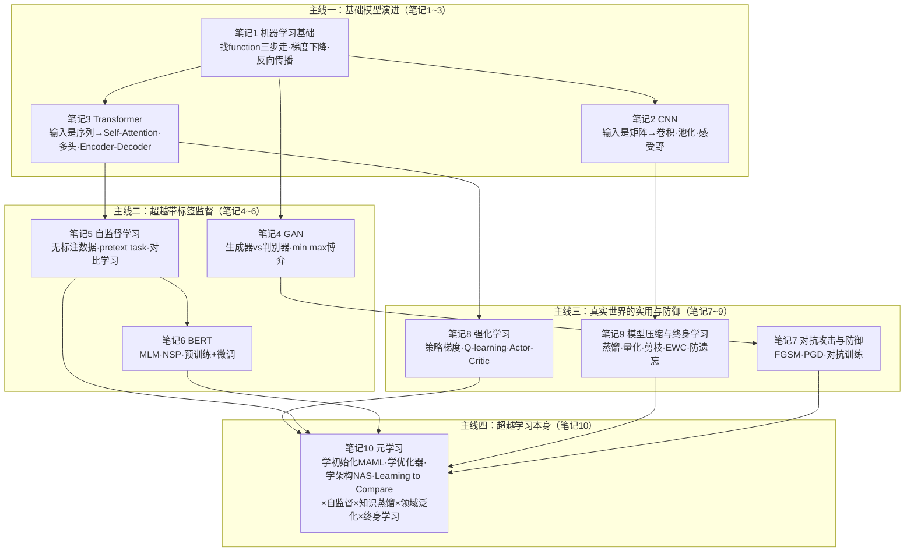

# 机器学习笔记 10 —— 元学习与课程总结

来源：李宏毅机器学习课 P50–P53（视频 BV1vL7E6dEqu）
整理时间：8/9

> 这是最后一篇了。我是边看 P50 到 P53 边记的，公式、例子、老师打的比方都尽量原样留着。这一章开头老师特意把第一堂课翻出来重讲，说要"首尾呼应"，所以前九篇的底子最好还在身上。

---

## 第 1 章　元学习（一）：学习如何学习

先记几个词：

- **Meta**：元，前缀，"关于 X 的 X"，高一层的意思
- **Meta Learning**：元学习，又叫 Learn to Learn（学习如何学习）
- **Hyper Parameter**：超参数，训练前由人设定的东西，比如学习率、网络层数
- **Learning Algorithm**：学习算法，把训练资料变成模型的算法
- **Handcrafted**：手工设计的，人自己想出来的
- **Dataset**：数据集，资料的集合

### 一、Meta 到底怎么翻

李宏毅老师说，Meta 这个词硬翻成中文，通常会翻成"圆"——"一元复始"那个圆。但更准确的理解是：**说一个东西是 Meta X，就代表它是"X 的 X"**。

- Meta Data（元数据）= 关于数据的数据。一张图片的拍摄时间、拍摄地点，这些就是"关于图片的数据"；
- Meta Learning（元学习）= 关于学习的学习，也就是**学习如何学习（Learn to Learn）**。

所以元学习跟我们前面讲的机器学习已经是**另外一个层次**的东西了。老师把元学习放在最后一堂课，刚好可以"收尾呼应"——第一堂课讲机器学习是什么，最后一堂课讲比机器学习更高一层的东西是什么，然后"我们要迈向下一个领域"。

用两个职业来比喻：

- **机器学习**好比一个**学生**：给他一本教材（训练资料），他学会解题（得到一个分类器）；
- **元学习**好比一个**老师（教学法研究者）**：他的工作不是解题，而是**研究怎么设计教材、怎么安排课程、用什么教法，学生才能学得又快又好**。老师研究的是"学习的方法"本身。

再贴切一点：机器学习是"给你鱼"，元学习是"教你钓鱼"，而元学习还要更进一步——**研究怎么设计出一套最好的钓鱼教学法**。

**为什么需要"学习如何学习"？** 老师用一个很接地气的场景开头：想想你在机器学习作业里到底在干嘛？朋友觉得你在做很潮的东西（生成动画人物、做翻译、玩 Atari 游戏），妈妈觉得你整天坐在电脑前，教授知道背后有很多数学……**但事实上，你大部分时间都在调超参数（Hyper Parameter）！**

深度学习几乎不能不调超参数：决定网络架构、决定学习率（Learning Rate）……而"调超参数"这件事真的非常烦人，而且**业界其实也没什么特别好的办法**：

- **业界的做法**：买很多 GPU，一次跑 1000 组不同的超参数、train 1000 个模型，哪组参数效果好就用哪个。这就像**翻车鱼（Sunfish）**——一次产好几亿颗卵，只要有少数几条活下来就够了。事实上业界买 GPU 的单位都是"万"（比如一次买 3 万张），学界的算力规模根本没法比。
- **学界的做法**：只有一张 GPU，就像**熊猫**——一次只生一胎，只能靠经验与直觉定一组超参数，然后祈祷它能有好结果。

那问题就来了：**既然我们做的是机器学习，机器可以自动学出一个模型，那超参数能不能也"学"出来？** 学习率、网络架构这些东西，能不能直接根据数据把它"学"出来？——这就是元学习能帮我们做的事情之一。

### 二、先复习：机器学习三步走

老师说要"首尾呼应"，先把第一堂课复习一遍。机器学习就是**找一个函数**：

- 做影像辨识：找一个函数，输入是一张图片，输出是辨识结果；
- 做语音识别：找一个函数，输入是一段声音，输出是文字。

找函数分**三步**：

**第一步，定义一个函数（Function）。** 函数里有一些未知参数。深度学习里，这个"带未知参数的函数"就是一个**神经网络（Neural Network）**，神经元里的**权重（Weight）和偏置（Bias）**就是未知参数。约定用 $\theta$ 表示所有待学习的参数，于是神经网络写成 $f_{\theta}$——代表这是一个由参数 $\theta$ 决定的函数。

**第二步，定义损失函数（Loss Function）。** 损失函数是参数 $\theta$ 的函数 $L(\theta)$，把 $\theta$ 代进去，就知道这组参数好不好。怎么定义？要有带标签（Label）的训练资料：把资料丢进 $f_{\theta}$，看它的输出跟正确答案差多少。如果是分类问题，就计算**交叉熵（Cross Entropy）**，把所有样本的交叉熵加起来就是 loss：

$$L(\theta)=\sum_{n=1}^{N} \text{CE}\big(f_{\theta}(x^{n}),\, \hat{y}^{n}\big)$$

其中 $x^{n}$ 是第 $n$ 个训练样本，$\hat{y}^{n}$ 是它的正确答案（标签）。

**第三步，找一个 $\theta$ 让 loss 越小越好。** 也就是解优化问题：

$$\theta^{*}=\arg\min_{\theta} L(\theta)$$

怎么解？这门课里我们用的都是**梯度下降（Gradient Descent）**：

$$\theta \leftarrow \theta - \eta \nabla_{\theta} L(\theta)$$

其中 $\eta$ 是学习率。找到 $\theta^{*}$ 以后，就有 $f_{\theta^{*}}$，就可以拿它做分类了。这就是第一堂课的内容。

一句话记：机器学习要找的是**一个小写的 $f$**（比如分类器），输入是图片或声音，训练资料是某个任务里的资料，loss 在训练资料上算，用梯度下降找 $\theta^{*}$。

### 三、学习算法本身也是一个函数

接下来是元学习的核心视角：**"学习"这件事，本身也是一个函数。**

一个机器学习的学习算法（Learning Algorithm），简化来看就是一个函数，我们用**大写的 $F$** 表示它：

- 输入：不是一张图片，而是一个**数据集（Dataset）**——训练资料；
- 输出：**训练完的结果**。假设我们要训练的是一个分类器（Classifier），那 $F$ 吃训练资料作为输入，输出的就是一个训练好的分类器。

$$F:\ \text{训练资料} \rightarrow \text{分类器}$$

有了分类器以后，再把测试资料丢进去，希望输出我们要的结果。

那这个大写的 $F$ 是从哪里来的呢？**它是 handcrafted 的——是人想出来的！** 我们今天的这些学习算法——深度学习（Deep Learning）、梯度下降——都是人设计出来的。那么问题来了：

> **我们能不能直接"学"出这个函数 $F$？能不能用机器学习的概念来学"学习算法"本身？能不能做到"学习如何学习"？**

答案是：**可以，而且并没有那么异想天开。** 想想看，在机器学习里我们是怎么找函数的？——通过三个步骤。在元学习里，我们要找的也是一个函数，只不过这个函数是"学习算法"，但我们**依然可以通过机器学习里学过的三个步骤**，把这个学习算法找出来。这就是元学习要做的事情。

**比喻**：把 $F$ 想成一台"模型加工机"。

- 普通机器学习：你手工造了一台加工机 $F$（人设计的算法，比如梯度下降），把训练资料倒进去，它吐出一个分类器；
- 元学习：你不再满足于手工造加工机，而是**造一台"造加工机的机器"**——给它一堆"加工任务"，它自动学出最好的"加工机设计方案"。

用游戏来比喻也一样：机器学习是"训练一个玩家去通关"，元学习是"训练一个教练，让教练能训练出任何新玩家去通关"。

### 四、元学习三步走：学什么、怎么定 loss、怎么优化

跟机器学习用三步找函数一样，元学习也用**三步**来找"学习算法"。

**第一步：决定学习算法里"要学的东西"是什么。** 机器学习里，神经元权重和偏置是要学出来的；那元学习里，学习算法里有什么东西可以学呢？**就看你想让机器自己决定什么**：

- 想自动学出网络架构（Neural Network Architecture）？
- 想学出初始化参数（Initialization）？
- 想学出学习率（Learning Rate）？

这些以前都是人自己设的、试不同参数看哪个好；现在我们希望它们**可以被学出来**。我们把"学习算法里想学的东西"统称为 **$\phi$（phi）**——注意约定：之前用 $\theta$ 代表一个函数里要学的参数，现在用 $\phi$ 代表**一个学习算法里要学的参数（元参数）**。所以一个学习算法写作 $F_{\phi}$，代表这个算法里有一些未知参数 $\phi$。不同的元学习方法，就是去学学习算法里**不同的组件（Component）**——学不同的组件，就有了不同的元学习方法。

**第二步：定义损失函数（Loss Function）。** 元学习的损失函数要决定"一个学习算法有多好"，用大写 $L(\phi)$ 表示：如果 $L(\phi)$ 很小，就代表这是个好的学习算法。问题来了：**元学习的"训练资料"是什么？**

在元学习里，我们收集的不是"样本"，而是**训练的任务（Training Task）**！假设你想训练一个二元的分类器，就要准备很多个二元分类任务：

- 任务一：分辨**苹果 vs 橘子**；
- 任务二：分辨**汽车 vs 脚踏车**；
- 任务三：分辨**猫 vs 狗**……

注意！**每一个任务里面都再分成"训练资料"和"测试资料"**。所以元学习是有点复杂的：有训练的任务，每个任务里面有训练资料、有测试资料。

有了训练任务以后，怎么知道一个学习算法 $F_{\phi}$ 好不好呢？流程如下：

1. 拿出任务一的训练资料，丢给学习算法 $F_{\phi}$，让它学习，得到一个分类器 $f_{\theta^{*}}^{1}$（上标 1 代表这是任务一的分类器，负责分苹果和橘子）；
2. 把这个分类器跑在**任务一的测试资料**上，把测试图片丢进去，得到预测结果，和正确答案比较，计算交叉熵并求和，得到 $l^{1}$（这个任务上的 loss）；
3. 对任务二也做同样的事，得到 $l^{2}$；
4. 把所有任务的 loss 加起来（或取平均），就得到整个学习算法 $F_{\phi}$ 的 total loss：

$$L(\phi)=\sum_{i=1}^{N} l^{i},\qquad l^{i}=\sum_{(x,y)\in \text{任务 }i\text{ 的测试资料}} \text{CE}\big(f_{\theta^{*}}^{i}(x),\, y\big)$$

其中 $N$ 是训练任务的总数（可以非常大），$f_{\theta^{*}}^{i}$ 是把 $F_{\phi}$ 用在任务 $i$ 的训练资料上所得出的分类器。

> 注意：这里有一个让人心跳加速的点——在一般的机器学习里，loss 是用**训练资料**算的；但在元学习里，我们的 loss 是用**测试资料**算的！"你怎么敢用测试资料？！"别慌，因为元学习的**训练单位是任务（Task）**，在元学习的训练过程中，**训练任务里面的测试资料是允许被使用的**。我们不会去碰"测试任务"里的任何资料。这个区别极其关键，下一节专门理清楚。

**第三步：找一个 $\phi$ 让 $L(\phi)$ 越小越好。** 也就是解优化问题：

$$\phi^{*}=\arg\min_{\phi} L(\phi)$$

怎么解？看你会什么优化方法：

- 如果 $\frac{\partial L(\phi)}{\partial \phi}$ 可以计算（$\phi$ 是连续值，比如学习率、初始化参数），**直接用梯度下降**就结束了；
- 如果 $\phi$ 是无法求导的东西（比如 $\phi$ 是网络架构——离散的、不可能从"3 层"变成"3.1 层"），梯度算不出来，怎么办？老师反复强调的那句话又来了：**用强化学习（Reinforcement Learning）硬做！** 也有人用演化算法（Evolutionary Algorithm）硬做。反正就是把优化问题硬解开来。

解出 $\phi^{*}$ 以后，你就得到了一个**学出来的学习算法（Learned Learning Algorithm）** $F_{\phi^{*}}$——听起来有点绕口："它是一个被学出来的学习算法"。

**元学习的完整使用流程：**

1. **训练阶段**：收集一大堆训练任务（如"分苹果橘子""分汽车脚踏车"），透过三步走学出一个学习算法 $F_{\phi^{*}}$；
2. **测试阶段**：来了一个真正关心的测试任务（如"分猫和狗"）——注意，测试任务里也有训练资料和测试资料！把**测试任务里的训练资料**丢进学出来的学习算法 $F_{\phi^{*}}$，让它学习，学出一个分类器；
3. 再把**测试任务里的测试资料**丢进这个分类器，得到你想要的结果。

训练任务是"陪练"，用来找出学习算法；测试任务才是我们真正关心、真正要解的。

**比喻：元学习的训练 vs 测试，可以类比"教练训练营"。**

- 训练阶段：教练（$F_{\phi}$）带各种"模拟运动员"（训练任务）训练，检验标准是"运动员在模拟赛（任务内测试）里的成绩"；
- 测试阶段：来了一个真正的新运动员（测试任务），教练用他带的"训练方法"（$F_{\phi^{*}}$）快速训练新运动员，让他在真正的大赛（任务内测试）里拿好成绩。

教练水平高不高，不看他自己多能跑，而看**他带出来的运动员成绩好不好**——这就是元学习 loss 要在"任务内测试资料"上算的原因。

### 五、训练任务和测试任务：两层训练、两层测试

这一节专门把"训练任务 / 测试任务"这团乱麻理清楚，因为很多文献都栽在这上面。

**容易混淆的地方**：在元学习里，"训练资料"这个词非常危险——它既可能指"训练任务里的训练资料"，也可能指"测试任务里的训练资料"，还可能指"用来训练学习算法的所有任务"。老师强调：在这门课里，我们只说**训练任务（Training Task）**和**测试任务（Testing Task）**：

- **训练任务**：用来找出学习算法 $F_{\phi^{*}}$ 的那些任务；
- **测试任务**：我们真正关心、真正要解的任务。

**每个任务内部**都有训练资料和测试资料。文献上为了避免混淆，常常给它们起别名：

- 任务内的**训练资料** → **支撑集（Support Set）**；
- 任务内的**测试资料** → **查询集（Query Set）**。

（在 "learning to compare" 系列的论文里，support set 和 query set 这两个词尤其常见。你看到一篇论文说"用 support set 做了什么，再用 query set 怎么样"，指的就是任务内的训练资料和测试资料。）

**两个层次的训练：**

- **跨任务训练（Across-task Training）**：根据一大堆任务学出学习算法 $F_{\phi^{*}}$ 的过程；
- **任务内训练（Within-task Training）**：把某个任务的训练资料丢进学习算法、学出该任务分类器的过程。

**两个层次的测试：**

- **任务内测试（Within-task Testing）**：把测试资料丢进分类器，得到结果；
- **跨任务测试（Across-task Testing）**：测试的不是一个分类器好不好，而是一个**学习算法**好不好。所以跨任务测试里面**包含了任务内训练 + 任务内测试**——"在元学习里，testing 还包含了 training"！

一次"任务内训练 + 任务内测试"合起来，叫做一个**回合（Episode）**。而计算 $l^{i}$ 一次，就要完整跑一个 episode——所以元学习每一步的运算量往往非常大：光算一个任务的小 $l$，就要做一次完整的训练加一次完整的测试。

**外层循环与内层循环**：在 "learning to initialize" 系列的论文（也就是非常知名的 **MAML** 那一系列工作）里，文献往往把：

- 跨任务训练（across-task training）叫做**外循环（Outer Loop）**；
- 任务内训练（within-task training）叫做**内循环（Inner Loop）**。

因为学习算法往往是迭代的（梯度下降要反复跑），所以有很多"循环套循环"。

层次对应关系我记成一张表：

| 层次 | 训练 | 测试 | 对象 |
|:---|:---|:---|:---|
| 任务层（元层）| Across-task Training（跨任务训练）| Across-task Testing（跨任务测试）| 学习算法 $F_{\phi}$ |
| 样本层（内层）| Within-task Training（任务内训练）| Within-task Testing（任务内测试）| 分类器 $f_{\theta}$ |
| 合起来 | — | 一个 Episode | — |

**机器学习 vs 元学习，其实非常像**（老师说："很多你在机器学习里学到的知识与基本概念，都可以直接搬到元学习里来用"）：

| | 机器学习（ML） | 元学习（Meta Learning） |
|:---|:---|:---|
| 找的目标 | 小写 $f$：一个分类器 | 大写 $F$：一个**可以找 $f$ 的**学习算法 |
| 训练资料 | 某个任务的训练资料 | 一大堆训练任务（每任务内分训练/测试资料） |
| 损失函数 | $L(\theta)=\sum$ 训练资料上的 CE | $L(\phi)=\sum_{i=1}^{N} l^{i}$，$l^{i}$ 在**任务 i 的测试资料**上算 |
| 优化 | $\theta^{*}=\arg\min L(\theta)$ | $\phi^{*}=\arg\min L(\phi)$，必要时用 RL 硬解 |
| 测试 | 测试资料丢进分类器 | 测试任务：任务内训练 + 任务内测试 |

### 六、Few-shot 和元学习：目标 vs 手段

Few-shot Learning（小样本学习）这个词你可能听过，也常有人把它跟元学习搞混。老师专门做了区分：

- **Few-shot Learning 是"目标"**：期待机器只看几个样本（比如每个类别只给 3 张图片）就能学会分类。它是一种**对能力的期待**；
- **Meta Learning 是"手段"**：学习如何学习这件事本身。

那为什么大家总觉得它俩是一回事？**因为"只看一点点资料就能学起来"的学习算法，往往不是人类能想得出来的**——所以那些 Few-shot 的学习算法，通常就是用元学习学出来的。**Few-shot 是目标，Meta 是手段**，两者密切相关，但有微妙的区别。

顺便记一下扩展：还有 One-shot Learning（每个类别只看一个样本）和 Zero-shot Learning（一个样本都不看，靠语义描述等知识做分类）。

**比喻**：把两者的关系想成"体育训练与比赛目标"——目标是"让运动员在奥运会上拿金牌"（few-shot 能力），手段是"一套科学的训练方法"（元学习）。你不可能靠人类直觉拍脑袋设计出最好的训练方法，所以要用"训练方法生成器"（元学习）去自动找。

### 七、元学习也会过拟合：任务增强与 Development Task

**元学习也会过拟合。** 在机器学习里，你会害怕模型在训练资料上做得很好、在测试资料上做得不好；在元学习里，你会害怕学出来的学习算法只在**训练任务**上表现好，来一个新的测试任务反而表现差。解决办法也是对称的：

- 机器学习：收集更多训练资料、做数据增强（Data Augmentation）；
- 元学习：**收集更多训练任务**、做**任务增强（Task Augmentation）**——想一些方法来增加训练任务。训练任务越多，学出来的学习算法越有机会泛化到新任务上。

**元学习也要调超参数，而且可能调得更凶。** 当你用梯度下降去最小化 $L(\phi)$ 的时候，梯度下降自己的学习率不也得调吗？——对，你还要调另一组超参数！老师说："做 meta learning 好像是为了避免秃头，结果让自己压力更大，反而秃头。" 但元学习期待做到的目标是：**爆调一次参数，找到一个好的学习算法，以后用在任何新任务上就再也不用调参数了**——一劳永逸。

**元学习应该有 Development Task（开发任务）。** 在机器学习里，我们不是只有训练集和测试集，中间还有个验证集（Development Set / Validation Set）用来挑模型架构；同理，元学习也应该有 **Development Task**：用 training task 学出一堆候选学习算法，用 development task 来挑哪个学习算法最好，最后才跑在 testing task 上——这样才不会拿测试任务来调超参数、造成"测试集污染"。

老师还讲了个有趣的小故事：他当年旁听林轩田老师的机器学习课时，林老师说"每个人都应该用 development set，但很多论文不用，直接在 testing data 上调参数，这是错误的"。今天大家都知道训练要分成 training set / development set / testing set；老师相信十年后，大家也都会知道元学习应该分成 training task / development task / testing task。（他也坦言，现在很多元学习论文确实没有 development task——新技术在发展过程中本来就会有各种"磕磕绊绊"。）

另外一个有趣的梗：会不会有 meta-meta-learning、meta-meta-meta-learning，无限套娃？老师说："这个就是一个梗，不知道什么时候才会停止。"

**比喻**：机器学习挑模型 = 用**模拟考（验证集）**决定复习策略；元学习挑学习算法 = 用**预选赛（development task）**决定哪个教练的训练方案最好，而真正的**总决赛（testing task）**只能打一次，绝不能提前泄露题目。

### 八、这一章跟前面几篇的串联

翻笔记的时候顺手记一下这章跟前面九篇的暗线：

1. **笔记 1（机器学习基础）**：元学习的三步走（定义函数 → 定 loss → 优化）与机器学习三步走完全同构，只是对象从"函数"升级为"学习算法"。老师特意首尾呼应，第一堂课的内容在这里重新出场；
2. **笔记 8（强化学习）**：当元参数 $\phi$ 是离散的（如网络架构）、梯度不可算时，用强化学习硬解——这是 P50 首次明确把 RL 作为元学习优化的工具；
3. **笔记 9（终身学习）**："学习算法要能泛化到新任务"跟终身学习的核心诉求（学会新任务不忘旧任务）一脉相承；P52 会正式把两者结合；
4. **笔记 5、6（自监督 / BERT）**：这章已经埋下伏笔——"找好的初始化参数"这件事，正是 MAML（P51）与 BERT 预训练（P52）之间的桥梁；
5. **笔记 1 的正则化部分**：元学习同样有过拟合问题，且解法一一对应（更多任务 ≈ 更多数据；task augmentation ≈ data augmentation；development task ≈ validation set），体现了"上层问题的结构与下层问题同构"这一元思想。

## 复习（自己出的题，答案在下面）

**第 1 题（概念）**：请用一句话分别解释 Machine Learning 与 Meta Learning 在"找函数"这件事上的区别，并说明为什么元学习的 loss 可以用"测试资料"来计算。

**第 2 题（术语辨析）**：Few-shot Learning 和 Meta Learning 是什么关系？有人说"Few-shot Learning 就是 Meta Learning"，这个说法准确吗？为什么？

**第 3 题（框架理解）**：元学习的三个步骤分别是什么？如果元参数 $\phi$ 代表"网络架构"这种离散量，第三步的优化应该怎么办？

**第 4 题（层次划分）**：请写出以下术语的两层对应关系：across-task training / within-task training / episode / outer loop / inner loop，并说明 support set 与 query set 分别指什么。

**答案：**

1. 机器学习是找一个小写 $f$（分类器），输入图片输出分类结果；元学习是找一个大写 $F$（学习算法），输入训练资料输出分类器——也就是"找一个可以找 $f$ 的 $F$"。元学习的训练单位是"任务"，元学习 loss 是在**训练任务内部的测试资料**（query set）上计算的：先拿任务内的训练资料学出分类器，再在任务内测试资料上评估这个分类器，从而评价学习算法好坏。训练任务的测试资料属于"训练材料"，可以用；而**测试任务**的任何资料（包括它的训练资料）在元学习训练阶段绝不能碰。
2. Few-shot Learning 是**目标**（只用少量样本就能学会），Meta Learning 是**手段**（学习如何学习）。二者常被混淆，是因为能实现 few-shot 的学习算法通常无法由人手工设计，必须靠元学习学出来；但概念上并不等价——元学习可以服务于其他目标，few-shot 也可以有其他实现方式。
3. 三步是：①决定学习算法里要学的东西 $\phi$（初始化、学习率、架构等）；②定义损失函数 $L(\phi)=\sum_{i=1}^{N}l^{i}$（在训练任务的 query set 上评估学出的分类器）；③解 $\phi^{*}=\arg\min_{\phi}L(\phi)$。若 $\phi$ 是离散的网络架构，梯度无法计算，可以用强化学习（把架构当作 agent 的动作，把 $L(\phi)$ 取负号当 reward）或演化算法硬解。
4. 任务层（元层）：across-task training = 用一堆任务学学习算法 = outer loop；样本层（内层）：within-task training = 学某个任务的分类器 = inner loop；一次 within-task training + within-task testing = 一个 episode。support set = 任务内的训练资料，query set = 任务内的测试资料（"learning to compare" 系列文献常用这种叫法）。
---

## 第 2 章　元学习（二）：万物皆可学

先记几个词：

- **Initialization**：初始化，训练开始前参数的起点 $\theta^{0}$
- **Batch**：小批量，从训练资料里采样的一小组样本
- **Optimizer**：优化器，决定怎么更新参数（SGD、Adam、RMSProp）
- **MAML**：Model-Agnostic Meta-Learning，模型无关元学习
- **Hessian**：海森矩阵，二阶导数矩阵
- **NAS**：Neural Architecture Search，神经架构搜索
- **N-way K-shot**：N 类 K 样本，few-shot 任务的规格
- **Omniglot**：手写字符数据集，元学习界的"果蝇"

### 一、万物皆可学：把梯度下降拆开看

元学习的基本概念讲完了，接下来用实例说明：**在元学习里，什么东西是可以被学出来的？**

我们最常用的学习算法就是梯度下降（Gradient Descent），它的流程是：

1. 定一个网络架构；
2. **初始化参数**，初始参数记为 $\theta^{0}$（通常是从某个固定的分布里随机采样的，即 Random Initialization）；
3. 从训练资料里采样一个 **batch**（小批量）；
4. 计算梯度；
5. 用梯度更新参数：$\theta \leftarrow \theta - \eta \nabla_{\theta} L$；
6. 反复进行，直到次数够多、结果满意，把最终参数输出。

在这整个流程里，**哪些东西是可以"学"的呢？** 老师的答案是：**几乎每一个零件都可以学！** 这一章就是一次"梯度下降全身解剖"，我按零件记下来：

- **初始化参数 $\theta^{0}$** → Learning to Initialize（MAML、Reptile、ANIL、FOMAML）
- **优化器（学习率、动量等）** → Learning to Learn by Gradient Descent by Gradient Descent
- **网络架构** → NAS（Neural Architecture Search）、DARTS
- **数据处理 / 数据增强** → 自动数据增强（如 AutoAugment 等）
- **样本权重** → Learning to Weight Samples
- **整个学习算法（抛弃梯度下降）** → Learning to Compare（度量方法）

**比喻**：把梯度下降想成一台"火锅店流水线"——锅底（初始化）、火候（学习率）、配菜搭配（架构）、摆盘（数据增强）、上菜顺序（样本权重），以前每个环节都要大厨（人）亲手调；元学习的目标是训练一个"店长 AI"，让它看很多家店（训练任务）的经营数据，自动学会把每个环节调到最优。

### 二、学初始化：MAML 详解与推导

初始化参数对训练结果的影响非常大——"好的初始化和不好的初始化可以天差地别"。那我们能不能透过一些训练任务，找出一个**对训练特别有帮助的初始化参数**呢？可以！这就是元学习系列里最耳熟能详的方法：

> **MAML = Model-Agnostic Meta-Learning（模型无关元学习）**

（转录里 MAML 常被听成"么某""MAMA"，注意还原。它的发音跟哺乳动物 "mammal" 有点像，而它的一个变形叫 **Reptile**——"爬虫类"，老师调侃说"不知道是不是故意取成动物名的"。）

MAML 属于 **Learning to Initialize**（学习初始化）这一技术路线：**元参数 $\phi$ 就是一组初始参数**，我们要从一堆训练任务中学出这组"万能起点" $\theta^{0}$，使得：任何一个新任务，只要从这组初始参数出发、做几步梯度下降，就能快速得到该任务上表现很好的模型。

为什么要叫 "Model-Agnostic（模型无关）"？因为 MAML 不关心你的模型是什么——CNN、Transformer、RNN 都行，只要**能用梯度下降训练**，MAML 就能套上去学它的初始化。这就是"模型无关"的含义。

**MAML 的两层优化（重点中的重点）**

MAML 的训练分为**内层循环（Inner Loop）**和**外层循环（Outer Loop）**两个层次。我们用 $\phi$ 表示初始参数（也就是元参数）。

**内层循环（任务内适应）**：对每个训练任务 $i$，从初始参数 $\phi$ 出发，用该任务自己的训练资料（support set）做 $k$ 步梯度下降，得到该任务的专属参数 $\theta'_{i}$：

$$\theta'_{i} = \phi - \alpha \nabla_{\phi} L_{i}^{\text{train}}(\phi)$$

这里 $\alpha$ 是内层学习率，$L_{i}^{\text{train}}$ 是任务 $i$ 的 support set 上的损失（比如交叉熵）。如果做多步，就写成：

$$\theta'_{i} = \phi - \alpha \nabla_{\phi} L_{i}^{\text{train}}\big(\phi\big), \qquad \theta^{(t+1)}_{i} = \theta^{(t)}_{i} - \alpha \nabla_{\theta^{(t)}_{i}} L_{i}^{\text{train}}\big(\theta^{(t)}_{i}\big)$$

**外层循环（跨任务更新）**：评估这些 $\theta'_{i}$ 在各自任务**测试资料（query set）**上的表现，把损失加起来作为元目标：

$$L(\phi) = \sum_{i=1}^{N} L_{i}^{\text{test}}\big(\theta'_{i}\big) = \sum_{i=1}^{N} L_{i}^{\text{test}}\Big(\phi - \alpha \nabla_{\phi} L_{i}^{\text{train}}(\phi)\Big)$$

然后对 $\phi$ 做一次梯度下降（外层学习率 $\beta$）：

$$\phi \leftarrow \phi - \beta \nabla_{\phi} L(\phi)$$

**关键点**：注意 $L_{i}^{\text{test}}$ 的自变量是 $\theta'_{i}$，而 $\theta'_{i}$ 本身又是 $\phi$ 的函数（因为它是由 $\phi$ 经梯度下降得来的）！所以 $\nabla_{\phi} L(\phi)$ 是一个"**穿过内层梯度下降过程**"的梯度——这正是 MAML 最精妙也最麻烦的地方。

**推导：元梯度 $\nabla_{\phi} L(\phi)$ 到底怎么算？**

我们单看一个任务 $i$ 的贡献，用链式法则展开（为了记号清爽，以下省略任务下标 $i$）：

$$\nabla_{\phi} L^{\text{test}}\big(\theta'\big) = \left( \frac{\partial \theta'}{\partial \phi} \right)^{\top} \nabla_{\theta'} L^{\text{test}}\big(\theta'\big)$$

其中 $\frac{\partial \theta'}{\partial \phi}$ 是一个矩阵（每个 $\theta'$ 分量对每个 $\phi$ 分量的偏导）。而由内层更新公式 $\theta' = \phi - \alpha \nabla_{\phi} L^{\text{train}}(\phi)$ 可得：

$$\frac{\partial \theta'}{\partial \phi} = \mathbf{I} - \alpha \frac{\partial}{\partial \phi}\nabla_{\phi} L^{\text{train}}(\phi) = \mathbf{I} - \alpha \nabla^{2}_{\phi} L^{\text{train}}(\phi)$$

其中 $\mathbf{I}$ 是单位矩阵，$\nabla^{2}_{\phi} L^{\text{train}}(\phi)$ 是损失函数对 $\phi$ 的**二阶导数矩阵，也就是海森矩阵（Hessian）**！所以：

$$\nabla_{\phi} L^{\text{test}}\big(\theta'\big) = \Big(\mathbf{I} - \alpha \nabla^{2}_{\phi} L^{\text{train}}(\phi)\Big)^{\top} \nabla_{\theta'} L^{\text{test}}\big(\theta'\big)$$

**展开来读**：元梯度 = "把测试损失对 $\theta'$ 的梯度，通过内层更新的一阶加二阶信息，回传到 $\phi$"。这就是为什么 MAML 被称为"二阶方法"——它的外层梯度计算涉及 Hessian 矩阵（实际实现中通常用 Hessian-vector product 来高效计算，不必显式构造整个矩阵）。

**FOMAML（First-Order MAML，一阶 MAML）**：Hessian 的计算又慢又占内存。Finn 等人发现，把 $\frac{\partial \theta'}{\partial \phi}$ 近似成单位矩阵 $\mathbf{I}$（即忽略二阶项），效果依然很好：

$$\nabla_{\phi} L^{\text{test}}\big(\theta'\big) \approx \nabla_{\theta'} L^{\text{test}}\big(\theta'\big)$$

也就是"假装内层更新不改变梯度方向"，直接把测试梯度拿来当元梯度用。这个大幅简化运算的变体就叫一阶 MAML（FOMAML）。

**Reptile（爬行动物）**：另一种更简单的近似。它的做法是：先随机初始化 $\phi$，对每个任务 $i$ 做 $k$ 步梯度下降得到 $\theta'_{i}$，然后直接把 $\phi$ 往 $\theta'_{i}$ 的方向拉一点：

$$\phi \leftarrow \phi + \varepsilon \big(\theta'_{i} - \phi\big)$$

其中 $\varepsilon$ 是外层步长。Reptile 完全没有 Hessian，实现极其简单，行为上相当于"让初始点靠近所有任务最优解区域的公共中心"。

**ANIL（Almost No Inner Loop）**：来自论文 *Rapid Learning or Feature Reuse?*。它发现内层循环真正有用的部分只在网络的最后一层（分类头），于是 ANIL 只对最后一层做内层更新，其余层完全冻结——"几乎不再有内循环"，计算量大减，且效果接近 MAML。

**MAML++（How to Train Your MAML）**：原版 MAML 其实**不太好训练**（对随机种子敏感，同样的代码换一个 random seed 可能就 train 不起来）。这篇论文（标题玩梗自电影《驯龙高手 How to Train Your Dragon》）尝试用 3 个不同随机种子训练 MAML，发现红色的三条线时好时坏，于是提出了更稳定的改进版 MAML++。

**MAML 的完整训练流程（算法伪代码，我抄下来了）：**

```
输入：训练任务分布 p(T)，内层学习率 α，外层学习率 β
随机初始化元参数 φ
重复直到收敛：
    采样一批任务 {T1, T2, ..., TN}  ~  p(T)
    对每个任务 Ti：
        （内层）从 φ 出发，用 Ti 的训练资料做 k 步梯度下降 → θ'i
    （外层）计算元损失 L(φ) = Σ_i L_test_i(θ'i)（在各自 query set 上）
    计算元梯度 ∇φ L(φ)（穿透内层更新，含二阶项）
    φ ← φ - β ∇φ L(φ)
输出：学出来的初始化参数 φ*
```

**测试阶段**：拿到新任务（testing task），用它的 support set 从 $\phi^{*}$ 出发做几步梯度下降，得到分类器 $\theta^{*}$，再在 query set 上评估——这就是"用很少的样本快速适应新任务"。

**比喻**：MAML 想找的初始化，可以比喻成**"考试基地"**（一个离所有考点都很近的中心位置）：

- 普通随机初始化 = 把营地扎在荒郊野外，每次要跑去考场都要跑很远（训练慢、容易迷路）；
- MAML = 看了一堆"模拟考场"的分布后，把营地扎在**离所有考场都近的市中心**，任何新考场出现，从市中心出发很快就到（几步梯度下降就适应好）。

而"为什么 MAML 有效"还有另一个解释：MAML 找的初始化可能本身就已经离每个任务的最优解很近了（不是"跑得快"，而是"起点就在终点附近"）——这就是下一节要讲的 rapid learning vs feature reuse 之争。

### 三、MAML 为什么有效：Rapid Learning vs Feature Reuse

MAML 找到的初始化参数，到底为什么好用？学界有两种互相竞争的假说：

- **假说一：Rapid Learning（快速学习）**——MAML 找出的初始参数是一个"很厉害的起点"，它能让梯度下降**快速**找到每个任务上好的参数（跑得快）；
- **假说二：Feature Reuse（特征复用）**——MAML 找出的初始化参数**本身就已经非常接近**每个任务最终的好结果了，所以直接做几步梯度下降就能轻易到达（起点就在终点旁边）。

哪一个是真相？一篇标题为 *Rapid Learning or Feature Reuse?* 的论文专门做了实验来回答，结论是：

> 结论：**Feature Reuse（特征复用）才是 MAML 有效的关键。**

也就是说，MAML 学出来的初始化，本质上是一个**高质量的特征提取器（representation）**——它对不同任务通用的底层特征（边缘、纹理、形状等）已经有了很好的建模，新任务到来时只需要在"顶层分类头"上稍作调整即可。这也解释了为什么 ANIL（几乎不做内层循环、只更新最后一层）效果依然很好——因为真正需要快速适应的只有最后一层，前面的层本来就是"复用"的。

**比喻**：把 MAML 的初始化想成一位老中医的"万用药箱"。

- Rapid Learning 假说 = 药箱里工具摆放得特别顺手，看病时拿什么都快（收敛快）；
- Feature Reuse 假说 = 药箱里已经备好了大多数常见病的通用药材，新病人来了只需稍微加减几味药（微调最后一层）就能治好。

实验证明真相是后者：药箱里"通用的基础药材"才是关键。

### 四、学优化器：用梯度下降学梯度下降

除了初始化，**优化器（Optimizer）本身也可以学！** 我们在更新参数时需要决定学习率（Learning Rate）、动量（Momentum）等超参数——这些能不能也"学"出来？

**能。** 这个想法很早以前就有了：**NeurIPS 2016** 有一篇论文，标题叫 *Learning to learn by gradient descent by gradient descent*（注意这不是笔误，标题真的就叫"用梯度下降来学习如何用梯度下降学习"——老师感叹"大家都是命名大师"）。

这篇论文的思路是：一般的优化器（Adam、RMSProp 等）都是人想出来的；这篇文章**直接"学"一个优化器**——它把"训练优化器里的参数"这件事，类比成训练一个 **LSTM**（长短期记忆网络），所以它的方法简称为 LSTM（这门课没有讲 LSTM，不知道没关系，只要理解"这是一个学出来的优化器"即可）。

它做了几个有趣的实验：

- **实验一**：训练任务和测试任务都是同一个（同样的网络架构）——"这根本就是 cheating 嘛，训练任务和测试任务一模一样，没什么特别厉害"；
- **实验二**：训练任务是一层网络、40 个单元，测试任务改成两层网络——**可以 work！** 学出来的优化器从一层网络迁移到了两层网络；
- **实验三**：把激活函数换掉（训练时用 Sigmoid，测试时改成 ReLU）——**哇，学出来的优化器就坏掉了。**

这个实验告诉我们一个重要的道理：**学出来的东西是有"适用范围"的**。学出来的优化器对"网络深度"有一定泛化能力，但对"激活函数类型"很敏感——超参数空间很大，学到的规律未必能迁移到分布外的配置上。

**比喻**：手写优化器 = 老厨师凭经验掌握火候；学出来的优化器 = 让 AI 看大量"做菜过程"（训练任务的梯度轨迹），自己学会"什么时候大火、什么时候小火"（学习率怎么变）。但 AI 学的"火候规律"可能只在"用煤气灶"（Sigmoid）时有效，换成"电磁炉"（ReLU）就失灵了。

### 五、学网络架构：NAS 与 DARTS

能不能学**网络架构（Neural Network Architecture）**？当然可以！这一系列研究就是大名鼎鼎的 **NAS（Neural Architecture Search，神经架构搜索）**——很多同学听过 NAS，但不太清楚它跟元学习的关系：**如果你把元学习要学的 $\phi$ 设为网络架构，那你就是在做 NAS。**

NAS 的难点在于：架构是**离散（Discrete）**的（层数、卷积核大小、步长都是离散值），没法求梯度。怎么办？老师反复强调的老办法：**用强化学习（RL）硬做！**

用 RL 做 NAS 的做法：

1. 把 $\phi$（架构）想成 RL 中 **agent 的动作（Action）**——agent 的"策略输出"就是网络架构相关的超参数：第一层 filter 的高度、宽度、横向步长、纵向步长、filter 数量……一层一层地输出；
2. 有了这些参数，就搭出一个网络，去训练它（这个训练过程就是 **within-task training**）；
3. 把这个网络在测试资料上的正确率（accuracy）当作**奖励（Reward）**；
4. 训练 agent 去**最大化 reward**——也就是最小化 $L(\phi)$（reward 设成 $-L(\phi)$）；
5. 训练 agent 的过程就是 **across-task training**。

在早期的 NAS 论文里，agent 通常是一个循环神经网络（Recurrent Network），每次输出一层架构的参数。早期 NAS 的毛病是训练任务和测试任务往往是**同一个**（比如在 CIFAR-10 上找架构、也在 CIFAR-10 上测）——"感觉有点 cheating"。不过近年来很多 NAS 工作已经做到训练任务和测试任务可以不同（跨数据集迁移架构）。

除了 RL，还可以用**演化算法（Evolutionary Algorithm）**硬做；还有一个经典做法是**让问题变可微**——这就是 **DARTS（Differentiable ARchiTecture Search，可微架构搜索）**：通过"软选择"（对每个候选操作学一个连续权重，训练后取权重最大的），把离散的架构选择变成连续可微的，从而可以直接用梯度下降来 minimize $L(\phi)$。DARTS 的细节就留给大家自己研究。

**比喻**：NAS 就像**让 AI 当"建筑设计师"**。

- RL 版设计师：建筑师每画一张图纸（输出架构），就找工人把楼盖出来、实际住一段时间测质量（训练 + 测试正确率），质量好就给建筑师奖励——建筑师慢慢学会画好图；
- DARTS 版设计师：不画"最终图纸"，而是画一张"每种材料都掺一点"的模糊图纸，用梯度下降慢慢调整各种材料的配比，最后收敛到一种材料——因为整个过程可微，所以能直接用梯度下降。

### 六、学数据处理：数据增强与样本权重

**数据增强（Data Augmentation）也可以学！** 训练神经网络时都要做数据增强（笔记 2 的 CNN 部分讲过；作业三还让大家试各种增强方法）。现在数据增强的方法都是人用 trial and error 试出来的——那能不能直接**学**出"怎么做数据增强"？可以！老师列了一些论文（如 AutoAugment 系列）供参考。

**样本权重（Sample Weight）也可以学！** 训练时有时需要给不同样本不同的权重。怎么给？文献里有不同策略：

- 有的策略说：离决策边界（Boundary）特别近的样本是**困难样本（Hard Example）**，应该给**较大的权重**，让模型重点学习它们；
- 但也有文献持相反结论：离边界近的样本可能**噪声标签（Noisy Label）**——它的难是不合理的，因为标签本身就标错了，应该给**较小的权重**。

到底怎么定样本权重的策略？你可以**直接把"定权重的方法"学出来**——让机器根据数据的特性，自动决定每个样本该分到多少权重。

**比喻**：给样本定权重就像**老师批改作业的"押分策略"**——有的老师觉得"压轴难题"（hard example）要重点辅导（大权重）；有的老师觉得"这些难题其实题目印错了"（noisy label），不该让学生纠结（小权重）。与其纠结哪种策略好，不如让 AI 看大量"考题分布"（训练任务）自己学一套批改策略。

### 七、终极形态：抛弃梯度下降的 Learning to Compare

到目前为止，我们看到的方法都是在**梯度下降的基础上改进**——学的是梯度下降的某一个组件。那我们有没有可能**完全舍弃梯度下降**呢？

**有！** 想象一个更激进的网络：这个网络的参数就是 $\phi$，它**直接吃训练资料作为输入，输出"训练好的结果"**（另一组参数，或者直接输出答案）。如果真有这样一个网络，我们就可以说：**我们让机器发明了新的学习算法，甚至抛弃了梯度下降。**

更进一步：能不能把**整个 episode（一次训练 + 一次测试）打包进一个网络**？——也就是**不再有训练与测试的分界**：把训练资料和测试资料一起作为网络的输入，网络读完训练资料后（内部发生了什么事我们不知道——也许它学出了一个 learning algorithm，也许它直接找出了答案），直接输出测试资料的答案。

这样的方法今日并不罕见，有一个系列的元学习方法叫 **Learning to Compare（学习比较）**，也叫 **Metric-based（度量）方法**——它们就可以看作"训练与测试没有分界、一个网络把训练资料和测试资料都读进去、直接输出测试结果"。代表工作包括：

- **Matching Network（匹配网络）**：用注意力机制把测试样本与 support set 里的样本做匹配；
- **Prototypical Network / ProtoNet（原型网络）**：对每个类算"原型"（该类 support set 样本的平均），测试样本归到离它最近的原型所属的类；
- **Relation Network（关系网络）**：额外学一个"相似度函数"来判断样本与原型有多像。

这些方法的共同点：**不做梯度下降式"训练"，而是靠"比较相似度"来分类**——所以叫 "learning to compare"。

**比喻**：梯度下降系方法 = 教练先**集训**（训练）再比赛（测试）；Learning to Compare 系方法 = **"看图找同类"的天赋选手**：不用集训，你把几张"样例照片"和一张"待识别照片"一起给他看，他直接告诉你待识别照片跟哪张样例最像——训练与测试的界限消失了。

### 八、Few-shot 的标准测试场：N-way K-shot 与 Omniglot

元学习技术最常拿来测试的任务叫做 **Few-shot Image Classification（小样本图像分类）**：每个任务都只有几张图片，每个类别（class）只有几张样本。例如：分类任务有 3 个类，每个类只给你 2 张图片，希望模型看这么一点点资料就能学会，给一张新图片能判断属于哪一类。

这种任务有个标准规格叫 **N-way K-shot 分类**：

- **Way（N）** = 任务里有几个类别；
- **Shot（K）** = 每个类别给几个样本。

比如上面那个例子就是 **3-way 2-shot** 分类。常见的有 5-way 1-shot、5-way 5-shot、20-way 1-shot 等。

要训练机器学会做 N-way K-shot 分类，就要准备**很多个 N-way K-shot 的任务**当作训练任务，机器才能学到"会做 N-way K-shot 的学习算法"。

去哪里找这么多任务？文献上最常见的做法是使用 **Omniglot** 这个基准数据集（Benchmark Corpus）——老师打了个比方：**做生物实验用果蝇（Drosophila），做元学习实验就用 Omniglot。** Omniglot 数据集里有 **1623 个不同的手写字符（Character）**，每个字符有 **20 个样本（example）**——比如某个字符是"勾起来、点两点"的样子，找 20 个人各写一遍，收集起来就是 20 个样本。

用 Omniglot 制造 N-way K-shot 任务的方法：

- 把 1623 个字符**分成两半**：一半用来造训练任务，一半用来造测试任务（保证测试任务的字符在训练中从未见过——这是元学习泛化性的关键考验）；
- 造一个训练任务：从训练用的字符里**随机采样 N 个字符**，每个字符**再采样 K 个样本**，集合起来就是一个训练任务；
- 造测试任务同理，但只用测试用的字符。

比如要造一个 20-way 1-shot 的任务：从 Omniglot 里选出 20 个字符，每个字符只取 1 个样本——support set 就是这 20 张图片，query set 就是从这 20 个字符里再取一些样本，问"这张测试图属于这 20 个类中的哪一个？"

有个有趣的观察：这种 few-shot 分类"看起来有点像弯弯绕绕的字符"，**人做这种任务是超级强的**（你一眼就能看出某张图属于哪个字符），所以 few-shot 分类可以难倒机器，但往往难不倒人——因为人天生有很强的"看一眼就归纳"的能力。

**比喻**：Omniglot 之于元学习，就像**果蝇之于遗传学、小白鼠之于医学**：因为字符类别多（1623 类）、每类样本少（20 个）、任务可以无限组合，是检验"学习算法能否快速适应新任务"的最方便实验场。而"训练字符"与"测试字符"严格分开，就像**考试题永远不会从复习册里原样出**——考验的是真正的学习能力，而不是背题。

### 九、元学习的应用版图：语音与 NLP

有人可能会问：元学习是不是只能用在 Omniglot 这种简单任务上？**不是！** 老师展示了一张表格，列举了元学习在**语音（Speech）**和**自然语言处理（NLP）**上的应用：

- **纵轴**：不同的元学习方法——Learning to Initialize（学初始化）、Learning to Compare（学比较）、NAS（学架构）等；
- **横轴**：不同的应用——**声音事件检测（Sound Event Detection）、关键词侦测（Keyword Spotting）、语者分类（Speaker Classification）、语音转换（Voice Conversion）、序列标注（Sequence Labeling）、机器翻译（Machine Translation）、语音识别（Speech Recognition）** 等。

也就是说，学界已经把元学习推向更复杂的任务，我们可以拭目以待元学习未来能不能真正用在现实应用上。

**比喻**：元学习就像"教方法的方法"，一开始只在"字符分类"这个小操场上练手，现在已经走进"语音工厂"和"语言工厂"这些大车间——从认字符，到认声音、认语言，应用的舞台越来越大。

### 十、这一章跟前面几篇的串联

1. **笔记 5、6（自监督 / BERT）**：MAML 与 BERT 都是"找好的初始化参数"。区别在于：MAML 的初始化是在**有标注的任务**上学的（目标明确）；自监督预训练是在**海量无标注数据**上用 pretext task（如填空）学的（目标与下游任务有 gap）。"self-supervised learning" 这个词是 Yann LeCun 在 2019 年 4 月喊红的，但在那之前，"找好初始化"的另一种做法是把多个任务的数据**倒在一起当一个大任务训练**——这叫 **multi-task training（多任务训练）**，它常常被当作 MAML 的 **baseline（基线）**，因为两者用的数据完全一样，只是前者分开任务、后者混合任务；
2. **笔记 8（强化学习）**：NAS 用 RL 硬解架构搜索——把架构当作 agent 的动作、正确率当 reward，这正是"RL 擅长处理无法求导的优化问题"的又一例证，也呼应"策略梯度 + 奖励设计"的思想；
3. **笔记 2（CNN）**：NAS 搜索的对象（卷积核尺寸、步长、filter 数量）全是笔记 2 讲过的 CNN 架构参数；数据增强也是笔记 2 作业里练过的东西；
4. **笔记 9（终身学习）**：ANIL 的结论"只有最后一层需要快速适应"与笔记 9 中"网络底层特征是通用的、顶层才是任务相关的"这一观察相互印证；
5. **笔记 3（Transformer）**：Metric-based 方法（Matching Network、ProtoNet）用到的"相似度 / 注意力"机制与 Transformer 的 self-attention 一脉相承——先学表示，再比相似度。

## 复习（自己出的题，答案在下面）

**第 1 题（MAML 推导）**：写出 MAML 内层更新的公式、元损失公式，并推导元梯度 $\nabla_{\phi}L(\phi)$ 的表达式（含 Hessian 的项）。FOMAML 做了什么近似？

**第 2 题（概念）**：MAML 为什么叫"模型无关"（Model-Agnostic）？它学出来的到底是什么东西？

**第 3 题（分析）**：为什么说"学出来的优化器对网络深度有一定的泛化能力，但对激活函数很敏感"？这个现象说明了元学习的什么局限？

**第 4 题（规格理解）**：什么是 N-way K-shot 分类？用 Omniglot 造一个 20-way 1-shot 训练任务的具体步骤是什么？为什么训练字符和测试字符必须严格分开？

**答案：**

1. 内层更新 $\theta'_{i}=\phi-\alpha\nabla_{\phi}L_{i}^{\text{train}}(\phi)$；元损失 $L(\phi)=\sum_{i}L_{i}^{\text{test}}\big(\phi-\alpha\nabla_{\phi}L_{i}^{\text{train}}(\phi)\big)$；元梯度 $\nabla_{\phi}L^{\text{test}}(\theta')=\big(\mathbf{I}-\alpha\nabla^{2}_{\phi}L^{\text{train}}(\phi)\big)^{\top}\nabla_{\theta'}L^{\text{test}}(\theta')$，其中 $\nabla^{2}_{\phi}L^{\text{train}}$ 是 Hessian 矩阵。FOMAML 把 $\frac{\partial\theta'}{\partial\phi}\approx\mathbf{I}$（忽略二阶项），元梯度直接取 $\nabla_{\theta'}L^{\text{test}}(\theta')$，大幅降低计算量。
2. 因为 MAML 不关心模型的具体结构——任何能用梯度下降训练的模型（CNN、RNN、Transformer 等）都可以套用 MAML。它学出来的是**一组初始参数（初始化）**：从这组参数出发，任何新任务只需几步梯度下降就能快速适应。
3. 论文实验显示：训练任务是一层网络、测试任务换成两层网络时，学出来的优化器仍然 work；但把激活函数从 Sigmoid 换成 ReLU 就失效。说明学出来的规律对"结构规模"有一定迁移能力，但对"函数类型"这种更本质的分布偏移非常敏感——元学习学到的知识同样受限于训练任务的分布，超出分布就失效（类比过拟合，只不过发生在"任务分布"这个层面）。
4. N-way K-shot = 任务有 N 个类别、每类提供 K 个样本。造 20-way 1-shot 任务：从 Omniglot 的训练字符池随机采样 20 个字符，每个字符只取 1 个样本构成 support set，再从这些字符中取其他样本构成 query set。训练 / 测试字符必须严格分开，是为了测试"学习算法对新类别（从未见过的字符）的适应能力"——如果测试字符在训练时见过，就退化成了"背题"，无法检验真正的泛化能力。

---

## 第 3 章　元学习的"奇葩"用法：与四大技术联姻

先记几个词：

- **Self-Supervised Learning**：自监督学习，用无标注数据造监督信号
- **Knowledge Distillation**：知识蒸馏，大模型（老师）教小模型（学生）
- **Domain Generalization**：领域泛化，对完全未知的目标域也保持泛化
- **Lifelong Learning**：终身学习，持续学新任务不忘旧任务
- **Catastrophic Forgetting**：灾难性遗忘，学新忘旧
- **Learning Gap**：学习差距，预训练目标与下游任务之间的鸿沟

老师在这章开头说明：这节课预设你已经具备元学习的基本概念（也就是 P50、P51 的内容），所以本章就是一场"元学习 × 老朋友"的联欢会。结合的四大技术分别是：自监督学习、知识蒸馏、领域泛化、终身学习。

### 一、元学习 × 自监督学习：乌龟背上的乌龟

自监督学习（Self-Supervised Learning）最具代表性的技术就是 **BERT 和它的好朋友们**。从"下游任务（Downstream Task）"的角度看，自监督学习做的事情其实是：**找一个比较好的参数初始化方式**。而元学习里也有一系列技术在做同样的事——**Learn to Initialize（学初始化）**，其中最具有代表性的就是 MAML。

**所以 BERT 和 MAML 的目标是一样的：都是找初始化的参数。** 那它们是什么关系呢？近年文献表明：**它们不是互斥的，而是可以相辅相成的。** 怎么结合？

**关键洞察：MAML 本身也需要初始化！** MAML 是用梯度下降来学初始化参数的——但**只要你用梯度下降，你就需要 initialization**。所以有趣的事情发生了：虽然 MAML 是在"找初始化"，但 MAML **自己也需要初始化**。这就像印度人的传说：世界站在一只乌龟背上，乌龟站在更大的乌龟背上，更大的乌龟又站在更大的乌龟背上……无穷无尽。

**那 MAML 的初始化从哪里来？** 近年文献的做法是：如果你做的是 NLP 相关任务，**往往就用 BERT（自监督学习学出来的参数）作为 MAML 的初始化**，再透过 MAML 去找更好的初始化。把 BERT 和 MAML 结合起来有什么好处？

- **BERT 的弱点**：BERT 的 pre-train objective（如填空题）其实跟下游任务**没有直接的关系**——虽然很神奇地它在各种 NLP 任务上都能发挥作用，但"预训练做的事"和"真正要你做的事"之间有一段差距，这个差距有人叫 **Learning Gap（学习差距）**；
- **MAML 的优点**：MAML 找初始化参数时，**目标本来就是为了在关心的任务上得到好的表现**——它是"有保障"的：如果训练任务和测试任务分布接近，在训练任务上表现好的初始化，大概率在测试任务上也表现好；
- **MAML 的弱点**：使用 MAML 需要准备**带标注的训练任务**，且**运算量非常庞大**；而 BERT 可以用无所不在的**海量无标注资料**来完成训练。

所以 **BERT 与 MAML 各有所长、各有所短，把它们结合在一起是一个不错的选择**。文献上有非常多"自监督模型 + MAML 系方法"结合的工作：

- **例一**（某个 NLP 任务上，纵轴分数越高越好、横轴是训练资料量）：蓝色线是 BERT 的结果；把 BERT 当初始化，再用 **Reptile**（MAML 的变形）更新 BERT 的参数得到更好的初始化，得到绿色线——**绿色线比蓝色线更好，尤其是在训练资料特别少的时候**，自监督 + 元学习的优势最明显；
- **例二**（Natural Language Understanding 任务上，纵轴是正确率）：同样是 BERT（蓝线）vs BERT + Reptile（橙线），**训练资料越少，结合的优势越显著**。

老师还提到他写了一篇**元学习在 NLP 上的综述论文（Overview Paper）**，统计了近三年把 MAML 或相关技术用在 NLP 上的文章，发现：**多数文章都用 Word Embedding、BERT 或多语言 BERT 来初始化**，真正完全从随机初始化（from scratch）训 MAML 的文章其实比较少。

**比喻——乌龟叠乌龟**：MAML 学初始化，但 MAML 也要初始化——那就用 BERT 当"垫底的大乌龟"，MAML 当"上面继续叠的小乌龟"。

更生活化一点的比喻：BERT 像**"科班出身的基础教育"**（海量无标注数据里练出通用的语言理解底子），MAML 像**"针对目标考试的冲刺集训"**（在带标注任务上优化"起点"）。基础教育覆盖面广、但和具体考试有 gap；冲刺集训目标精准、但需要大量带答案的习题。**先基础教育、再冲刺集训**，效果最好——尤其当习题很少的时候，基础教育带来的底子就显得无比珍贵。

### 二、元学习 × 知识蒸馏：学会"如何教学"

先复习一下**知识蒸馏（Knowledge Distillation，笔记 9 讲过）**：先训练一个大的 Teacher Model（教师模型），把大模型的输出当作小模型（Student Model）的学习目标，让学生模型的输出跟老师的输出越接近越好。

但是！**这个大的 Teacher 模型，本身在训练时就是当作普通模型来解分类问题的——它到底"善不擅长教学"，我们不知道。** 甚至有文献指出：**在分类任务上做得特别好的 Teacher，不见得是特别擅长教学的。** 老师举了两个表格的例子：

- **Table 1**：有四个不同的模型，正确率各不相同。正确率最高的模型是 **CutMix**（一种数据增强方法训练出的模型），但拿 Student 去跟这四个模型学，**正确率最高的老师教出来的不见得是最厉害的学生**；
- **Table 2**：有四个不同大小的 ResNet，越大的 ResNet 正确率越高。用 20 层的 ResNet 去跟这四个"不同程度的老师"学习，结果发现：**最烂的老师教出来的学生是最强的；正确率最高的老师，教出来的学生反而是最弱的！**

这个现象李宏毅老师吐槽说：这跟高等教育很像——我们总假设"最能做研究的人就是最会教学的人"，但往往不见得是这样。

**那我们有没有办法让 Teacher Network 学会"怎么去 teach"呢？有——用元学习的概念！** 做法是：

1. 我们的 Teacher Network 学习的目标**不再是单纯的分类正确率**；
2. 新的目标变成：**"学生跟这个老师学完以后的正确率"**——给 Teacher 一些训练资料，它先做一次知识蒸馏，得到 Student Network；
3. 再拿另外一些资料测试一下 Student Network 的好坏，得到 Student 在测试资料上的正确率；
4. Teacher 更新参数的优化目标：**不是自己做得有多好，而是 Student 能做得有多好！**

这样的 Teacher 不一定正确率特别高，但它是一个"**学生跟它做完知识蒸馏以后结果特别好**"的老师——这就是 **Learn to Teach（学习去教学）**。

有人可能担心：要更新 Teacher 的整组参数来优化"学生成绩"，会不会很难学？其实**不一定要更新整个大模型的所有参数**。比如有的文章只更新 Teacher 输出的 **Temperature（温度）**——做知识蒸馏时，要把 Teacher 的输出除以温度 T 来软化（soften）概率分布，这个 T 到底该设多大？以前只能当超参数人手调；现在可以用 Learn to Teach 的方法**把 T 学出来**。

**比喻**：知识蒸馏 = 老师（大模型）教学生（小模型）；普通做法 = 只看老师"自己考多少分"就让他当老师（可能是个"高分低能"的教书匠）；Learn to Teach = **不看老师自己考多少分，只看"他的学生考多少分"**——把老师的绩效 KPI 从"自己的成绩"改成"学生的成绩"，老师自然就学会怎么教了。更有意思的是，甚至只需要调老师的"讲课口吻"（Temperature）这一个旋钮，就能优化学生成绩。

### 三、元学习 × 领域泛化：轮流假扮目标域

**领域适配（Domain Adaptation）**：课堂上讲过，当训练资料和测试资料的分布不匹配时，要做领域适配。如果目标域（Target Domain）有一些（但不多）带标签的数据，用元学习来处理完全没问题——因为**元学习特别擅长解 few-shot learning 的题目**，所以元学习可以很自然地用在"有少量标注数据"的领域适配上。

但老师想特别分享的是一个比较 tricky 的东西：**怎么把元学习用在领域泛化（Domain Generalization）上**。

**什么是 Domain Generalization？** 我们对目标域**一无所知**（没有目标域的任何数据），在这样的情况下，想训练一个泛化能力比较好的模型——就算是未知的目标域，它也能有好的表现。任务设定是：有一堆训练用的领域（Source Domain），想训练一个模型，它很厉害，就算在没见过的新领域（Target Domain）上也有好的表现。

**怎么把元学习用在领域泛化上？** 我们要做的是：**学一个"可以从不同领域里学出一个模型、且这个模型可以泛化到新领域"的学习算法**。至于学学习算法里的什么东西，看你自己——如果是 MAML 系列，就是学里面的 Initialization。

但是仔细想一下，**还真不知道该从何下手**：因为领域泛化里我们**没有 Target Domain 的数据**！如果有目标域数据，当然可以直接优化"在目标域上的表现"；但领域泛化设定下，目标域资料在训练阶段是拿不到的。怎么办？

**神奇的做法：让训练领域里的其中一个领域"假扮"目标域（Pseudo-Target Domain）。** 具体来说：

1. 把蓝色领域拿出来，宣布"**它就是现在的目标域**"；
2. 在红色、黄色领域上训练出一个模型（用 MAML 等元学习方法学初始化参数），**最终目标是要让蓝色领域上的正确率越高越好**；
3. 因为蓝色领域的资料我们其实是有的，所以可以放心地"优化在蓝色领域上的表现"；
4. 每一个训练领域都可以轮流假扮目标域：红色假扮时，黄、蓝负责训练；黄色假扮时，红、蓝负责训练；蓝色假扮时，黄、红负责训练——**每一次"不同领域假扮目标域"，就是不同的训练任务！**

于是我们就在这一堆训练任务上，学一个学习算法，然后把它用在真正的测试任务上：把所有训练领域（源域）的资料倒在一起训练，期待它在我们**从来没有看过的目标域**上也有好的表现。

文献上确实有人做过：比如一个文本分类（Text Classification）任务，手上有英文、法文、德文的资料，目标域是日文。训练任务就设计成：

- Task 1：在英文、法文上训练，在德文上测试；
- Task 2：在英文、德文上训练，在法文上测试；
- Task 3：在法文、德文上训练，在英文上测试；

在这些训练任务上找一个学习算法（原文用了一个叫 **MLDG——Meta-Learning for Domain Generalization** 的方法），测试的时候：在英文、法文、德文上训练，用在**日文**上——看学出来的模型能不能泛化到没见过的日文。

**比喻——"轮流假扮"的演习**：军队演习时，今天 A 部队假扮"敌军"、B、C 打它；明天 B 假扮敌军、A、C 打它；后天 C 假扮敌军……每个部队都当过"假想敌"，于是总指挥部（元学习）就学会了"无论面对什么样的敌人（新领域）都能打"的通用战术。真正的敌人（未知目标域）从来没出现过，但演习已经把各种"敌方模式"都练过了。

### 四、元学习 × 终身学习：对抗灾难性遗忘

先复习**终身学习（Lifelong Learning，笔记 9）**：一般人对 AI 的想象是——给它资料集一，它学会任务一；再给它资料集二，它学会任务一加二；不断教它，几千年后它就变成"天网"（电影《终结者》里的超级 AI）。但今天的机器学习训练过程并不是这样的：如果你让模型先看过 Data 1、再看 Data 2，**它很有可能会只记得在 Data 2 上学过的东西，却忘记 Data 1 上学的东西**——这种状况叫做**灾难性遗忘（Catastrophic Forgetting）**。

过去的课程里已经讲过一系列处理灾难性遗忘的方法，比如基于正则化（Regularization-based）的方法：**EWC（Elastic Weight Consolidation，弹性权重巩固）、SI（Synaptic Intelligence，突触智能）** 等（转录原文近似 "Selective Synaptic Statisticity"，结合上下文即为 SI 这类"保护重要突触"的方法）。这些方法都是**人设计**的——人设计了约束（constraint），让参数从 $\theta^{R}$ 更新到 $\theta^{R'}$ 的时候不要忘记过去学到的东西。

**那能不能用元学习来找一个"不会遗忘的学习算法"呢？有可能！** 思路是：

- 一般元学习要学的学习算法，目标是在测试资料上 loss 低、正确率高；
- 但这里我们处理的是灾难性遗忘问题，所以**可以改一下元学习的目标**：我们要学一个学习算法，它把参数 $\theta^{R}$ 更新成 $\theta^{R'}$ 以后，**不只可以学会新的东西，也不忘记旧的东西**——即"学新不忘旧"就是元学习的目标本身；
- 于是元学习不再以"测试正确率"为唯一目标，而是以"**避免灾难性遗忘**"为目标，用一堆训练任务把这个"防遗忘的学习算法"学出来（老师列了两篇论文供参考）。

**比喻**：普通终身学习 = 用"**紧箍咒**"（人设计的正则化约束）防止猴子（模型）学新把戏时忘了老把戏；元学习终身学习 = **直接训练一个"天生记性好"的猴子**——它的训练目标就是"学新不忘旧"，所以不需要额外设计复杂的紧箍咒。

### 五、递归的困境：元学习自己也需要领域适配和抗遗忘

这是 P52 最有"哲学味"的部分：**元学习可以帮助机器学习解决领域适配问题，但元学习本身也可能需要领域适配；元学习可以帮终身学习解决灾难性遗忘，但元学习本身也可能遇到灾难性遗忘。** 问题在"元"这个层面上又递归地出现了一遍。

**元学习本身需要领域适配吗？** 需要。我们为什么要做领域适配？因为训练资料和测试资料的分布可能不一样。而在元学习上，有**另外一个层次的分布差异问题**：你的**训练任务和测试任务的分布可能不匹配**——比如训练任务都是"字符分类"，测试任务却是"物体分类"。这时候，你需要**另外一个层级的领域适配**：当训练任务和测试任务很不一样时，怎么在这样的训练任务上学出一个学习算法，可以应用在不太一样的测试任务上？这是一个"上代"（元层面）的研究问题。

**元学习本身会遇到灾难性遗忘吗？** 会。假设你在训练学习算法时有一系列训练任务：先用第一组训练任务找一个学习算法，再拿第二组训练任务继续找，再拿第三组……你仍然可能遇到灾难性遗忘——**看完这一组训练任务后找出来的学习算法，只在黄色这组任务上能发挥作用，看到过去蓝色那组训练任务时可能就解不了**。所以：元学习可以避免灾难性遗忘，但元学习本身也有可能遇到灾难性遗忘。怎么解？老师又列了两篇论文，此处不细讲。

**比喻——递归套娃**：医生能给别人治病，但医生自己也会生病，需要别的医生治；同理，元学习能帮"学习"解决过拟合、遗忘、适配问题，但"元学习"自己也面临着过拟合（只在训练任务上好）、遗忘（学完新任务组忘掉旧任务组）、适配（任务分布不匹配）的问题。**"元"不是魔法，它只是把问题抬升了一层，问题本身依然存在。**

### 六、这一章跟前面几篇的串联

1. **笔记 5、6（自监督 / BERT）**：本章的"BERT 初始化 + MAML/Reptile 再优化"是笔记 5、6 与元学习最直接的交汇点；Learning Gap（预训练目标与下游任务的差距）这个概念在笔记 6 讲 BERT 时已经埋下伏笔；
2. **笔记 9（模型压缩 / 知识蒸馏）**：Learn to Teach 是知识蒸馏的"元版本"；Temperature 超参数在笔记 9 中是手调的，在本章变成可学习的——这正是元学习"万物皆可学"思想的延伸；
3. **笔记 9（终身学习）**：EWC、SI 等正则化方法在笔记 9 中是主角，本章展示了"用元学习替代人工设计正则化"的新思路；而"元学习本身也会遗忘"则提醒我们：任何技术都有其适用边界；
4. **笔记 6、7（对抗攻击 / 可解释）**："训练分布之外性能崩坏"的现象与对抗攻击的迁移性研究同源——都是分布偏移（distribution shift）的不同表现形式；
5. **P50、P51（本章的元学习基础）**：本章的四个结合案例全部建立在 P50 的框架（训练任务 / 测试任务、跨任务训练）之上；MAML（P51）作为"学初始化"的代表在 3.1、3.3 两节反复登场，Reptile、MLDG 都是 MAML 家族的变体。

## 复习（自己出的题，答案在下面）

**第 1 题（关系理解）**：BERT 和 MAML 的目标有何异同？为什么说"MAML 本身也需要初始化"？实践中通常怎么解决？结合"乌龟叠乌龟"的比喻说明。

**第 2 题（现象解释）**：为什么"分类正确率最高的 Teacher 教出来的学生反而不一定最强"？Learn to Teach 是怎么改造 Teacher 的优化目标的？

**第 3 题（方法设计）**：在 Domain Generalization 中拿不到任何目标域数据，元学习是怎么"假装"有目标域数据来训练的？请用"英法德 → 日语"的例子说明训练任务如何构造。

**第 4 题（递归思考）**：请说明"元学习本身也可能遇到灾难性遗忘"的含义，并解释为什么"元"并不能消除问题本身。

**答案：**

1. 相同点：两者目标都是找一组好的初始化参数。不同点：BERT 用海量无标注资料做 pretext task（与下游任务有 Learning Gap，但数据几乎免费）；MAML 用带标注的训练任务直接优化"在目标任务上的表现"（有保障但成本高）。因为 MAML 用梯度下降学初始化，而梯度下降本身需要初始化，所以 MAML 也需要初始化——实践中（尤其 NLP 任务）常用 BERT 的参数作为 MAML 的初始化，再继续优化，即"BERT 打底、MAML 精调"。
2. 因为"解题能力强"（自己分类正确率高）和"教学能力强"（让学生变强）是两回事——老师自己的 KPI 与学生成绩未必正相关（文献里最烂的老师教出了最强的学生）。Learn to Teach 把 Teacher 的优化目标从"自己的正确率"改为"学生跟它学完知识蒸馏后的正确率"，甚至只需学习 Temperature 这一个超参数，即可让老师为"学生的成绩"负责。
3. 从训练领域里轮流拿出一个领域"假扮"目标域（Pseudo-Target Domain）：每次让一个领域扮演目标域，其余领域负责训练，并优化"假目标域上的正确率"。英法德 → 日语的例子：训练任务 1＝英法上训练、德上测试；任务 2＝英德上训练、法上测试；任务 3＝法德上训练、英上测试；学出学习算法后，在英法德上训练、用于从未见过的日语上。
4. 元学习用一系列训练任务组学学习算法时，如果先用第一组任务、再用第二组任务继续学，学出来的学习算法可能只对最新一组任务有效、对旧任务组失效——这就是元层面的灾难性遗忘。原因：元学习只是把问题从"样本层"抬升到"任务层"，学习算法同样是"有记忆的模型"，一样会学新忘旧；"元"带来的是抽象层次的提升和更强的表达能力，并不会自动消除过拟合、遗忘、分布偏移这些根本问题。

---

## 第 4 章　课程结语：完结撒花与全课程回顾

先记几个词：

- **Deep Learning**：深度学习，本课程核心
- **CNN / Transformer / GAN**：卷积网络 / 变换器 / 生成对抗网络
- **Domain Adaptation**：领域适配，应对分布不匹配
- **Reinforcement Learning**：强化学习，与环境互动学习
- **Explainable ML**：可解释机器学习
- **Model Compression**：模型压缩，让模型变小变快
- **Lifelong Learning**：终身学习，学新不忘旧
- **Meta Learning**：元学习，学习如何学习

### 一、我们学了什么：课程知识版图

老师用"到目前为止我们学过了什么"开场，把整个课程的知识版图铺开。

**前半学期（基础篇）：**

1. **什么是机器学习**：机器学习不是太神奇的东西，**它就是要找一个 function**；
2. **深度学习**：第一堂课就告诉大家 linear 的 model 是不够的，直接进入主题——什么是 Deep Learning；
3. **CNN（卷积神经网络）**：怎么用深度学习处理一张图片、处理"输入是矩阵"的状况；
4. **Self-Attention 与 Transformer**：假设输入是一个 sequence（一段声音、一段文字）时怎么处理——讲了 self-attention 的概念，最后讲了 **Transformer**：它的 input 和 output 的长度可以是不一样的（例如翻译）。

因为时间有限，课堂上没办法分享太多不同模型的变形，但老师说："**你只要知道这一页图片讲的这些模型，你就可以处理多数你感兴趣的应用**"。

**后半学期（进阶篇）：**

5. **生成模型（Generative Model）**：怎么让机器学会"创造"——讲了 **GAN（生成对抗网络）**；
6. **自监督学习（Self-Supervised Learning）**：怎么利用没有标注的资料——分享了今日最关键的 **BERT**；
7. **领域适配（Domain Adaptation）**：训练和测试资料不匹配（不 match）的时候怎么办；
8. **强化学习（Reinforcement Learning）**：试图用平易近人的方法告诉你什么是 RL；
9. **模型的攻击与防御**：如何应付来自人类的恶意；
10. **可解释机器学习（Explainable ML）**：学出一个模型以后，怎么解释模型学习的结果；
11. **模型压缩（Model Compression）**：假设你要在 edge device（边缘设备）上做运算该怎么办——讲了神经网络压缩技术；
12. **终身学习（Lifelong Learning）**："迈向天网之路"——或者说是"我们为什么没有办法制造出天网"，讲了 lifelong learning 技术；
13. **元学习（Meta Learning）**：最后，我们要**超越机器学习**——我们不只是要学习，还要超越"学习"这件事本身，做到**学习如何学习**。

**比喻**：课程的知识版图就像**一座不断加盖的大楼**：

- 一层：机器学习基础（找 function 的地基）；
- 二层：CNN / Transformer（处理图片和序列的"建材"）；
- 三层：GAN / 自监督 / 领域适配（让模型会创造、会用无标注数据、能适应新环境）；
- 四层：RL / 攻击防御 / 可解释 / 压缩（让模型会决策、能防御、可解释、跑得快）；
- 五层：终身学习（让模型持续进化）；
- 顶层：**元学习——给这座大楼装上"自我设计蓝图"的能力**，让机器自己学会"怎么学"。

### 二、我们做了什么：机器学习应用的万花筒

除了知识，这门课还带大家看到了机器学习**各式各样的应用**：

- **疫情相关**：把机器学习用在跟 **COVID-19 有关的趋势预测**上；
- **影像处理**：除了最基本的影像分类，还做了**影像系统的攻击、调试（对抗样本）、压缩、异常检测（Anomaly Detection）**；
- **生成**：让机器画图——**生成二次元人物的头像**（笔记 4 GAN 作业）；
- **自然语言**：两个 NLP 应用——**翻译**（把一种语言自动翻译成另一种）和**问答**（问机器一个问题，它给你一个答案）；
- **语音**：把声音信号变成文字——做了简化版的**语音辨识**；还能辨识说话的人是谁——**语者辨识**；
- **强化学习**：用 RL 技术让机器**玩小游戏**（Atari）。

老师说：这门课有这么多应用，就是要告诉你——**机器学习、深度学习可以用在各式各样的领域**。你可以想想看：你现在关注的问题里面，有没有可以用机器学习、深度学习来解的问题？

**比喻**：这门课的作业就像**一盒"瑞士军刀"的试用装**：分类、生成、翻译、问答、语音、游戏……每把刀都让你试了一下，让你知道"原来这把刀是这么用的"。以后你遇到自己的问题，至少知道该抽哪把刀出来。

### 三、深度学习一日游：这门课的定位

老师非常坦诚地给这门课做了定位：**这门课最重要的目的，并不是带你深入研究某一个机器学习里的问题，而是告诉你说——今天在深度学习这个领域里，有哪些关键的技术存在。**

他用了两个比喻：

- **"深度学习一日游"**：就像台北一日游，带你去看看台北各个景点（101 爬上去看个夜景就结束了），但你不可能真的了解台北——那需要在台北住得够久、体验当地文化。这门课做的事情就是"深度学习一日游"：告诉你有哪些技术，甚至很多技术只是略微提到——**就像远远地指着 101 告诉你"看，那边有个景点叫 101，你下次来台北玩的时候可以记得爬上去看看"**；
- **"带你到技术的门边"**：我们只是带你到了这些技术的门边，把门打开来告诉你说"门里面可能有什么"，但**要真的跨入这个门内，就要靠你未来自己继续努力**。

**比喻**：课程是"**地图 + 导游**"——导游不会替你把每个景点都玩透（那是你自己的事），但他会告诉你"全城有哪些值得去的地方、怎么去、里面大概有什么"。拿到地图的你，接下来可以自己规划深度游。

### 四、课程之后：如何继续进阶

有同学会问：这门课结束之后，接下来我可以做什么呢？老师给了几条建议：

1. **找一个应用来自己解决**：如果你是研究生，一定有正在研究的问题——过去可能不知道该怎么用深度学习来处理，现在可以想想：在我们做过的这些作业里，有没有什么概念可以派得上用场？有没有什么作业甚至可以直接用在你的研究问题上？
2. **读论文**：如果你想要更进一步学习深度学习技术，现在你应该**有能力读懂论文了**——可以去找机器学习顶尖国际会议（如 NeurIPS、ICML、ICLR）的论文来看。假设这门课的多数内容你都已通透、静下心来，你应该有办法看懂这些论文的大致内容；
3. **参加暑期学校**：有一个活动叫 **Machine Learning Summer School（MLSS 2021）**——这是老师"最后的业配"（广告）——从 8 月 2 日到 20 日，每天有 1~2 堂 3 小时的课，可以跟大师学习最前瞻的主题；而且 **General Program 对学生是免费的**——"既然是免费的，那你还不赶快先报名一下再说！"

**比喻**：课程结束 = 拿到"驾驶执照"——执照只证明你学会了基本交规和操作，真正成为老司机要靠自己上路练习（做应用）、读高手的行车笔记（读论文）、上高级驾驶课程（暑期学校）。

### 五、修课众生相：1280 人的课堂

这学期机器学习课设成了**一类加选**——只要想修的同学都可以修到（过去这门课有名额限制，还曾有"先修能力测验"，很多同学想修修不到，老师说以前拒绝加签时心里挺难过的）。结果起初有非常多人选课，**过了停修申请之后还剩 1280 人修课**。各个系所的人数分布：最多的是**资工系 13.7%**，第二多的是**电机系 11.8%**，还有资管系、资工系硕士班等（5% 就有 80 个人，因为 1% 是 13 人）。修课同学来自各个不同的系所。

因为大家背景非常不一样，老师**对教材和作业都重新做了设计**，目标是让更多人听得懂。"一门课讲得大家都听不懂是很容易的；要讲得让很多人听懂，是很挑战的一件事。"

老师还回应了同学们的各种"痛苦"：

- **模型训练时间太长 / 没有好的 GPU / Colab 不够用**：他完全了解——他是"经历过连 GPU 加速都不知道的年代"的人。五六年前不是每个人都有 GPU，作业二那样的 baseline 过去要训练**两天**才训得出来，作业只剩一天时"你唯一能够做的事情就是放弃"；现在训练只需要数小时。Colab 虽然不完美，但**没有 Colab 就不太可能开这个超大型的班级**。算力资源的迭代非常迅速：他刚回台大任教时实验室好多人共用一张 GTX 760（现在送给你都嫌占地方）；2018 年初 Colab 上只有 K80，当时"免费的 K80 多香啊"（现在抽到 K80 都觉得堵心）。**痛苦是比较出来的**——未来同一门课同样的作业也许几分钟就完成了，到时候学弟妹抱怨"居然要几分钟"，你就可以呛回去："以前可是要好几个小时，deadline 前 10 分钟是不可能做出来的！"
- **Private set 和 Public set 的结果不一样 / 每日 submission 次数限制**：老师说，今天在 **Kaggle** 上看机器学习的比赛，都有一样的配置，这门课并没有特意刁难大家；
- **作业一直在"通灵"（靠感觉调参）**：老师说，如果你这样想，他感到欣慰——**代表你真的有认真去 train deep 的 model**。如果有人告诉你"我 train deep neural 不用通灵，我都知道参数、超参数要设什么"，那你要怀疑他到底有没有实际 train 过 model。**有过实际训练经验的人都知道：训练的结果千奇百怪，往往无法预测。**

很多同学应该听过 **NIPS 2017 Test of Time Award 得主 Ali Rahimi 的演讲**——他把深度学习比喻成**炼金术（alchemy）**。这跟同学们把深度学习比喻成"玄学学习"、说这门课应该去行天宫（台北的庙）开，有异曲同工之妙。老师说：**不知道该怎么调 hyperparameter，这也是深度学习本质的问题。** 这些问题不是 bug，他并没有刻意为难大家，它们就是深度学习本质上的问题。

**比喻**：调参如"通灵"——训练模型就像炼金术，同样的配方（代码）换一批材料（数据 / 随机种子），结果可能大相径庭；真正做过的人都知道，模型结果"千奇百怪、无法预测"，这不是玄学，而是深度学习的本质。算力则像"电梯"——以前训练模型要爬两天楼梯（两天训练），现在坐电梯（GPU / Colab）只要几小时，但无论电梯多快，坐电梯的人依然会抱怨"电梯太慢"。痛苦是比较出来的。

### 六、深度学习的真实样貌：不藏拙的课程与"疫苗"之喻

老师谈了一个很真诚的话题：**为什么这门课不"藏拙"？**

- 他完全可以"把让人不舒服的东西藏起来"：比如把所有的作业都出成选择题、只问概念性问题——"那你会很开心，我也很轻松"。**但他选择不要这么做。** 因为他并不打算藏着掖着、不把深度学习会实际遇到的困难告诉你；**他希望你对深度学习有真实、完整而全面的认识**；
- 他对比了坊间很多**付费的 AI 课程**：那些课程以盈利为目的，讲到深度学习时一定把困难的部分藏着掖着，免得主管学员学了不高兴跑掉。结果主管上完课执行了一些范例程式，觉得"太爽了，深度学习就是这么简单"，回去跟工程师说"我随便都训个 10 个 8 个 network，你明天就给老子弄几个应用出来"，工程师做不出来，主管就说"你们都是笨蛋，台湾没有人才"——**这就是对深度学习有错误认识导致的灾难**；
- 老师不鼓吹"每个人都要学 AI""AI 要取代人类啦，没学 AI 就要被淘汰啦"——他从来没有说过这些话。他做的事情是：**让你了解这个技术，你自己决定未来要不要继续深入去研究**。

最后，他把这门课比作**疫苗**：也许它有一些地方有副作用（会让你觉得不舒服——调参的痛苦、GPU 的焦虑），但想想它最糟的状况是什么？——"顶多是你在门课没拿到好成绩"。一门课没拿到好成绩，对你的人生几乎没什么影响；但如果你接触过深度学习**真实的样貌**，也许可以帮助你在未来面对更大的挑战：有一天你必须要自己面对一个全新的问题，**在完全没有提示的情况下，自己想办法把模型训练起来**。

**比喻——疫苗之喻**：打疫苗会有点疼、有点副作用（课程中的痛苦），但它给你的是"免疫力"——对"深度学习很简单"这类错误认知的免疫力。等你将来被老板（或自己）逼着"明天给我弄个应用出来"时，你不会天真地以为那是十分钟的事，而是知道要留足调参、试错、训练的时间——这份"真实的认知"就是疫苗给你的抗体。

### 七、《为学一首示子侄》（机器学习改编版）

课程最后，老师给觉得修这门课很辛苦的同学一点"勉励"，他改编了小学课文——清代彭端淑的《为学一首示子侄》。原文大意：

> 天下事有难易乎？为之，则难者亦易矣；不为，则易者亦难矣。
> 蜀之鄙有二僧：其一贫，其一富。贫者语于富者曰："吾欲之南海，何如？"富者曰："子何恃而往？"曰："吾一瓶一钵足矣。"富者曰："吾数年来欲买舟而下，犹未能也。子何恃而往！"
> 越明年，贫者自南海还，以告富者，富者有惭色。

老师的**机器学习改编版**（大意还原）：

> 台湾大学有二生：其一贫，其一富。
> 贫者语于富者曰："吾欲修李宏毅机器学习，何如？"富者曰："子何恃而去？"曰："吾无 Colab 一钵一舟足矣。"（注：转录原文"无 Colev 主义"，结合上下文还原为"无 Colab 一瓶一钵"）
> 富者曰："吾数年来欲买 V100 而修，犹未能也。"（不过帮富者说句好话：他可能只是没有通过先修能力测验而已，他也不是不想修）
> 越一学期，贫者完成不止十个作业，以告富者，富者有惭色。

**寓意**：富者（有好 GPU、好资源的人）总在等"万事俱备"——等买到 V100 再修；贫者（资源有限的人）一个 Colab 就开干，结果一个学期完成了不止十个作业。**行动比资源更重要**——这也呼应了前面"痛苦是比较出来的"：别让"没有最好的 GPU"成为你不开始学习的理由。

### 八、全课程回顾：笔记 1~10 串一遍

整个课程（笔记 1~10）可以用四条主线串成一张完整的知识图谱。

**主线一：机器学习基础与模型演进（笔记 1 → 2 → 3）**

- 笔记 1《机器学习基础》：找 function 三步走（定函数 → 定 loss → 梯度下降优化），深度学习的基石；
- 笔记 2《CNN》：输入是矩阵（图片）时怎么找 function——卷积、池化、感受野；
- 笔记 3《Transformer》：输入是序列（声音 / 文字）时怎么找 function——self-attention、多头注意力、encoder-decoder（输入输出长度可以不同）。

**主线二：超越"带标签的监督学习"（笔记 4 → 5 → 6）**

- 笔记 4《GAN》：让机器学会"创造"——生成器与判别器的博弈，$\min_G \max_D$ 目标；
- 笔记 5《自监督学习》：利用无标注资料——pretext task（如填图、对比学习）；
- 笔记 6《BERT》：自监督在 NLP 的巅峰实践——Masked Language Model + Next Sentence Prediction，预训练 + 微调范式。

**主线三：走向真实世界的实用与防御（笔记 7 → 8 → 9）**

- 笔记 7《对抗攻击与防御》：数据分布偏移的极端形态——对抗样本、FGSM/PGD、防御方法；
- 笔记 8《强化学习》：从"给定答案学习"到"与环境互动试错学习"——策略梯度、Q-learning；
- 笔记 9《模型压缩与终身学习》：让模型"跑得快"（蒸馏 / 量化 / 剪枝）与"学得久"（EWC、防灾难性遗忘）。

**主线四：超越学习本身（笔记 10，本笔记）**

- 元学习：学习如何学习——学初始化、学优化器、学架构、学数据增强，甚至抛弃梯度下降；并回看它与自监督、知识蒸馏、领域泛化、终身学习的联姻。

**"首尾呼应"的收官结构**：第一堂课讲"机器学习是找一个 function"；最后一堂课讲"学习算法也是一个 function，而这个 function 也可以被学出来"——用元学习做结，正好呼应第一堂课的内容，形成完美的闭环。这也解释了为什么老师把元学习放在最后一讲："拿来作为这一堂课的收尾，刚刚好。"

（完整的总知识图谱见后面的附录 A。）

**比喻**：整个课程就像**一部"机器学习的进化史"**：

1. 猿人时代：用手工规则找函数（机器学习基础）；
2. 工具时代：发明了"看图的眼"（CNN）和"听声的耳"（Transformer）；
3. 创造时代：学会了画画（GAN）、自学成才（自监督 / BERT）；
4. 生存时代：学会了防身（对抗防御）、决策（RL）、瘦身（压缩）、长寿（终身学习）；
5. **文明时代：学会了"学习方法论"（元学习）——从"会学习"进化到"会设计学习"**。

### 九、毕业之际的几句串联

1. **与全系列笔记的纵向关联**：这一章的知识版图就是整个笔记系列的"目录索引"——前半学期是笔记 1~3（基础模型），后半学期是笔记 4~9（进阶主题），元学习收尾是笔记 10。可以把第一节当作"全系列总复习提纲"；
2. **与 P50 的首尾呼应**：P53 中老师再次强调"机器学习就是找一个 function"，而 P50 正是从"学习算法 F 也是一个 function"出发建立元学习框架——两集首尾相接，构成课程的"元叙事"；
3. **与笔记 9 的暗线**："真实样貌"那节与笔记 9 中"终身学习为什么难（灾难性遗忘）"一脉相承——都是"不回避本质困难"的态度；Ali Rahimi 的"炼金术"演讲也常被引用来说明深度学习的不可预测性；
4. **与笔记 8 的呼应**：应用回顾里提到的"用 RL 玩小游戏"正是笔记 8 的作业；而 P50 中"元学习无法求导时用 RL 硬解"则把 RL 从"被学的方法"变成了"元学习的手段"；
5. **与笔记 5、6 的收官联动**：关于 Colab / 算力的讨论，正是笔记 5、6 中"自监督学习为什么需要大算力"的现实注脚；而 P52 的"BERT + MAML"结合则是笔记 6 与笔记 10 之间最直接的桥梁；
6. **学习方法论层面的延伸**：老师的结语其实也是一次"元学习"的示范——他教你的不只是知识，还有"如何对待一门技术"的态度：不神化、不妖魔化、不藏拙、自己判断。这种"关于学习的学习"，正是元学习精神在现实生活中的体现。

## 复习（自己出的题，答案在下面）

**第 1 题（知识版图）**：请按"四条主线"列出整个课程（笔记 1~10）的知识体系，并说明为什么元学习适合作为整个课程的收官主题。

**第 2 题（应用回顾）**：P53 中李老师回顾了哪些类型的应用（至少举出 4 类）？这些应用分别对应前面哪几篇笔记？

**第 3 题（态度理解）**：为什么李老师说"有人告诉你 train deep neural 不用通灵，你要怀疑他有没有实际 train 过 model"？"疫苗"比喻想说明什么？

**第 4 题（古文改编）**：简述《为学一首示子侄》改编版的故事梗概，并说明李老师用"贫者 vs 富者"想传达什么道理。

**答案：**

1. 主线一：ML 基础 → CNN → Transformer（找函数的三级演进）；主线二：GAN → 自监督 → BERT（超越带标签监督）；主线三：对抗攻击 / 防御 → 强化学习 → 压缩与终身学习（真实世界的实用与防御）；主线四：元学习（超越学习本身）。元学习适合收官：①它与第一堂课"找 function"首尾呼应——学习算法本身也是 function，也可以被学；②它站在所有技术之上，是"关于学习的学习"，恰好为整个课程的知识体系收束成闭环。
2. ①疫情趋势预测（应用展示）；②影像处理：分类、攻击 / 防御（笔记 7）、压缩（笔记 9）、异常检测；③生成：二次元头像（笔记 4 GAN）；④自然语言：翻译、问答（笔记 3 Transformer / 笔记 6 BERT）；⑤语音：语音辨识、语者辨识；⑥强化学习：玩 Atari 游戏（笔记 8）。
3. 因为实际训练过模型的人都知道，训练结果千奇百怪、无法预测，调超参数（"通灵"）是深度学习的本质问题——Ali Rahimi 把深度学习比作炼金术就是这个意思；宣称"完全不需要调参"的人多半没有真实训练经验。疫苗比喻：课程如疫苗，有副作用（调参痛苦、算力焦虑），但最糟不过是"一门课没拿好成绩"；它带来的是对深度学习真实样貌的认知——这种"免疫力"能帮助你在未来没有提示、没有范例代码的全新问题面前，不因错误预期而崩溃。
4. 改编版中，富者要"买 V100"才肯修课，数年未成；贫者"无 Colab 一瓶一钵"（一个免费的 Colab 笔记本）就开始，一学期完成不止十个作业，富者羞愧。道理：**行动比资源更重要**——不要等"万事俱备"（最好的 GPU、完美的条件）才动手，条件有限也能靠行动把课程学完；同时呼应"痛苦是比较出来的"，资源永远在变好，别让"没有好显卡"成为不学习的借口。

---

## 附录 A　整个课程（笔记 1~10）的总知识图谱

我把十篇笔记的关系画成了一张图（Mermaid 格式，能渲染的地方会直接显示成图）：



再用文字把十篇笔记过一遍：

- **基础 · 笔记 1 机器学习基础**：找一个 function——三步走、loss、梯度下降、反向传播；
- **基础 · 笔记 2 CNN**：处理矩阵输入——卷积、池化、感受野、数据增强；
- **基础 · 笔记 3 Transformer**：处理序列输入——self-attention、多头、位置编码；
- **进阶 · 笔记 4 GAN**：让机器学会创造——生成器 / 判别器、min-max 博弈；
- **进阶 · 笔记 5 自监督学习**：利用无标注资料——pretext task、对比学习；
- **进阶 · 笔记 6 BERT**：预训练语言模型——MLM、NSP、微调；
- **进阶 · 笔记 7 对抗攻击与防御**：应对恶意输入——FGSM、PGD、对抗训练；
- **进阶 · 笔记 8 强化学习**：与环境互动学习——策略梯度、Q-learning；
- **进阶 · 笔记 9 压缩与终身学习**：跑得快、学得久——蒸馏、量化、剪枝、EWC；
- **收官 · 笔记 10 元学习与课程总结**：学习如何学习——MAML、NAS、Learn to Compare。

---

## 附录 B　核心公式速查（全课程）

这是我给自己整理的一本"公式口袋书"，考前、写作业、复习时随手翻一下。按笔记顺序记：

**笔记 1 · 机器学习基础**

- 带参数的模型：$f_{\theta}(x)$
- 分类的交叉熵损失：$L(\theta)=\sum_{n}\text{CE}\big(f_{\theta}(x^{n}),\hat{y}^{n}\big)$
- 回归的均方误差：$L(\theta)=\frac{1}{N}\sum_{n}\big(f_{\theta}(x^{n})-y^{n}\big)^{2}$
- 梯度下降更新：$\theta \leftarrow \theta - \eta\nabla_{\theta}L(\theta)$（$\eta$ 是学习率）
- Sigmoid：$\sigma(z)=\frac{1}{1+e^{-z}}$；ReLU：$\text{ReLU}(z)=\max(0,z)$
- L2 正则化：$L_{reg}=L+\lambda\|\theta\|_{2}^{2}$
- 反向传播核心：$\frac{\partial L}{\partial w^{(l)}}=\delta^{(l)}(a^{(l-1)})^{\top}$

**笔记 2 · CNN**

- 卷积运算：$y_{i,j}=\sum_{m,n}W_{m,n}\,x_{i+m,j+n}+b$
- 输出尺寸：$\left\lfloor\frac{W-F+2P}{S}\right\rfloor+1$（$W$ 输入、$F$ 卷积核、$P$ 填充、$S$ 步长）
- 最大池化：$y=\max_{m,n}x_{m,n}$

**笔记 3 · Transformer**

- 生成 Q/K/V：$Q=W_{q}X,\ K=W_{k}X,\ V=W_{v}X$
- 缩放点积注意力：$\text{Attention}(Q,K,V)=\text{softmax}\!\left(\frac{QK^{\top}}{\sqrt{d_{k}}}\right)V$
- 多头拼接：$\text{MultiHead}(X)=W_{o}\,[\text{head}_{1};...;\text{head}_{h}]$
- 位置编码：$\text{PE}_{(pos,2i)}=\sin\!\left(\frac{pos}{10000^{2i/d}}\right)$

**笔记 4 · GAN**

- min-max 博弈：$\min_{G}\max_{D} V(D,G)=\mathbb{E}_{x}[\log D(x)]+\mathbb{E}_{z}[\log(1-D(G(z)))]$
- 判别器损失：$L_{D}=-\mathbb{E}_{x}[\log D(x)]-\mathbb{E}_{z}[\log(1-D(G(z)))]$
- 生成器损失：$L_{G}=-\mathbb{E}_{z}[\log D(G(z))]$

**笔记 5 · 自监督学习**

- 掩码重建（填图 / 填空）：$\min_{\theta}\ -\mathbb{E}_{x\sim D}\log P_{\theta}(x_{masked}\mid x_{visible})$
- 对比学习 InfoNCE：$L_{CL}=-\log\frac{\exp(\text{sim}(z_{i},z_{j})/\tau)}{\sum_{k}\exp(\text{sim}(z_{i},z_{k})/\tau)}$

**笔记 6 · BERT**

- 掩码语言模型：$L_{MLM}=-\sum_{t\in \text{masked}}\log P(w_{t}\mid \text{context})$
- 下一句预测：$L_{NSP}=-\log P(\text{isNext}\mid \text{segA},\text{segB})$
- 预训练总损失：$L = L_{MLM}+L_{NSP}$
- 微调：$f_{\theta^{*}}$ 从预训练参数出发继续训练（预训练 + 微调范式）

**笔记 7 · 对抗攻击与防御**

- FGSM：$x'=x+\varepsilon\,\text{sign}\big(\nabla_{x}L(f_{\theta}(x),y)\big)$
- PGD：$x_{t+1}=\text{clip}_{x,\varepsilon}\big(x_{t}+\alpha\,\text{sign}(\nabla_{x}L)\big)$
- 对抗训练：$\min_{\theta}\ \mathbb{E}\big[L(f_{\theta}(x'),y)\big],\ x'\sim \text{攻击}$

**笔记 8 · 强化学习**

- 策略梯度（REINFORCE）：$\nabla J(\theta)\approx\mathbb{E}\big[\nabla\log\pi_{\theta}(a\mid s)\,R(\tau)\big]$
- 价值函数贝尔曼方程：$V^{\pi}(s)=\mathbb{E}[r_{t}+\gamma V^{\pi}(s_{t+1})]$
- Q-learning 更新：$Q(s,a)=r+\gamma\max_{a'}Q(s',a')$
- 优势函数：$A(s,a)=Q(s,a)-V(s)$

**笔记 9 · 模型压缩与终身学习**

- 知识蒸馏损失：$L_{KD}=\text{CE}\big(y,\ \text{softmax}(z_{s}/T)\big)+\lambda\,\text{CE}\big(\text{softmax}(z_{t}/T),\ \text{softmax}(z_{s}/T)\big)$
- 带温度的 softmax：$q_{i}=\frac{\exp(z_{i}/T)}{\sum_{j}\exp(z_{j}/T)}$
- EWC：$L_{EWC}=L_{new}(\theta)+\sum_{i}\frac{\lambda}{2}F_{i}\big(\theta_{i}-\theta^{*}_{i}\big)^{2}$（$F$ 是 Fisher 信息）
- 量化：$q(w):\ w\in\{-2^{n},...,2^{n}\}$
- 剪枝：把 $\|w\|_{1}$ 小的权重置零

**笔记 10 · 元学习（本篇）**

- 学习算法即函数：$F_{\phi}: \text{训练资料}\rightarrow \text{分类器}$
- 元损失：$L(\phi)=\sum_{i=1}^{N}l^{i},\quad l^{i}=\sum_{(x,y)\in\text{query}} \text{CE}(f_{\theta^{*}}^{i}(x),y)$（在 query set 上评估）
- 元学习优化目标：$\phi^{*}=\arg\min_{\phi}L(\phi)$
- MAML 内层更新：$\theta'_{i}=\phi-\alpha\nabla_{\phi}L_{i}^{\text{train}}(\phi)$
- MAML 元目标：$L(\phi)=\sum_{i}L_{i}^{\text{test}}\big(\theta'_{i}\big)$
- MAML 外层更新：$\phi\leftarrow\phi-\beta\nabla_{\phi}L(\phi)$
- 元梯度（含 Hessian）：$\nabla_{\phi}L^{\text{test}}(\theta')=\big(\mathbf{I}-\alpha\nabla^{2}_{\phi}L^{\text{train}}(\phi)\big)^{\top}\nabla_{\theta'}L^{\text{test}}(\theta')$
- FOMAML 一阶近似：$\nabla_{\phi}L^{\text{test}}\approx\nabla_{\theta'}L^{\text{test}}$
- Reptile：$\phi\leftarrow\phi+\varepsilon(\theta'_{i}-\phi)$
- NAS：把 $\phi$ 设成架构，用 RL 最大化 $-L(\phi)$

---

## 附录 C　全课程术语清单（本篇出现过的）

按字母序抄一遍，方便回头查：

- **Across-task Training / Testing**：跨任务训练 / 测试（1.5）
- **ANIL (Almost No Inner Loop)**：几乎无内循环的 MAML 变体（2.2）
- **Benchmark**：基准数据集（2.8）
- **Catastrophic Forgetting**：灾难性遗忘（3.4）
- **Component**：组件（1.4）
- **Cross Entropy**：交叉熵（1.2）
- **DARTS**：可微架构搜索（2.5）
- **Data Augmentation**：数据增强（2.6）
- **Development Task**：开发任务（1.7）
- **Domain Adaptation**：领域适配（3.3）
- **Domain Generalization**：领域泛化（3.3）
- **Episode**：回合（1.5）
- **EWC**：弹性权重巩固（3.4）
- **Feature Reuse**：特征复用（2.3）
- **Few-shot Learning**：小样本学习（1.6）
- **FOMAML**：一阶 MAML（2.2）
- **Gradient Descent**：梯度下降（1.2）
- **Handcrafted**：手工设计的（1.3）
- **Hessian**：海森矩阵（2.2）
- **Hyper Parameter**：超参数（1.1）
- **Initialization**：初始化（2.1）
- **Inner Loop / Outer Loop**：内循环 / 外循环（1.5）
- **Knowledge Distillation**：知识蒸馏（3.2）
- **Learn to Learn**：学习去学习（1.1）
- **Learn to Teach**：学习去教学（3.2）
- **Learning Algorithm**：学习算法（1.3）
- **Learning Gap**：学习差距（3.1）
- **Learning Rate**：学习率（1.1）
- **Lifelong Learning**：终身学习（3.4）
- **Loss Function**：损失函数（1.2）
- **MAML**：模型无关元学习（2.2）
- **Meta Learning**：元学习（1.1）
- **Metric-based Method**：度量方法（2.7）
- **MLDG**：领域泛化的元学习方法（3.3）
- **Multi-task Training**：多任务训练（2.10）
- **N-way K-shot**：N 类 K 样本（2.8）
- **NAS**：神经架构搜索（2.5）
- **Omniglot**：手写字符基准数据集（2.8）
- **Optimizer**：优化器（2.4）
- **Overfitting**：过拟合（1.7）
- **Query Set**：查询集（1.5）
- **Rapid Learning**：快速学习假说（2.3）
- **Reinforcement Learning**：强化学习（1.4）
- **Reptile**：爬行动物算法（2.2）
- **Self-Supervised Learning**：自监督学习（3.1）
- **SI (Synaptic Intelligence)**：突触智能（3.4）
- **Support Set**：支撑集（1.5）
- **Task Augmentation**：任务增强（1.7）
- **Teacher / Student Network**：教师 / 学生网络（3.2）
- **Temperature**：温度（3.2）
- **Testing Task / Training Task**：测试任务 / 训练任务（1.4）
- **Within-task Training / Testing**：任务内训练 / 测试（1.5）

---

## 尾声

到这里，《李宏毅机器学习课程》十篇笔记全部完成。从第一堂课的"机器学习就是找一个 function"，到最后一堂课的"学习算法本身也是一个 function，也可以被学出来"——跟着李宏毅老师走完了一次完整的"机器学习的进化之旅"：

- **基础**：找函数的三步走、梯度下降、CNN、Transformer；
- **进阶**：GAN、自监督、BERT、对抗攻防、强化学习、压缩与终身学习；
- **元学习**：学习如何学习——MAML 的推导、NAS、Learn to Compare，以及元学习与自监督 / 蒸馏 / 领域泛化 / 终身学习的联姻。

李老师在最后一集说的话，我抄在这儿：

> "这门课就像是一个疫苗，也许它有一些地方有副作用，会让你觉得有一点不舒服……但如果你有在这门课接触过深度学习真实的样貌，也许可以帮助你在未来面对更大的挑战。"
>
> "富者数年来欲买 V100 而修，犹未能也；贫者无 Colab 一瓶一钵，越一学期，完成不止十个作业。"
>
> "请给坚持到最后的自己一个热烈的掌声。"

未来我也许就是那个"贫者"——但没关系，就像元学习教给我们的：**真正重要的不是"学会某个任务"，而是"学会如何学习"。**

完结撒花！

